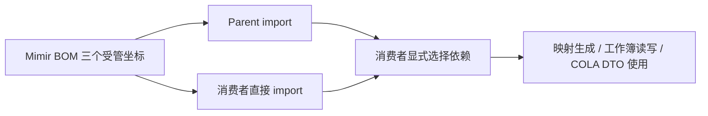

# BOM 配套依赖设计

推荐方案，未实施。[规格](./spec.md) · [计划](./plan.md) · [讨论来源](./brainstorm.md)

## 背景、目标与非目标

当前 BOM 已管理 Lombok、MapStruct、POI 基础包，缺少配套坐标。目标是落实 B1、B2 的三项按需版本托管。保持框架基线；不增加运行依赖、构建 profile、第三方完整 BOM 或全量兼容平台。

## 架构

## 配置契约与数据模型（B1、B2）

在 `mimir-boot-bom/pom.xml` 的 properties 与 dependencyManagement 增加以下声明。坐标只进入管理列表，不进入 dependencies。

| 坐标 | 版本表达式 | 属性默认值 | 责任 |
|---|---|---|---|
| org.projectlombok:lombok-mapstruct-binding | `${lombok-mapstruct-binding.version}` | 0.2.0（推荐） | 编译期配套 |
| org.apache.poi:poi-ooxml | `${poi.version}` | 已有 5.5.1 | 复用 POI 版本，不创建第二属性 |
| com.alibaba.cola:cola-component-dto | `${cola-component-dto.version}` | 5.0.0 | 只托管 DTO 坐标 |

本轮已核对源码 POM 和本地 binding/COLA 缓存；缓存存在不是许可证或组合兼容证据。实施前依据缓存 POM、源码包及开发规程核对版本来源、许可证和传递依赖，记录实际结果。选择 0.2.0 不表示它是最新版。

BOM 内属性用于维护受管版本，不向 import 方承诺同名属性覆盖能力。两类消费者均通过自身 dependencyManagement 显式管理同坐标进行覆盖；直接 dependencies 声明版本也按 Maven 原生优先级处理。继承 Parent 与 import BOM 的示例共享组件声明；独立 import 方负责 compiler release 与注解处理配置，不能复制 Parent 配置承诺而缺少实际配置。

binding 与 Lombok、MapStruct processor 以编译期/provided 示例接入，保持 Parent 的 classpath 发现；不默认添加 annotationProcessorPaths。

审查补充（推荐）：只 import BOM、不继承 Parent 的消费者得不到 Parent 的 JDK 处理器 profile。构建 JDK≥23 时 javac 默认不再执行 classpath 上的注解处理器，须自行开启：设置 `maven.compiler.proc=full`，或在 compilerArgs 传 `-proc:full`。推荐放在 `activation/jdk=[23,)` 的 profile 中，而非无条件设置，避免影响低版本构建 JDK 的既有行为。`proc=full` 需要较新的 maven-compiler-plugin：本地缓存的 3.13.0 至 3.16.0 描述符均已列出 `full` 取值，更早的最低支持版本以实施时核实为准；消费者自管旧版插件时需先升级。

Common/MyBatis 自行声明 COLA optional 依赖，BOM 不参与它们的运行装配。

## 兼容、错误处理与约束

审查补充：`poi-ooxml` 的传递依赖可能被导入的 spring-boot-dependencies 3.3.13 压低，例如其 `log4j2.version=2.23.1` 会管理 log4j-api；commons-io、commons-compress、xmlbeans 也需核对。本轮 BOM 不覆盖这些版本，只以依赖树记录有效版本作为证据；若发现不兼容，回到本设计另提取舍。

新增管理可能影响“原先经传递依赖获得同坐标”的下游有效版本，即使没有新增直接声明也需检查依赖树。不得将“只管理不引入”解释为对所有消费者零影响。既有坐标版本与三组框架基线不变；不借冲突修复自动升级其他组件。

解析失败直接报 Maven 坐标错误；工作簿读写/映射生成失败阻止该组合验收，不用仅成功下载替代。无网络或无目标 JDK 时记录缺失环境并保留该项未验证，不降低验收标准。

| 非功能维度 | 约束 |
|---|---|
| 依赖范围 | 仅增加 3 个管理条目，运行依赖自动新增数为 0 |
| 消费兼容 | 继承与 import 两条路径均需验证 |
| 编译矩阵 | 配合 Parent 验证 JDK 17、21、25，目标 17 为共同基线 |

## 替代方案

完整 COLA BOM 能统一更多组件，但超出 D-67；让消费者各写版本减少框架维护，却无法兑现 B1。选择显式管理三个坐标。

## 验证策略

| 契约 | 层级与方法 | 通过标准 |
|---|---|---|
| B1 版本及按需性 | 发布形态有效 POM、dependency:tree | 三个版本正确；未选择组件的最小消费者运行树不含三者 |
| B1 传递版本 | 选择 OOXML 的消费者 dependency:tree | log4j-api、commons-io、commons-compress、xmlbeans 有效版本及来源已记录为证据 |
| B1 OOXML | 独立消费者行为测试 | 内存工作簿写入文本/数值后读取相等 |
| B2 编译组合 | 继承/import 两种消费者，clean compile | Lombok 属性与 MapStruct 实现同时生成并完成映射断言 |
| B2 显式开启处理 | import 消费者在 JDK 25 按推荐 `[23,)` profile 设置 `proc=full`，clean compile | 编译成功，Lombok 属性与 MapStruct 实现生成并完成映射断言 |
| B2 未开启处理 | import 消费者在 JDK 25 不配置处理，clean compile | 编译失败；该负向只在 JDK≥23 成立，JDK 17/21 不作要求 |
| B1 COLA | 显式声明 DTO 并编译运行 | PageResponse 可用；转换语义由 Common/MyBatis 验收 |
| 覆盖与失败 | 自身管理覆盖、缺制品负向用例 | 有效版本符合原生优先级；缺制品明确失败 |

消费者使用隔离本地仓库中的待验收发布 POM，不依赖 reactor 相对路径。临时样例可放临时目录，不向 tools 增加一次性脚本。
