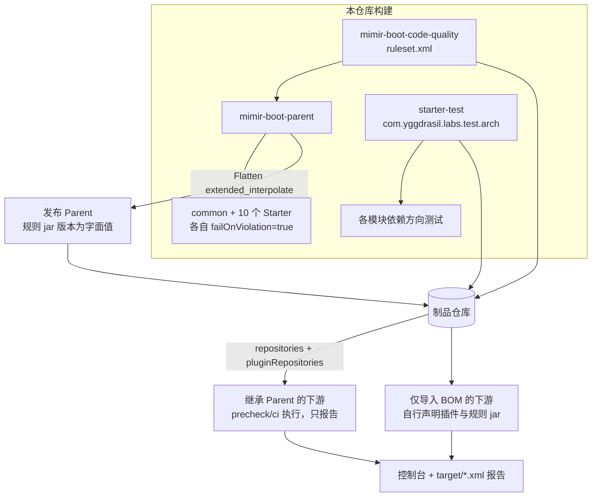

# 代码质量工具链设计

> 推荐方案，未实施。D-102～D-109 为已确认约束；插件版本、参数名、规则清单与阈值是本轮推荐，须按计划 T1/T2 的核实步骤确认。

导航：[版本入口](../brainstorm.md) · [方案大纲](./brainstorm.md) · [规格](./spec.md) · [实施计划](./plan.md) · [架构 RFC](../../../design-docs/arch-code-quality-toolchain.md)

## 背景与事实边界

事实入口：[Parent POM](../../../../mimir-boot-parent/pom.xml)、[根 POM](../../../../pom.xml)、[BOM](../../../../mimir-boot-bom/pom.xml)、[starter-test POM](../../../../mimir-boot-starters/mimir-boot-starter-test/pom.xml)、[Java 构建模型](../../../../tools/engineering/src/quality/java-build-model.mjs)、[发布消费者契约](../../../../tools/engineering/src/release/consumer.mjs)。

当前事实（2026-11-02，基于 `feat/v2.4.0-parent-build` 的 `7cd4684`）：

- Parent 只管理 Spotless、JaCoCo、Enforcer 与 Sonar；四模式预设 `jacoco.skip`、`spotless.check.skip`，`ci` 额外启用 Enforcer。
- Parent 的 Flatten 配置对 `pluginManagement`、`properties`、`build`、`profiles` 采用 `keep`。Common、`mimir-boot-starters` 聚合 POM 与 10 个 Starter 都以 `combine.self="override"` 覆盖了 Flatten 配置，所以 Parent 的这段配置实际只作用于 Parent 自身的发布 POM。
- Common 与 10 个 Starter 的 `<parent>` 都直接是 `mimir-boot-parent`。`mimir-boot-starters` 只是聚合器，它的 `properties` 不会被 Starter 继承。
- 根 POM 不为子模块绑定 source/javadoc 附件；BOM 与新模块一样以根 POM 为父。
- 本仓库 main 源码 124 个文件；`starter-mybatis` 与 `starter-mybatis-processor` 都有 `com.yggdrasil.labs.mybatis.annotation` 包。
- 除 Common 和 starter-test 自身外，每个 Starter 都已以 test 范围依赖 starter-test；Common 不依赖任何 Spring 类。
- 版本：`maven-pmd-plugin` 3.28.0 内置 PMD 7.17.0，要求 Maven 3.6.3、Java 8。ArchUnit 1.5.1 只传递 `slf4j-api`；它的 JUnit5 引擎依赖 junit-platform 1.14.4，而 Boot 3.3.13 管理的是 1.10.5。
- PMD `CommentRequired`（2026-11-02 核对 PMD 源码与规则文档）：按声明可见性（`getVisibility()`）判定；类型级要求对任何可见性的类与接口都生效，record 与注解类型没有类型级检查；构造器与同可见性方法共用 `publicMethodCommentRequirement` 等属性，没有单独开关；`@Override` 方法与 getter/setter 先于可见性判断，分别由 `methodWithOverrideCommentRequirement`、`accessorCommentRequirement` 控制。PMD 7.17.0 起 `GenericsNaming` 废弃，由 `TypeParameterNamingConventions` 取代；`DanglingJavadoc` 同版本引入。
- 两轮文档审查读取了插件 `plugin.xml`，确认以下事实：
  - 属性 `pmd.skip`、`pmd.failOnViolation`、`pmd.maxAllowedViolations`（PMD 与 CPD 共用）、`pmd.skipPmdError`（默认 `true`）、`pmd.printFailingErrors`、`pmd.analysisCache`、`cpd.skip`、`cpd.failOnViolation` 都存在。
  - skip 时 PMD/CPD 的 check 都不输出日志。
- 第二轮审查用 Flatten 1.8.0 做了最小实验（结构与本仓库相同）：
  - `properties=interpolate` 不解析 `${project.version}`；生产者带 `-Drevision` 时，还会把 `revision` 写进发布 POM 的属性。
  - `resolve` 会混入继承属性与 settings 中的属性。
  - `extended_interpolate` 能解析 `${project.version}`，保留 `${project.build.directory}` 不解析，也不注入 `revision`。
- 工具现状：
  - [verify-build-model.mjs](../../../../tools/engineering/src/quality/verify-build-model.mjs) 在隔离缓存中依次以 `-N install` 安装根 POM、BOM、Parent。
  - Java 构建与产物登记在 [java.mjs](../../../../tools/engineering/src/quality/java.mjs)。
  - 报告核验与构建输入检查（`validateBuildInputs`）在 [verify-java-reports.mjs](../../../../tools/engineering/src/quality/verify-java-reports.mjs)。构建输入检查会拒绝 `.mvn/jvm.config` 与 `MAVEN_OPTS` 等环境变量中覆盖测试、覆盖率、格式的 `-D` 参数，但目前不拦截 `pmd.*`、`cpd.*`。
  - [runner.mjs](../../../../tools/engineering/src/quality/runner.mjs) 只接收 Java 子报告中固定的 `java-tests`、`java-coverage`、`java-sonar` 三项，并校验子报告 `schemaVersion` 为 1。
- 发布消费者夹具：只有 test 源码，POM 只声明 `<repositories>`，没有 `<pluginRepositories>`。[Central 公开验证](../../../../tools/engineering/src/release/public.mjs)只抽查根 POM 与 starter-web。

T2 仍须复核插件描述符，确认本设计用到的其余参数（如 `excludeRoots`、`minimumTokens`、`failurePriority`）存在且含义一致。

## 目标与非目标

- 满足规格 CQ-01～CQ-10。
- 新增 1 个模块、0 个 Java 运行时依赖；下游默认模式下执行 0 项新检查。
- 本仓库 11 个 Java 模块全部在 `ci` 下严格执行 PMD、CPD，并各有 1 个依赖方向测试。
- Mimir 的检查配置不改变下游已有 execution 的规则、范围与参数；剩余影响只有原生开关属性与插件依赖合并（CQ-10）。

非目标：不改 Spotless、JaCoCo、Enforcer、Sonar 的配置与语义；不改 Git hook 与 CI workflow；不引入 Checkstyle（D-109）、SpotBugs、Error Prone、doclint、`dependency:analyze`；不检查 Javadoc 标签与签名的一致性；不为下游提供 ArchUnit 的自动执行；不升级 Java、Boot、Maven 基线。

## 架构与数据流



一次检查的数据流：

1. Maven 按模式与属性得到 Mimir execution 的有效配置。
2. 插件类加载器从插件仓库加载规则 jar。
3. PMD/CPD 在 `verify` 读取 main 源码与编译类路径。
4. 输出控制台违规与 XML 报告，再根据 `*.failOnViolation` 决定是否失败。
5. 本仓库完整验收时，再核对有效配置与构建输入，并登记报告。

## 接口契约

### 规则 jar 模块（CQ-01、CQ-02、CQ-03、CQ-09）

坐标 `io.github.yggdrasil-labs:mimir-boot-code-quality:${revision}`，目录 `mimir-boot-code-quality/`，父 POM 为根 `mimir-boot`，`packaging=jar`，不含 Java 源码。它不进入 BOM，因为插件依赖不受 `dependencyManagement` 管理。

| 资源路径 | 内容 |
|---|---|
| `mimir-boot/pmd/ruleset.xml` | PMD 规则集，见下文 |

- 发布附件：源码包由 `maven-source-plugin` 的 `jar-no-fork` 打包资源。没有 Java 源码时 Javadoc 插件不产出附件，因此用 `maven-jar-plugin` 以 `javadoc` 分类器打包模块内的说明文件，满足 Central 对附件的要求。
- 其他构建设置：Flatten 沿用根 POM 配置；与 Common 一样显式设置 `maven.deploy.skip=false`；签名沿用根 POM 的 `sign-artifacts`。
- 资源路径以 `mimir-boot/` 为前缀，避免与下游或其他 jar 中的同名资源冲突。

### PMD 规则集（CQ-01、CQ-02）

规则集只有一份，同时承载注释、命名与坏味道三个维度（D-109）。注释与命名规则来自 documentation、codestyle 类目，但只启用下表列出的规则，不整体引入类目。

| 维度 | 类目 | 规则 |
|---|---|---|
| 注释 | documentation | `CommentRequired`，见下文；`DanglingJavadoc` |
| 命名 | codestyle | `ClassNamingConventions`、`MethodNamingConventions`、`FieldNamingConventions`、`FormalParameterNamingConventions`、`LocalVariableNamingConventions`、`TypeParameterNamingConventions`、`PackageCase`，均使用默认格式 |
| 坏味道 | bestpractices | `UnusedPrivateField`、`UnusedPrivateMethod`、`UnusedLocalVariable`、`UnusedFormalParameter`、`UnusedAssignment`、`PreserveStackTrace`、`MissingOverride`、`SystemPrintln`、`AvoidPrintStackTrace`、`UseCollectionIsEmpty`、`ForLoopCanBeForeach` |
| 坏味道 | errorprone | `EmptyCatchBlock`、`OverrideBothEqualsAndHashcode`、`CompareObjectsWithEquals`、`ReturnEmptyCollectionRatherThanNull`、`CloseResource`、`EqualsNull`、`BrokenNullCheck`、`AssignmentInOperand`、`ImplicitSwitchFallThrough`、`ConstructorCallsOverridableMethod`、`UseLocaleWithCaseConversions`、`AvoidBranchingStatementAsLastInLoop` |
| 坏味道 | design | `CyclomaticComplexity`（`methodReportLevel=15`）、`CognitiveComplexity`（`reportLevel=20`）、`NPathComplexity`（默认 200）、`SimplifyBooleanReturns`、`SimplifiedTernary`、`AvoidThrowingRawExceptionTypes`、`SignatureDeclareThrowsException`、`UselessOverridingMethod` |
| 坏味道 | multithreading | `DoubleCheckedLocking` |

`CommentRequired` 的参数，目标是 D-107“只要求公开类型与方法有 Javadoc”：

| 属性 | 取值 | 作用 |
|---|---|---|
| `classCommentRequirement`、`enumCommentRequirement` | `Required` | 类、接口、枚举需要 Javadoc |
| `publicMethodCommentRequirement` | `Required` | public 方法需要 Javadoc |
| `protectedMethodCommentRequirement`、`packageMethodCommentRequirement` | `Ignored` | 与原 `scope=public` 一致 |
| `methodWithOverrideCommentRequirement`、`accessorCommentRequirement` | `Ignored` | `@Override` 方法与 getter/setter 不要求 |
| `fieldCommentRequirement`、`serialVersionUIDCommentRequired`、`serialPersistentFieldsCommentRequired` | `Ignored` | 字段不要求 |
| `violationSuppressXPath` | 构造器，或有效可见性不是 public 的节点 | 弥补规则按声明可见性判断、构造器与方法共用开关的差异 |

`violationSuppressXPath` 的推荐写法是 `self::ConstructorDeclaration or @EffectiveVisibility != 'public'`。这样 package-private 类、非公开外部类中的 public 成员与构造器都不报告。T1 须用规格 CQ-01 的示例验证 XPath 属性名与取值；无法表达时暂停对齐，不得改为放宽 D-107 或要求更多 Javadoc。

已知缺口（D-109 接受）：

- 不检查 Javadoc 标签与签名是否一致，如 `@param` 指向不存在的参数；
- 不检查 Javadoc 首句与 `@` 标签描述是否为空；
- record 与注解类型本身没有类型级 Javadoc 检查，其中的 public 方法仍然检查；
- 没有 record 组件命名规则。

`ClassNamingConventions` 的 `utilityClassPattern` 若默认要求 `Utils`、`Helper` 等后缀，设为与 `classPattern` 相同，不强制工具类后缀；其余命名规则保持默认。

明确不启用：codestyle 与 documentation 类目中除上表外的规则（含 `UnnecessaryImport`、`CommentSize`、`LinguisticNaming`），以及 performance、security 类目。PMD 遇到未知规则名会直接让构建失败，因此规则名是否正确由首次构建验证。

### Parent 属性（CQ-04、CQ-06、CQ-09、CQ-10）

| 属性 | 公共默认 | 说明 |
|---|---|---|
| `maven.pmd.plugin.version` | `3.28.0` | 插件版本，使用内置 PMD |
| `mimir-boot-code-quality.version` | `${project.version}`，发布后为字面版本 | 规则 jar 版本，下游可覆盖 |
| `pmd.skip` / `cpd.skip` | `true` | 原生跳过开关（D-108） |
| `pmd.failOnViolation` / `cpd.failOnViolation` | `false` | 原生失败开关（D-108） |

四模式（每个模式显式设置，沿用 D-82 写法）：

| 属性 | dev | precheck | ci | prod |
|---|---|---|---|---|
| `pmd.skip`、`cpd.skip` | true | false | false | true |

- `*.failOnViolation` 不在模式中设置，保持独立。
- Parent 不定义规则位置属性，规则位置写在 Mimir execution 内部（见下节）。下游替换规则的方式是在自身 POM 中覆盖同 id execution 的配置。设计不新增 Mimir 私有属性。
- CQ-06 的保证方式：
  - Spotless、JaCoCo、Enforcer、Sonar 的属性、插件配置与 execution 一律不改；
  - “同一问题只有一个工具报告”由规则表中的“明确不启用”清单保证。

### Parent 插件配置（CQ-01～CQ-04、CQ-10）

插件级（`pluginManagement` 的 `<plugin>` 层）只放版本与插件依赖（规则 jar）。

所有检查参数写在 Mimir 自己的 execution 的 `<configuration>` 内。这样不会合并进下游已有的 execution，下游原有的规则、范围和参数不变：

- `maven-pmd-plugin`，execution `pmd-check`（goal `check`）与 `cpd-check`（goal `cpd-check`），均绑定 `verify`：
  - `rulesets=mimir-boot/pmd/ruleset.xml`、`targetJdk=${java.version}`；
  - `includeTests=false`、`excludeRoots=${project.build.directory}/generated-sources`；
  - `printFailingErrors=true`、`failurePriority=5`、`minimumTokens=100`；
  - `linkXRef=false`、`analysisCache=true`。

  `check`、`cpd-check` 会在同一 execution 内分叉执行报告目标，T2 须确认 execution 级配置会传给分叉出的报告目标。不能传递时暂停对齐。

插件在 `build/plugins` 中公开声明，与 JaCoCo 相同，由 skip 控制是否执行。mojo 加载时就要构建插件类加载器，跳过检查时也一样，所以执行到 `verify` 的任何构建都要能从插件仓库解析规则 jar；`test` 等更早的阶段不会解析它。解析失败时构建失败，符合 CQ-09“不静默跳过”。

### 对已自行配置同名插件的下游（CQ-10）

这是用户确认的向后兼容显式例外（D-108）。影响写在 Parent README 和版本升级说明中，不能静默生效。由于检查参数都放在 Mimir execution 内，剩余影响只有下表各项：

| 影响 | 原因 | 下游恢复方式 |
|---|---|---|
| 下游自己的 PMD/CPD execution 在默认模式与 dev 下被跳过，在 precheck/ci 下不再失败 | 插件参数默认读取 `${pmd.skip}`、`${cpd.skip}` 与对应的 `failOnViolation` 用户属性，而 Parent 定义了这些属性 | 在 POM 中设置对应的 `*.skip=false`、`*.failOnViolation=true` |
| 上一项恢复后，Mimir 的 `pmd-check`、`cpd-check` 也会执行并按严格模式失败 | 两类 execution 读取同一组原生属性 | 在下游 POM 中把这两个 execution 的 `phase` 设为 `none`，或修复 Mimir 规则报告的问题 |
| 构建需要从插件仓库解析规则 jar | 插件依赖合并 | 配置能访问 Mimir 制品的 `pluginRepositories` 或镜像 |

不改用 Mimir 私有开关的原因：用户已确认采用插件原生属性（D-108，与 Parent 需求 D-84/D-85 的原生开关原则一致）。私有开关会让 `-Dpmd.skip` 这类通用命令对 Mimir execution 失效。下游自行配置的 Checkstyle 不受本需求影响（D-109）。

### 本仓库严格模式（CQ-05）

在 Common 与 10 个 Starter 共 11 个 POM 的 `properties` 中各自设置：

- `pmd.failOnViolation`、`cpd.failOnViolation` 均为 `true`；
- `pmd.skipPmdError=false`，让 PMD 解析或处理错误也阻断构建。下游保持插件默认 `true`，不因工具错误打断只报告模式。

这 11 个 POM 是直接继承 Parent 的全部 Java 模块，`mimir-boot-starters` 聚合 POM 不承担继承职责。发布的 Parent 默认值不变。规则 jar 没有 Java 源码，不执行这些检查。以后新增 Starter 必须同样设置这些属性；漏设时，门禁核对会把它当作放宽而失败，新增 Starter 规程同步写明这一要求。

存量违规按以下顺序处理：

1. 修复。
2. 对确有理由的个别位置，使用 `@SuppressWarnings("PMD.<Rule>")`，并在相邻注释中写明原因。
3. 某条规则在本仓库普遍误报时，复杂度阈值可以在 ±25% 内调整，并在交付摘要中说明；移除规则或改变类目须先对齐，涉及工具定位时同步 RFC 定位表。

禁止文件级或模块级的整体排除，禁止为了通过检查而修改公开 API。

### 发布 Parent 的规则 jar 版本

问题：Flatten 对 `pluginManagement` 与 `properties` 都采用 `keep`，`${project.version}` 会原样进入发布 Parent，到下游就解析成下游自己的版本。

方案：在 Parent 的 Flatten `pomElements` 中，`properties` 由 `keep` 改为 `extended_interpolate`，其余元素不变。

- 第二轮审查的最小实验表明，这个模式能把 `${project.version}` 解析为字面版本，保留 `${project.build.directory}` 这类构建路径引用，带 `-Drevision` 时也不注入 `revision` 属性。
- `pluginManagement` 中的 `${mimir-boot-code-quality.version}`、`${pmd.skip}` 等引用继续原样保留，到下游再解析。
- 当前 Parent 属性均为字面值，预期插值后其余属性内容不变。
- 以后新增引用其他属性的 Parent 属性时，发布值可能在生产者侧被固定，Parent POM 注释需写明这一点。

上述结论来自最小工程，T2 须在真实 Parent 上用发布命令（含 `-Drevision`）验证以下三点；任一项不成立就回到方案比较中的备选方案：

- 新增的版本属性成为字面值；
- 其余属性与改动前逐项相同；
- 属性中没有 `revision`，也没有生产者路径。

该改动调整了 Parent 需求中“其余保留/解析策略不变”的推荐。实施时须在 [Parent 需求](../parent-build/design.md)的验证路径上复核：发布 Parent 的其余属性、四模式和覆盖能力不变。

### ArchUnit 规则库（CQ-07）

starter-test 以 optional 方式依赖 `com.tngtech.archunit:archunit`，版本由 BOM 托管为 1.5.1。不引入 `archunit-junit5`；下游用普通 JUnit Jupiter 测试调用 `rule.check(classes)`。规则库位于包 `com.yggdrasil.labs.test.arch`。

所有 `String` 包参数（包括 `LayerSpec.layer` 的第二个参数）都是**完整包名**，如 `com.yggdrasil.labs.log`，不是 ArchUnit 包标识。规则内部把 `p` 转换为 `p..`，即包含全部子包。

```java
public final class MimirArchClasses {
    /** 从类路径按包导入生产类：目录与 jar 都导入（多模块工程的兄弟模块在 verify/install 时以 jar 出现），排除测试类；结果为空时抛 IllegalStateException。 */
    public static JavaClasses importMain(String rootPackage);
    /** 只导入指定编译输出目录，用于同名包分属多个模块的场景；目录不存在或为空时抛 IllegalStateException。 */
    public static JavaClasses importDirectory(Path classesDirectory);
}

public final class MimirArchRules {
    /** 以 rootPackage 的直接子包为切片，切片之间不得形成循环；同一子包内部的循环不检查。 */
    public static ArchRule noCycles(String rootPackage);
    /** sourcePackage 下的类不得依赖 forbiddenPackages 中的任一包。 */
    public static ArchRule noDependencyOn(String sourcePackage, String... forbiddenPackages);
    /** 在 namespace 下，ownPackage 只能依赖自身与 allowedPackages；namespace 之外的依赖不受约束。 */
    public static ArchRule onlyDependOnWithin(String namespace, String ownPackage, String... allowedPackages);
    /** 按声明顺序自上而下分层，下层不得依赖上层；缺失的层视为可选，但有类的层少于 2 个时规则失败。 */
    public static ArchRule layered(LayerSpec spec);
}

public final class LayerSpec {
    public static LayerSpec of(String rootPackage);
    /** 层包为 rootPackage + "." + name（含子包）。 */
    public LayerSpec layer(String name);
    /** 层包为给定的完整包名列表（各含子包）。 */
    public LayerSpec layer(String name, String... packageNames);
}

public final class ColaArchRules {
    /** adapter、client、app、domain、infrastructure 的 COLA 访问约束，缺失层可选。 */
    public static ArchRule layered(String rootPackage);
    /** domain 不依赖 Spring、MyBatis、MyBatis-Plus、Servlet、JPA。 */
    public static ArchRule domainIsFrameworkFree(String rootPackage);
    /** layered + domainIsFrameworkFree + noCycles 的组合。 */
    public static ArchRule recommended(String rootPackage);
}
```

COLA 访问约束：

| 层 | 允许访问它的层 |
|---|---|
| `adapter` | 无 |
| `app` | `adapter` |
| `client` | `adapter`、`app` |
| `domain` | `app`、`infrastructure` |
| `infrastructure` | 无（装配代码位于各层之外，不受约束） |

缺失的层可选，但有类的 COLA 层少于 2 个时规则失败，避免根包写错或导入为空时空跑通过。

参数错误：根包为 null 或空白、`LayerSpec` 少于 2 层、层名重复、包名为空时，抛 `IllegalArgumentException`，信息包含参数名。

违规信息沿用 ArchUnit 默认格式：每条违规列出源类、目标类及源码位置（类名与行号），可直接断言其中包含源类和目标类的全限定名。

冻结存量违规直接使用 ArchUnit 原生的 `FreezingArchRule.freeze(rule)`，规则库不另行封装。ArchUnit 默认不自动创建违规存储，README 给出示例，并说明首次运行需在测试资源 `archunit.properties` 中设置 `freeze.store.default.allowStoreCreation=true`。

### 本仓库依赖方向测试（CQ-08）

每个模块新增 1 个测试类，使用 `MimirArchClasses.importDirectory(target/classes)` 导入，只检查本模块的产物。Common 直接使用 ArchUnit API 写等价规则，原因见表后说明。

表中包名均省略公共前缀 `com.yggdrasil.labs.`，调用时传完整包名；namespace 固定为 `com.yggdrasil.labs`。

| 模块 | 自身包 | 允许的其他 Mimir 包 | 额外规则 | 归属任务 |
|---|---|---|---|---|
| common | `common` | 无 | 不依赖 `org.springframework` 包 | T5 |
| starter-log | `log` | `common` | — | T5 |
| starter-exception | `exception` | `common` | — | T5 |
| starter-web | `web` | `common`、`exception` | — | T5 |
| starter-mybatis | `mybatis` | `common` | — | T5 |
| starter-mybatis-processor | `mybatis` | 无 | — | T5 |
| starter-nacos | `nacos` | `common` | — | T5 |
| starter-test | `test` | `common` | — | T4 |
| starter-rpc-core | `rpc.core` | `common` | — | T5 |
| starter-dubbo | `rpc.dubbo` | `common`、`rpc.core` | — | T5 |
| starter-feign | `rpc.feign` | `common`、`rpc.core` | — | T5 |

- 每个模块同时检查 `noCycles(自身包)`。
- Common 不能依赖 starter-test，否则会形成 reactor 循环，所以直接以 test 范围使用 ArchUnit。
- ArchUnit 在 starter-test 中是 optional，不会传递给依赖 starter-test 的模块，因此除 starter-test 外的 10 个模块都要在自身 POM 中以 test 范围声明 `archunit`。
- 允许关系来自 [ARCHITECTURE.md](../../../../ARCHITECTURE.md)；新增允许关系须先修改架构文档。

### 质量门禁与发布契约工具（CQ-05、CQ-09）

这些改动都是对现有全局工具的扩展，长期职责是校验 Parent 的质量契约与发布形态，复用入口为 `quality --mode full` 与 CI/发布工作流，不新增脚本。

**必须产出两类报告的模块**：有 `src/main/java` 的 jar 模块，即 Common 与 10 个 Starter。根 POM、Parent、BOM、聚合 POM 与规则 jar 不要求。

**verify-build-model.mjs**：在隔离缓存中先以 `install` 安装 `mimir-boot-code-quality`，再安装 Parent。否则 Parent 自身执行到 `verify` 时解析 PMD 插件依赖会失败。

**java-build-model.mjs**：在既有的 coverage、format 两类插件之外，登记 `pmd`（`maven-pmd-plugin`）。对每个必须产出报告的模块，按白名单核对 `-Pci` 有效模型：

- `pmd-check`、`cpd-check` 两个 execution 存在，且绑定设计规定的阶段；
- 每个 execution 的有效配置参数集合与取值，必须与 Parent 声明的完全相等，包括 `skip=false`、`failOnViolation=true`、`skipPmdError=false`。出现额外参数（如 `includes`、`excludes`、`excludeFromFailureFile`、`compileSourceRoots`、`minimumPriority`、`typeResolution`、`ignoreLiterals`、`ignoreIdentifiers`、`ignoreAnnotations`、`skipExec`）或取值不同（如 `maxAllowedViolations`、`failurePriority`、`minimumTokens`、`rulesets`），都报出模块与参数；
- 插件依赖中的规则 jar 版本等于当前 `revision`。

白名单的值从 Parent 的有效模型读取，不在工具里固定版本号或阈值。

**verify-java-reports.mjs 的 `validateBuildInputs`**：被拒绝的覆盖参数扩展到 `pmd.*`、`cpd.*`、`minimumTokens`。这些参数通过 `-D` 注入时不会出现在有效 POM 里，只靠模型核对拦不住。

**java.mjs 与 verify-java-reports.mjs 的报告处理**：

- 两类报告纳入构建前清理、同次构建产物登记（含摘要）与报告核验；
- Java 子报告新增 `java-pmd`、`java-cpd` 两个检查项，规则 id 新增 `quality-report-missing`、`quality-report-stale`、`quality-report-violation`；
- 报告存在但含违规视为失败。严格模式下构建本应已经失败，这里起兜底作用。
- 有效配置被放宽时，沿用现有方式，由 Java 子报告的构建模型校验项报错，并指出模块与参数。

**runner.mjs**：把 `java-pmd`、`java-cpd` 加入 Java 子报告的必需项与复制列表，使聚合质量报告能看到两项状态。

**schemaVersion 约定**：新增字段与检查项都是增量，不升级任何 `schemaVersion`。若实现需要改变已有字段的语义，必须在同一改动中同时升级产出方与全部读取方，包括 `runner.mjs` 的子报告校验、`results.mjs`、`verify-java-reports.mjs` 与 `java-build-model.mjs` 中的 `schemaVersion`。

**consumer.mjs 与 fixture-consumer.mjs**：

- 已发布制品清单、紧凑 POM 清单与生产者选择器加入 `mimir-boot-code-quality`；
- 断言发布 Parent 中 `mimir-boot-code-quality.version` 为字面版本，属性中没有 `revision`，也没有生产者工作目录路径；
- 两个继承 Parent 的夹具 POM（`consumerPom`、`failureConsumerPom`）在 `<repositories>` 之外增加同源的 `<pluginRepositories>`。这是适配新插件依赖的必要改动：原有阶段的命令不变，预期结果仍是成功或按原样失败；
- 新增独立阶段 `consumer-quality-precheck`，与 `consumer-isolated-clean-verify` 一样离线运行，使用阻断设置与消费者缓存：
  - 夹具增加一个能编译、含一处已知违规（公开方法缺 Javadoc，即 `CommentRequired`）的 main 源文件；
  - 以 `-Pprecheck -Djacoco.skip=true -Dspotless.check.skip=true verify` 运行，只隔离出两类新检查；
  - 断言构建成功、两类报告存在、PMD 报告含该违规。
- 默认模式下两类检查与 Spotless 都跳过，所以新增的 main 源文件不改变原有阶段的结果。

**public.mjs**：Central 公开验证的抽查清单加入规则 jar 的 POM 与 jar。规则 jar 一旦缺失，所有继承 Parent 的下游都会在 `verify` 阶段失败。

**tools/engineering/README.md**：同步上述用途说明。

## 失败处理

| 外部依赖或失败点 | 场景 | 处理 |
|---|---|---|
| 制品仓库 | 规则 jar 或插件无法解析 | 构建失败并给出坐标；README 与升级说明列出内网镜像需同步的坐标 |
| 插件仓库配置 | 下游只用 `<repositories>` 接私有仓库，没有镜像或 `<pluginRepositories>` | 插件依赖解析失败，构建失败；README 与升级说明要求配置 `pluginRepositories` 或镜像 |
| 规则文件 | 含未知 PMD 规则名或无效的 `violationSuppressXPath` | 插件加载规则集时报错并失败；T1 用内置 PMD 加载一次规则集验证 |
| PMD 处理 | 单个文件解析或处理错误 | 本仓库设 `pmd.skipPmdError=false`，阻断构建；下游保持默认 `true`，只记录日志，不打断只报告模式 |
| 本地多模块构建 | 不带 `-am` 构建单个模块，本地仓库没有规则 jar 的 SNAPSHOT | 构建失败并给出坐标；开发规程说明先执行一次 `install`，或带 `-am` |
| 下游已有同名插件配置 | 见 CQ-10 | 升级说明给出恢复配置 |
| 门禁旁路 | 通过 `.mvn/jvm.config` 或环境变量注入 `-Dpmd.skip=true` 等参数 | `validateBuildInputs` 拒绝，完整验收失败 |
| ArchUnit 导入 | 根包或目录下没有类 | 抛 `IllegalStateException`，不空跑通过 |
| Flatten 插值 | `${project.version}` 未被插值、注入了 `revision`，或其他属性被改变 | T2 验收时一旦发现即暂停对齐，回退到方案比较中的备选方案 |

## 数据模型

无持久化数据。新增的结构化内容只有一份 PMD 规则集 XML 和两类报告文件，格式由工具定义。Java 子报告与聚合质量报告只增量新增两个检查项和三个规则 id，`schemaVersion` 不变。

## 非功能要求

| 维度 | 指标 |
|---|---|
| 性能 | 下游默认模式新增检查 0 项；本仓库 `-Pci clean verify` 耗时增幅 ≤ 20%（推荐值，实施前后同机测量）；PMD 启用分析缓存 |
| 兼容 | JDK 17 可运行；Maven 下限不高于 Parent Enforcer 的 3.8.0（插件要求 3.6.3）；Spotless、JaCoCo 等既有属性与模式语义不变；已自行配置 PMD 的下游受 CQ-10 影响，须在升级说明中列出；执行到 `verify` 的任何构建都要能从插件仓库解析规则 jar |
| 安全 | 规则 jar 不含可执行代码；检查过程不访问网络；不向运行时类路径引入依赖 |
| 可用性 | 规则 jar 无法解析时构建失败并给出坐标；内网镜像需同步 PMD 插件及其传递依赖与规则 jar |
| 可观测性 | 控制台违规含文件与行号；生成 `target/pmd.xml`、`target/cpd.xml`；完整验收报告登记 `java-pmd`、`java-cpd` 两项状态 |

## 方案比较

| 方案 | 优点 | 缺点 | 结论 |
|---|---|---|---|
| Flatten `properties=extended_interpolate` 固化规则 jar 版本 | 版本单一来源；改动一行；最小实验可行 | 需在真实 Parent 上验证；以后新增的引用型属性可能在生产者侧被固定 | 采用 |
| Flatten `properties=interpolate` | 改动一行 | 最小实验表明它不解析 `${project.version}`，带 `-Drevision` 时还会注入 `revision` | 不采用 |
| Flatten `properties=resolve` | 能解析版本 | 混入继承属性与 settings 属性 | 不采用 |
| release-please `extra-files` 同步 Parent 中的字面版本 | 不改 Flatten | 两处版本，SNAPSHOT 期间容易漂移，需额外门禁比对 | 备选 |
| 规则 jar 使用独立版本号（如 1.0.0） | 与发布节奏解耦 | 独立的生命周期与发布流程，规则版本与框架版本对不上 | 不采用 |
| 检查参数放在插件级配置 | 写法更短 | 会合并进下游已有 execution，改变其规则、范围与参数 | 不采用 |
| 只在 `precheck`/`ci` profile 内声明插件 | dev 下不解析插件 | 下游无法在 dev 用 `-D*.skip=false` 单独开启，违反独立开关原则 | 不采用 |
| 引入 `archunit-junit5` 提供 `@ArchTest` | 写法简洁 | 依赖 junit-platform 1.14，与 Boot 3.3 管理的 1.10.5 冲突 | 不采用 |
| 保留 Checkstyle 负责注释与命名 | 能检查 Javadoc 标签与签名一致 | 多一个工具与引擎；13.x 起需 JDK 21 运行而须固定 12.x；下游已有 Checkstyle 配置也受原生开关与引擎版本影响 | 不采用（D-109） |
| 把 PMD 覆盖到 7.29.0 | 新规则与修复 | 需同时覆盖插件依赖的多个 PMD 模块，版本组合风险高 | 暂用插件内置版本 |

## 测试策略

| 测试对象 | 层级 | 验证方法 | 通过标准 |
|---|---|---|---|
| 插件参数名 | 静态 | 读取 PMD 插件 jar 中的 `META-INF/maven/plugin.xml` | 设计列出的每个参数都存在，否则暂停对齐 |
| 四模式与独立开关（CQ-04） | 有效模型 | 对各模式及组合执行 `help:effective-pom` | 与模式表一致；命令行覆盖生效 |
| execution 级配置（CQ-10） | 有效模型 | 临时消费者已有自己的 PMD execution，升级前后对比有效配置 | 下游 execution 的规则、范围与参数不变；只有原生开关属性与插件依赖受影响 |
| 规则行为（CQ-01～CQ-03、CQ-06） | 集成 | 仓库外临时消费者放入规格各场景的示例源码，分别以默认属性和严格属性运行 | 违规是否出现与规格一致；默认构建成功，严格构建失败 |
| 本仓库严格模式（CQ-05） | 集成 | `./mvnw -Pci clean verify`；在某个 Starter 中临时加入一处违规后复跑（不提交） | 无违规时通过；加入违规后失败并指出位置 |
| 门禁放宽与旁路（CQ-05） | 工具 | 逐一临时设置：`pmd.failOnViolation=false`、`cpd.skip=true`、`pmd.maxAllowedViolations=10`、`pmd.skipPmdError=true`、自定义 `excludes`、`ignoreLiterals=true`、在 `MAVEN_OPTS` 中注入 `-Dpmd.skip=true`、删除某个 Starter 的严格属性；分别运行完整验收 | 每种情况都失败，并指出模块与参数 |
| ArchUnit 规则库（CQ-07） | 单元 | 在 starter-test 内用测试夹具包覆盖：每个公开方法的通过、违规与参数错误；空目录、空包导入；只有 1 个 COLA 层；`FreezingArchRule` 在临时存储目录中先记基线再新增违规 | 违规信息含源类与目标类的全限定名；参数错误抛 IAE；空导入抛 ISE；单层时失败；冻结后只报告新增违规 |
| 多模块 COLA 导入（CQ-07） | 集成 | 仓库外临时四模块 COLA 工程，在 `start` 模块用 `importMain` 写架构测试，分别执行 reactor `test` 与 `verify` | 两种方式报告同一违规 |
| 未声明 ArchUnit 的下游（CQ-07） | 集成 | 仓库外临时消费者只依赖 starter-test，执行 `dependency:tree` 与 `test` | 测试类路径中没有 ArchUnit，测试通过 |
| 本仓库依赖方向（CQ-08） | 单元 | 各模块测试 | 全部通过；临时加入反向引用时失败 |
| 发布形态（CQ-09） | 契约 | 发布消费者契约：部署到文件仓库，再由隔离消费者使用，含新增的 `consumer-quality-precheck` 阶段 | 规则 jar 已发布；Parent 版本属性为字面值，无 `revision`、无生产者路径；新阶段成功并生成两类报告；原有阶段结果不变 |
| 仅导入 BOM 路径（CQ-09） | 集成 | 临时消费者按 README 声明插件版本与规则 jar | 违规与继承 Parent 时一致；省略规则 jar 版本时失败 |
| 插件仓库配置（CQ-09） | 集成 | 临时消费者只配 `<repositories>`，不配镜像与 `<pluginRepositories>` | 构建失败并给出规则 jar 坐标 |
| 已有同名插件配置的下游（CQ-10） | 集成 | 临时消费者先在旧 Parent 上配置 PMD 的 check 与 cpd-check execution；升级后分别按默认、按 README 恢复属性、关闭 Mimir execution 运行 | 与 CQ-10 各场景一致 |
| 回归 | 完整验收 | JDK 17 下运行 `bash scripts/engineering.sh quality --mode full --source worktree` | 全部通过 |

## 里程碑

| 阶段 | 产出 | 依赖 |
|---|---|---|
| M1 规则与接入 | 规则 jar、Parent 属性与插件、Flatten 调整 | Parent 需求已合入 |
| M2 本仓库落地 | 严格模式、存量违规治理、ArchUnit 规则库与各模块依赖方向测试 | M1 |
| M3 门禁与发布契约 | 构建模型核对、构建输入检查、报告核验、消费者契约、公开验证 | M2 |
| M4 文档 | 测试规程定位表、模块 README、升级说明、架构文档同步 | M3 |
