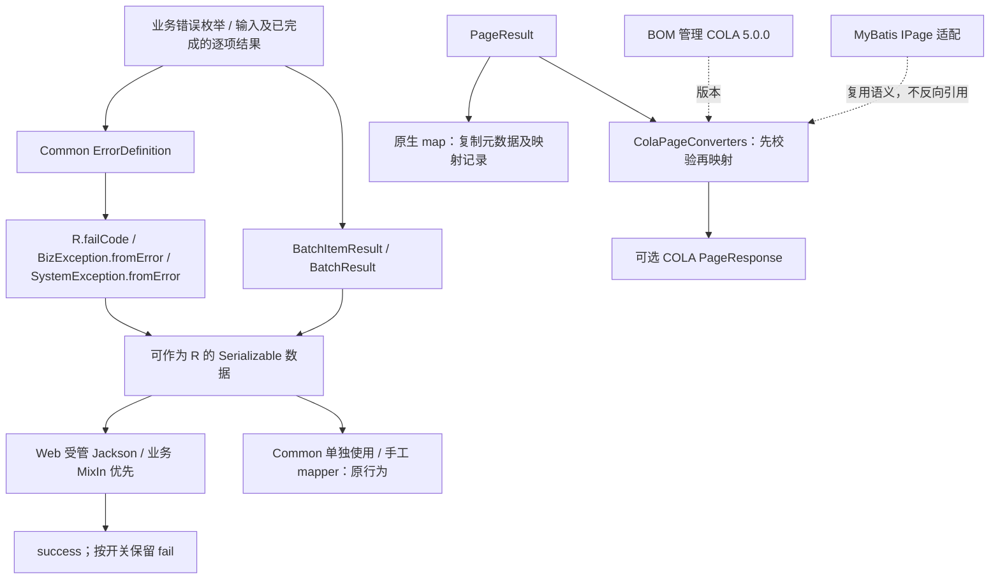

# Common 公共契约设计

导航：[需求大纲](./brainstorm.md) · [规格](./spec.md) · [实施计划](./plan.md) · [版本大纲](../brainstorm.md)

## Context

Common 当前只有内置 `ErrorCode` 和字符串异常入口，业务枚举不能作为独立错误定义接入；`PageResult` 无映射方法；批量协议尚不存在。`R.isSuccess()` 与 `isFail()` 都会被普通 Jackson 识别，Common 的 Jackson 依赖仅用于测试。

本设计为中规模完整 SDD。所有新增实现均未落地，推荐项不等于用户逐项确认。历史决定维持原含义，具体名称、剩余边界和迁移策略由本轮推荐补全。

### 本地证据

| 入口 | 已核实事实及设计影响 |
|---|---|
| [R.java](../../../../mimir-boot-common/src/main/java/com/yggdrasil/labs/common/response/R.java) | `fail(String)`、`fail(String,String)` 已存在；success 只按 `00000` 判断；新增入口必须异名 |
| [ErrorCode.java](../../../../mimir-boot-common/src/main/java/com/yggdrasil/labs/common/exception/ErrorCode.java)、[BaseException.java](../../../../mimir-boot-common/src/main/java/com/yggdrasil/labs/common/exception/BaseException.java) | code/message 均为 String；旧枚举构造器是独立二进制描述符，不能改成接口参数代替 |
| [PageResult.java](../../../../mimir-boot-common/src/main/java/com/yggdrasil/labs/common/page/PageResult.java) | 六个 Long/Boolean 元数据字段，构造会校验并重算，setter 无此保证；map 不能借带参构造修正元数据 |
| [Common POM](../../../../mimir-boot-common/pom.xml) | 当前无 COLA；Jackson 为 test scope；需要增加 optional COLA，保留 Jackson 测试范围 |
| 本地 Maven 缓存 `com.alibaba.cola:cola-component-dto:5.0.0` 源码包 | `PageResponse<T>` 无 Serializable 上界；`of(data,totalCount,pageSize,pageIndex)` 显式 success=true；整数为 int，null 数据读取为空列表，页码/大小会自动校正为 1 |
| [JacksonConfig.java](../../../../mimir-boot-starters/mimir-boot-starter-web/src/main/java/com/yggdrasil/labs/web/config/JacksonConfig.java) | 现有 builder customizer、Module 扩展与全局空值策略；C-07 须尊重原扩展能力 |
| [MimirExceptionHandler.java](../../../../mimir-boot-starters/mimir-boot-starter-exception/src/main/java/com/yggdrasil/labs/exception/handler/MimirExceptionHandler.java) | BizException 为 HTTP 200，SystemException 为 HTTP 500；新工厂不改变处理器选择。业务异常分支把 `e.getMessage()` 原样交给响应工厂，message 为 null 时 R 的 message 也为 null |
| [WebProperties.java](../../../../mimir-boot-starters/mimir-boot-starter-web/src/main/java/com/yggdrasil/labs/web/config/WebProperties.java) | `serialization.writeNulls` 默认 false，JacksonConfig 据此设置 NON_NULL；null message 在默认受管 JSON 中整键省略 |
| [IException.java](../../../../mimir-boot-common/src/main/java/com/yggdrasil/labs/common/exception/IException.java) | 与新接口同为 `String getCode()`/`String getMessage()`，但表示异常实例；语义分工见 I1 |
| [RTest.java](../../../../mimir-boot-common/src/test/java/com/yggdrasil/labs/common/response/RTest.java) | 用 Common 测试内的普通 ObjectMapper 断言 success 与 fail 同时输出；属于 Common 独立使用路径 |
| [MyBatis PageConverters.java](../../../../mimir-boot-starters/mimir-boot-starter-mybatis/src/main/java/com/yggdrasil/labs/mybatis/page/PageConverters.java) | MyBatis Starter 已有同名短类名工具；Common 新工具不能复用该名称。MyBatis 新增的 IPage→COLA 工具按 D-99 命名为 `IPageColaConverters`，同样不与 Common 重名 |
| [Parent POM](../../../../mimir-boot-parent/pom.xml) 编译参数 | 以 `-parameters` 编译；Boot 注册参数名模块且 Jackson 默认创建器可见性为 ANY，私有多参构造可被 Jackson 当作创建器（`BatchItemResult` 属此类）；Jackson 2.17.3 不把无 `@JsonCreator` 的私有单参构造自动识别为创建器，`BatchResult(items)` 读取时抛 `InvalidDefinitionException`。批量模型既不能以“无公开构造即不可反序列化”为前提，也不能以“当前必然失败”为契约 |
| Jackson 2.17.3 默认 `MapperFeature` | `INFER_PROPERTY_MUTATORS`、`ALLOW_FINAL_FIELDS_AS_MUTATORS` 默认开启：有可见 getter 的私有 final 字段即使不是构造参数，也会在创建器构造后被 JSON 经反射覆盖。派生值（成功标记、计数、状态）若存为字段，构造内校验无法保证一致 |

以上为 2026-10-29 的本地源码检查（2026-10-31 审查补充最后七行事实，其中私有多参构造可被创建、单参构造不被识别、非构造参数 final 字段被 JSON 覆盖三项经本地 Jackson 2.17.3 + ParameterNamesModule + `-parameters` 复现确认：私有构造 `(index, code)` 派生 `success=code==null` 并存字段时，读取 `{"index":1,"code":"E","success":true}` 得到 code=E 且 success=true），不是消费者、CI 或线上验证。三个内部项目未引用 Common 的说法沿用版本大纲历史证据，本轮未重查。

## Goal

1. 提供独立错误定义和三个类型的明确工厂，保持旧公共描述符删除数为 0。
2. 原生分页映射与 COLA 转换共享逐项顺序/null/异常身份语义，COLA 必需元数据全部在映射前校验。
3. 批量模型从完整结果派生计数，任意有效对象满足总数＝成功数＋失败数＝结果数。
4. Web 默认受管 JSON 仅输出 success，提供一个布尔过渡入口，Common 保持无 Spring/Jackson 运行时依赖。

## Non-Goal

- 不增加错误模板格式化、国际化、错误码前缀注册、按 code 自动选择异常类型。
- 不改变旧失败入口的宽松语义、旧构造方法、`IException` 或异常 HTTP 语义。
- 不新增 `R.map`、无总数分页、整页函数、`MultiResponse` 转换或新模块。
- 不实现批量执行、事务、重试、异步调度或强制业务迁移到 Common。
- 不承诺所有手工 mapper 或其他 JSON 库都移除 fail，不承诺通用批量结果的 JSON 反序列化。

## 关键决策

| 项目 | 历史约束 | 本轮推荐及理由 |
|---|---|---|
| C-01 | D-90 至 D-96 异名工厂、消息规则、输入校验、保留旧入口 | 名称 `ErrorDefinition`、`R.failCode`、`BizException.fromError`、`SystemException.fromError`；消息与 cause 用固定三参组合避免 null 歧义 |
| 默认 message | 尚未得到用户对双 null 的逐项回答 | 允许默认与覆盖消息均为 null；框架不编造文案，由下游决定展示 |
| 原生 map | D-22、D-55 新结果、逐条转换、保留 null、原异常传播 | 新可变列表，六个元数据原样复制；null 列表保留；函数 null 为参数错误 |
| COLA | D-62、D-66 至 D-69 独立 optional 工具、int 拒绝越界 | 独立 `page.ColaPageConverters`；成功响应；先校验三个必需元数据再映射；输出泛型不增加 Serializable 上界 |
| 批量 | D-24、D-63 完整逐项结果与汇总 | 不可变批次/条目，按输入标识或序号关联；批次仅汇总传入结果，不校验原始输入完整性或顺序，空批次独立状态 |
| JSON 迁移 | D-39、D-64 收敛到 success，迁移单列 | `mimir.boot.web.json.include-legacy-fail=false`；业务 MixIn 优先；true 恢复框架默认旧字段；2.x 保留开关，下个主版本再评估删除，不自动到期 |

2026-10-31 审查补充（推荐，非用户确认）：

- null 默认消息的 JSON 形态、`R<BatchResult<T>>` 跨服务反序列化边界、`ErrorDefinition` 与 `IException` 的语义分工分别补入 I1、I5。
- 版本大纲 C-07 条目要求“同步调整 `RTest` 中对 `fail` 的断言”；本设计保留 Common 独立使用时的 `fail` 输出，因此 `RTest` 的 fail 断言保持不变，以本设计 I6 为准，取代版本大纲该句。
- 版本大纲中出现的 `PageConverters` 指 MyBatis Starter 既有类；Common 新转换工具最终名称为 `ColaPageConverters`，MyBatis 新增 IPage→COLA 工具为 `IPageColaConverters`（D-99），见 I4。
- 批量模型不承诺、不验收跨服务 JSON 反序列化，测试不得断言其失败；实例字段只存私有构造参数并在构造内校验，成功标记、计数、状态等派生值不落字段、在 getter 中由已校验状态计算，见 I5。
- C-07 受管 JSON 以 Servlet 应用且 `mimir.boot.web.enabled=true` 为前提，见 I6。

除 2026-10-31 用户确认的 D-99（MyBatis 新转换工具命名）外，本轮不追加其他“已确认决定”。已有 optional COLA 方向已获确认，没有新增 Starter → Common 之外的依赖方向，因此本稿不另起 RFC；实施时若引入反向依赖或扩大运行时耦合，须停止扩展并重新走架构决策。

## Architecture



Common 新增 `exception.ErrorDefinition`、`page.ColaPageConverters`、`batch` 模型，依赖 JDK 与可选 COLA DTO。`PageResult`、`R`、异常及批量模型的字段、方法、父类不暴露 COLA 类型。Web 负责 Jackson 技术接入；MyBatis 负责 `IPage` 适配；BOM 负责版本管理。Common 不反向依赖这些 Starter。

## Interface Contract

### I1：错误定义与失败响应（B1）

```java
package com.yggdrasil.labs.common.exception;
public interface ErrorDefinition {
    String getCode();
    String getMessage();
}
// 原枚举增加 implements ErrorDefinition；不变更枚举常量或既有方法。

// com.yggdrasil.labs.common.response.R 中新增：
public static <T extends Serializable> R<T> failCode(ErrorDefinition error);
public static <T extends Serializable> R<T> failCode(ErrorDefinition error, String message);
```

- `ErrorDefinition` 不继承 `IException`、`Throwable` 或 `Serializable`，只表达定义，读取结果快照为字符串；不持有业务枚举对象。
- 新入口先拒绝 null 定义（`IllegalArgumentException`），再读取一次 code；code 为 null、`isBlank()` 或精确 `00000` 时同样拒绝。其他 code 原样保留，不 trim，不限制长度和格式。
- message 非 null 原样采用；message 为 null 或没有覆盖参数时读取默认消息，允许默认消息 null。默认值不从 cause 推导。不格式化、不调用国际化服务。
- 返回 `R<T>` 的 data 为 null，timestamp 沿用现有构造行为；traceId 由既有增强路径处理。普通失败码 `ORDER_NOT_FOUND` 对应 success=false。
- `ErrorDefinition` getter 自身抛出的异常原样传播，不包装为业务异常或兜底码。未触发默认消息读取时无需调用其 getter。
- 保留所有旧 `R` 工厂；尤其不新增 `fail(ErrorDefinition)`，`R.fail(null)` 仍匹配 String。

**与 `IException` 的语义分工（审查补充）**：两者方法签名完全相同，但不互相替代。`ErrorDefinition` 描述“可复用的错误定义”，由内置/业务错误枚举等常量实现，是新失败响应、异常工厂及批量失败项的输入；`IException` 描述“已发生的异常实例”，由 `BaseException` 体系实现，供全局处理器读取实际 code/message。异常的 message 可能已被覆盖，不能反向当作错误定义；错误枚举也不应实现 `IException` 冒充异常。两接口不建立继承关系，业务不得以“签名相同”为由传入另一方或做强转；README 需说明该分工。

**null 消息的输出形态（审查补充）**：默认消息与覆盖消息均为 null 时，`fromError` 产生的 BizException 经 Exception 现有处理器写出 message=null 的 R；Web 默认 `write-nulls=false` 使用 NON_NULL，JSON 中整个 `message` 键缺失，开启 write-nulls 才输出 `"message": null`。这是 Common、Exception、Web 三模块组合形成的对外形态：Common 只记录该形态，不为此补默认文案或改变处理器；实际输出在 Exception/Web 联合验收（Web W-T4）中验证。

### I2：异常命名工厂（B2）

```java
// com.yggdrasil.labs.common.exception.BizException 中新增：
public static BizException fromError(ErrorDefinition error);
public static BizException fromError(ErrorDefinition error, String message);
public static BizException fromError(ErrorDefinition error, String message, Throwable cause);

// com.yggdrasil.labs.common.exception.SystemException 中新增：
public static SystemException fromError(ErrorDefinition error);
public static SystemException fromError(ErrorDefinition error, String message);
public static SystemException fromError(ErrorDefinition error, String message, Throwable cause);
```

共享 I1 的校验和消息语义。无 cause 形式等价于 cause=null；使用默认消息并传 cause 写成 `fromError(error, null, cause)`。不增加二参 Throwable 形式，`fromError(error, null)` 无歧义。cause 为 null 合法，非 null 保留实例身份。方法返回异常对象，不自动抛出。

不把新接口加入构造重载，不改 `BaseException` 四个 protected 构造描述符。BizException、SystemException 现有四个 public 构造各自全部保留（String/String、String/String/Throwable、ErrorCode、ErrorCode/Throwable）。新工厂最终可调用原字符串构造，避免为新接口更改继承结构。内部校验代码组织由实现者选择，不能为去重额外暴露公共校验 API。

### I3：原生分页映射（B3）

```java
// com.yggdrasil.labs.common.page.PageResult<T extends Serializable> 中新增：
public <U extends Serializable> PageResult<U> map(Function<? super T, ? extends U> mapper);
```

顺序为校验 mapper → 读取源数据 → 顺序映射到新列表 → 创建新结果并复制元数据。mapper 为 null 一律 `IllegalArgumentException`，包括空页。源 data 为 null 时目标 data 为 null，否则用可变新列表；不能使用拒绝 null 元素或返回不可变列表的收集方式。

原样复制 `totalCount`、`pageIndex`、`pageSize`、`totalPages`、`hasNext`、`hasPrevious`，包括 null/负值/互相矛盾的值；不走会重算派生字段的带参构造。null 元素不调用 mapper，mapper 返回 null 保留；异常同一实例抛出。源对象不被框架修改，不承诺并发修改安全或数据深复制。`map(identity)` 也必须返回新结果和新非 null 列表。

### I4：COLA 转换（B4）

```java
package com.yggdrasil.labs.common.page;
public final class ColaPageConverters {
    private ColaPageConverters();
    public static <T extends Serializable> PageResponse<T> toCola(PageResult<T> source);
    public static <T extends Serializable, R> PageResponse<R> toCola(
            PageResult<T> source, Function<? super T, ? extends R> mapper);
}
```

**命名（审查补充）**：最终名称为 `com.yggdrasil.labs.common.page.ColaPageConverters`。MyBatis Starter 已有 `com.yggdrasil.labs.mybatis.page.PageConverters`（IPage 与 Common 分页适配），并按用户确认的 D-99（2026-10-31）新增 `com.yggdrasil.labs.mybatis.page.IPageColaConverters`（IPage→COLA）。三者职责不同，短类名互不相同，避免同一消费者导入冲突；版本大纲中的 `PageConverters` 均指 MyBatis 既有类，不作为 Common 新工具的名称，Common 名称不因 D-99 改变。

`PageResponse` 为 `com.alibaba.cola.dto.PageResponse`，`R` 为本方法类型参数，不是统一响应类。转换输出无需实现 Serializable；输入因原生模型定义继续保留上界。便利入口使用身份映射语义，也复制非 null 列表。

1. 校验 source 非 null；映射形式再校验 mapper 非 null，错误为 `IllegalArgumentException`。
2. 快照读取 totalCount/pageIndex/pageSize；依次校验非 null、总数 ≥0、页码/大小 ≥1，再校验三者均 ≤ `Integer.MAX_VALUE`。任一失败在用户 mapper 调用前抛 `IllegalArgumentException`，错误说明包含字段名和约束，不把 long 强转后的值用于校验。
3. 按 I3 的逐项顺序/null/异常规则映射记录；不检查 data.size 与 pageSize/totalCount 的关系，不拒绝超出最后一页的页码。
4. 调用 `PageResponse.of(mappedData, totalCount, pageSize, pageIndex)`；注意与 Common 构造器页码/大小顺序相反。结果 success=true，errCode/errMessage=null。totalPages 由 COLA 自行计算，源派生字段不复制。

非 null 源列表产生可变新列表；null 源可以传 null，`getData()` 按 COLA 5.0.0 规则返回空列表，不保证该空列表可变性。类仅由显式使用者加载，不在 Common 的静态初始化、普通模型 getter 或自动扫描注册中引用。

POM 增加 `com.alibaba.cola:cola-component-dto`、`optional=true`，版本由 BOM 5.0.0 管理，不引入 `cola-components-bom`。普通消费者不自动获得 COLA；转换消费者自行声明依赖。MyBatis 采用同样的元数据校验与函数语义，实际接入见[MyBatis 需求](../mybatis-capabilities/brainstorm.md)，不要求 Common 了解 IPage。

### I5：完整批量结果（B5）

新增 `com.yggdrasil.labs.common.batch`，以下为公共签名，非完整实现：

```java
public enum BatchStatus { EMPTY, ALL_SUCCESS, PARTIAL_SUCCESS, ALL_FAILED }

public final class BatchItemResult<T extends Serializable> implements Serializable {
    public static <T extends Serializable> BatchItemResult<T> success(
            Integer index, String inputId, T data);
    public static <T extends Serializable> BatchItemResult<T> failure(
            Integer index, String inputId, ErrorDefinition error);
    public static <T extends Serializable> BatchItemResult<T> failure(
            Integer index, String inputId, ErrorDefinition error, String message);
    public Integer getIndex();
    public String getInputId();
    public boolean isSuccess();
    public T getData();
    public String getCode();
    public String getMessage();
}

public final class BatchResult<T extends Serializable> implements Serializable {
    public static <T extends Serializable> BatchResult<T> of(List<BatchItemResult<T>> items);
    public int getTotalCount();
    public int getSuccessCount();
    public int getFailureCount();
    public BatchStatus getStatus();
    public List<BatchItemResult<T>> getItems();
}
```

构造器私有、实例字段 final、无 setter；两个 class 定义 `serialVersionUID=1L`。条目至少提供一种可用关联：非 null 的 index 必须 ≥0；index 为 null 时 inputId 必须是非空白文本。index 存在时 inputId 可为 null、空白或重复且原样保留；不要求 inputId 唯一。`success` 的 data 可为 null，code/message 必为 null。`failure` 遵守相同关联规则及 I1 的错误与消息语义；成功数据固定 null，仅保存 code/message 字符串，不保存 ErrorDefinition、异常或堆栈。

`BatchResult.of(items)` 要求 items 非 null 且不含 null 条目；不接收原始输入总数，不校验是否覆盖全部输入、index 是否连续/唯一或条目是否按输入顺序排列。列表按调用方提供的顺序保留，允许按完成顺序收集；批次完整性由业务执行方保证。每个条目须满足上述关联规则。

批次先完成校验，再制作不可修改列表快照；三个数量和状态在 getter 中由列表导出，不接收独立成功/失败计数，也不存为字段（见下方构造内校验）。仅防列表结构及结果字段变化，不深复制 T。EMPTY 对应 0 项；非空按成功数量分为 ALL_SUCCESS/PARTIAL_SUCCESS/ALL_FAILED，不增加含义不明的批次级 `isSuccess()`。

普通 Jackson 通过 getter 输出，无需 Common 引入 Jackson 注解；JSON 固定属性名如下，空字段是否出现由 mapper 的 inclusion 策略决定：

```json
{
  "totalCount": 2,
  "successCount": 1,
  "failureCount": 1,
  "status": "PARTIAL_SUCCESS",
  "items": [
    {"index": 0, "inputId": "a", "success": true, "data": "ok", "code": null, "message": null},
    {"index": 1, "inputId": "b", "success": false, "data": null, "code": "ORDER_NOT_FOUND", "message": "订单不存在"}
  ]
}
```

支持 Java 序列化往返（前提为数据实际对象图可序列化）和默认 Jackson 输出；不承诺直接 JSON 反序列化到该不可变模型，也不把它作为请求 DTO。`R<BatchResult<T>>` 可编译；推荐 `R.success(batch)` 表示请求已处理完，逐项状态决定业务结果，HTTP 不由此模型控制。

**跨服务读取边界（审查补充）**：`R` 常被下游以 Feign 等 HTTP 客户端作为跨服务响应契约直接反序列化。批量模型不提供公开反序列化入口（私有构造、final 字段、无 setter、不加 `@JsonCreator`）。按本节构造约束，`BatchResult` 只有单参私有构造 `(items)`：本地 Jackson 2.17.3 不会把无注解的私有单参构造识别为创建器，读取 `R<BatchResult<T>>` 在当前技术栈上确定地抛出 `InvalidDefinitionException`；而 `BatchItemResult` 为私有多参构造，在 `-parameters`、Boot 参数名模块及默认创建器可见性 ANY 下可能被单独创建（已本地复现）。单参构造的识别属于 Jackson 启发式规则，随版本或 `ConstructorDetector` 配置可能变化，因此“当前必然失败”不作为契约：`R<BatchResult<T>>` 的跨服务 JSON 反序列化不承诺、不验收；测试不得断言反序列化失败或成功。调用方按上方 JSON 字段自建接收 DTO。本轮不为此增加 Common 的 Jackson 运行时依赖、公开无参构造或 setter；Common README 必须写明该限制。

**构造内校验与派生值（审查补充，修订）**：

- 实例字段只保存私有构造参数，字段与构造参数同名一一对应：`BatchItemResult` 存 index、inputId、data、code、message；`BatchResult` 只存 items 不可修改快照。所有校验（关联规则、成功/失败互斥、code 校验、items 非 null/无 null 条目）在私有构造内执行，工厂只负责组装参数及 I1 消息回退。
- 派生值不存为字段：`BatchItemResult.isSuccess()` 由 `code == null` 计算（失败项构造时已保证 code 非 null 非空白）；`BatchResult` 的三个计数和状态在 getter 中遍历 items 计算。理由：Jackson 默认开启 `INFER_PROPERTY_MUTATORS`、`ALLOW_FINAL_FIELDS_AS_MUTATORS`，非构造参数的 final 字段在创建器构造后会被 JSON 覆盖（见本地证据），构造内派生并存字段无法阻止 `{"code":"E","success":true}` 产生矛盾对象；不存字段则 JSON 中的 success/计数/状态键没有可写目标，按 mapper 配置被忽略或报未知属性。
- 计数读取改为 O(n)（放宽原 O(1) 要求，见 NFR）。不采用 transient 缓存：Java 序列化后缓存丢失需惰性重算，引入可变字段与并发可见性问题；Jackson 对 transient 的处理还受 `PROPAGATE_TRANSIENT_MARKER` 等配置影响，徒增“可被反序列化覆盖”的审查面。批次通常在服务端构造后读取有限次数，线性读取开销可接受；需要频繁读取的业务自行缓存返回值。
- 承诺范围收窄为：经工厂或 Jackson 创建器路径产生的对象满足关联、互斥及“计数＝由条目派生”不变量。不承诺防御 `setAccessible` 直接改写字段、Unsafe 或篡改的 Java 序列化流；Java 反序列化不经构造器，不额外承诺 `readObject` 校验。
- 实施后新增字段必须同时是私有构造参数，或不存储；“派生读取不得引入可被反序列化覆盖的字段”作为 Decision Boundary 约束。

### I6：C-07 JSON 协议与迁移（B6）

技术实现归 [Web 设计](../web-binding/design.md)，此处为协议约束：

| 配置/来源 | 推荐行为 |
|---|---|
| 生效前提（审查补充） | Servlet 应用且 `mimir.boot.web.enabled=true`（由 Web 自动配置提供）；非 Servlet 或关闭 Web 时共享 mapper 仍输出 fail，下列受管行为均不适用 |
| `mimir.boot.web.json.include-legacy-fail=false`（默认） | Web 受管 mapper 对 R 忽略 isFail，仅保留 success；不修改 R 的 Java 方法 |
| `include-legacy-fail=true` | 框架不安装移除 fail 的规则，普通受管 mapper 同时输出 success/fail |
| 已有业务 R MixIn | 业务优先；框架不替换，不能为了执行默认值删除业务其他注解 |
| Common 独立、手工 mapper、完全自定义 mapper、fastjson2 | 无自动变更，按该路径自己的配置序列化 |
| 非法布尔值 | 由 Boot 配置绑定报错，不静默降级 |

Common 独立使用路径不变：Common 测试中用普通 ObjectMapper 序列化 R 时仍同时输出 success 与 fail，因此 [RTest.java](../../../../mimir-boot-common/src/test/java/com/yggdrasil/labs/common/response/RTest.java) 现有 fail 断言（含字段总数 7）保持不变；版本大纲“同步调整 RTest 对 fail 的断言”一句由本设计取代（审查补充）。受管路径无 fail 的断言写在 Web 测试中。

Web 使用已有 Jackson 集成扩展点，确保检查 mapper 的实际业务 MixIn 后再应用缺省规则；“注册更晚必然覆盖业务配置”不可作为实现。具体安装时机、Module 与 customizer 顺序及测试归 Web 文档，不在 Common 添加 Jackson 注解或反向依赖。

升级前盘点所有复用受管 mapper 的 HTTP、消息、缓存及持久化 JSON 消费者。依赖 fail 的消费者先显式设置 true，改读 success 后移除；2.x 保留兼容开关，下个主版本再评估删除，不自动到期。默认 false 是可见 JSON 协议变更，须在版本说明中明确。Java 成功判断只看 code，外部构造和历史数据语义不被重新解释。

## Data Model

| 模型 | 数据与不变量 | 关系与序列化 |
|---|---|---|
| ErrorDefinition | code/message 为 String；接口自身不强制失败语义，新失败/异常/批量失败入口负责校验 | ErrorCode 与业务枚举实现；不改变 IException |
| R | 既有 code/message/data/timestamp/traceId，不新增存储 success/fail 字段 | 两个布尔判断仍派生；Web 决定输出字段 |
| PageResult | 六个元数据和 data 保持原结构；map 仅新建容器及转换记录 | 无 COLA 暴露；已有 Serializable 上界不变 |
| BatchItemResult | 存储字段 index:Integer（可空），inputId:String（可空），data:T，code/message:String；至少一个关联有效；成功与失败字段互斥；success 不存字段，由 code==null 派生 | 只持有错误文本，不持有定义实例；JavaBean getter 支持 JSON 输出 |
| BatchResult | 存储字段仅 items:不可修改快照；totalCount/successCount/failureCount:int 与 status:BatchStatus 由 getter 计算，不存字段 | 计数由传入条目派生；不校验输入完整性或条目顺序 |

## Error Handling

- 新工厂、mapper 参数、COLA 元数据、批次不变量失败统一 `IllegalArgumentException`；消息说明具体参数，测试断言异常类型及问题字段，不冻结整句中文文案。
- 用户 ErrorDefinition getter 或映射函数异常原样传播，不包装、不吞掉、不中途返回“部分页”。已调用函数的副作用不回滚。
- COLA 缺失仅允许普通模型工作；显式引用适配类但无依赖属于消费者 classpath 配置错误，不捕获 `LinkageError` 伪装为业务失败。
- JSON 序列化遵循实际 mapper；数据图不能 Java 序列化时使用 JDK 原生失败，不承诺仅凭 T 上界保证任意字段图成功。
- 无网络请求、数据库写入或外部服务调用；本需求不增加重试和日志记录用户数据。

## Non-Functional Requirements

| 维度 | 可验证约束 |
|---|---|
| 算法 | map/转换 O(n) 时间及 O(n) 新列表空间；批次构造 O(n)，无排序；派生计数/状态每次读取 O(n)、不引入额外存储（审查补充：由 O(1) 放宽，派生读取不得引入可被反序列化覆盖的字段） |
| 调用次数 | 每条非 null 记录 mapper 恰好一次；元数据无效时 0 次；遇首个异常即停止 |
| 兼容 | 旧公共描述符删除数 0；Common 新增 Spring/Jackson 运行时依赖数 0；只新增一个 optional COLA DTO 依赖 |
| 安全与可观测性 | 新增数据日志 0；批量失败结果不包含 Throwable/堆栈；不增加鉴权或 I/O 责任 |
| 并发 | 不引入线程；容器隔离为浅复制，不提供源对象并发修改的一致快照保证 |
| 性能预算 | 没有业务容量与运行环境基线，不编造 P95/SLA；以线性复杂度、函数次数及无额外 I/O 作为本轮验收 |

## Alternatives Considered

| 方案 | 优点 | 代价/不选原因 |
|---|---|---|
| `R.fail(ErrorDefinition)` 同名重载 | 名称统一 | 破坏旧 `fail(null)` 源码编译，D-90 已排除 |
| 新异常构造取代 ErrorCode 构造 | 接口更少 | 破坏旧字节码描述符；命名工厂可增量接入 |
| 拒绝双 null 消息或自动兜底文案 | 保证每个结果有文本 | 没有相应用户确认，扩大约束或掩盖业务文案选择；推荐允许 null |
| map 重用带参构造 | 自动保持派生元数据一致 | 改写 setter 写入状态，拒绝原来可持有的对象；选择原样复制 |
| COLA 方法放进 PageResult | 调用短 | getter/反射扫描可能强制链接可选类型，违背 D-66 |
| 可变批次并独立传数量 | 贴近旧 JavaBean | setter 可破坏计数和互斥；选择不可变列表与派生计数 |
| 显式传入预期总数并校验输入完整性 | 能发现业务漏项 | 增加调用信息且无法验证总数真实性；本轮改选只传条目列表，完整性由业务执行方保证 |
| Common 直接 Jackson 忽略注解 | 所有 Jackson 路径默认统一 | 扩大运行时依赖与非 Web 消费者行为；选择 Web 受管规则和迁移开关 |

## Testing Strategy

| 契约 | 层级与验证对象 | 通过标准 |
|---|---|---|
| I1 ErrorDefinition、两种 failCode | Common 单元与 JavaCompiler 编译测试 | 业务枚举可用；默认/覆盖/双 null/空白/code 拒绝全矩阵；旧 `fail(null)` 编译通过 |
| I2 两类异常三种工厂 | Common 单元、既有构造兼容测试 | 两类各 3 种入口可用；三参 cause 同实例、双 null 合法；所有旧构造描述符存在 |
| I1/I2 二进制兼容 | 模块内真实历史 API 编译消费者再用新类运行 | 覆盖旧 R 工厂及两类异常四种构造，无 NoSuchMethodError；不能用新源码重编译代替 |
| I2 HTTP 语义 | Exception 模块既有处理器测试与 HTTP 集成回归 | 两类新异常仍走 HTTP 200/500，code/message 未被工厂改变 |
| I3 PageResult.map | Common 单元与泛型编译 | 六字段逐一保留含 null/不一致；新对象/新列表；函数次数、异常身份、null 位置、可变性符合 B3 |
| I4 两种 toCola | Common 单元、泛型编译 | 非 Serializable 输出可编译；int 最大边界、Long 越界、参数顺序、success、列表隔离及校验先于映射 |
| I4 optional 隔离 | Common 模块测试内隔离 classloader/消费者 | classpath 有 COLA 时转换成功；无 COLA 时普通模型加载、反射、Jackson 输出成功；依赖图不传递 COLA |
| I5 三种条目工厂 | Common 单元 | success/error 字段互斥；index、消息/code 与 cause 不存在的边界明确 |
| I5 批次工厂与 getter | Common 单元 | EMPTY/全成功/部分/全失败，按输入标识或序号关联、缺少/无效关联、重复标识及传入顺序保留；不校验输入完整性/序号连续性；原列表修改不影响结果，返回列表拒绝结构修改 |
| I5 序列化与外层 R | Common Java 序列化及 Jackson 测试 | 正常 Serializable 数据图往返，R 泛型可编译，JSON 名称及全部条目保留；不宣称 JSON 反序列化，也不断言其失败；README 写明 `R<BatchResult<T>>` 跨服务需自建 DTO |
| I5 构造内校验与派生值 | Common 单元（测试范围 Jackson，模拟 Boot：ParameterNamesModule、`-parameters`，分别开关 FAIL_ON_UNKNOWN_PROPERTIES） | “若反序列化成功，则不变量成立”：读取含矛盾派生键（如 `{"index":1,"code":"E","success":true}`、计数与 items 不符的批次）及无效关联的 JSON，若未抛异常则断言 `isSuccess()==(code==null)`、计数/状态等于由条目派生值、关联规则成立；抛异常也视为通过，不断言成功或失败。为防止用例空转，另设前置自检：同一测试 mapper（FAIL_ON_UNKNOWN_PROPERTIES=false）读取一个合法 `BatchItemResult` JSON 必须成功，否则判定测试环境未模拟 Boot、用例无效。另以反射核对两类的非 static 实例字段集合与私有构造参数名一致，且不含 success/计数/status 字段；不再反射调用私有构造 |
| I1 null 消息输出形态 | Exception/Web 联合 MVC 验收（Web W-T4），Common 不新增测试 | 默认 write-nulls=false 时失败响应 JSON 无 `message` 键；开启后为 `"message": null` |
| I6 Common 独立路径 | 既有 RTest | fail 断言保持不变并继续通过 |
| I6 默认、迁移、自定义 MixIn | Web 配置与 MVC/mapper 集成测试 | 默认无 fail，true 有双字段，业务 MixIn 优先；共享/builder 与手工路径分别验证 |

测试命令及任务归属见[计划](./plan.md)。本轮仅编写与自检 SDD，表中 Java/类路径/HTTP 验证均是后续实施验收，尚未执行。
