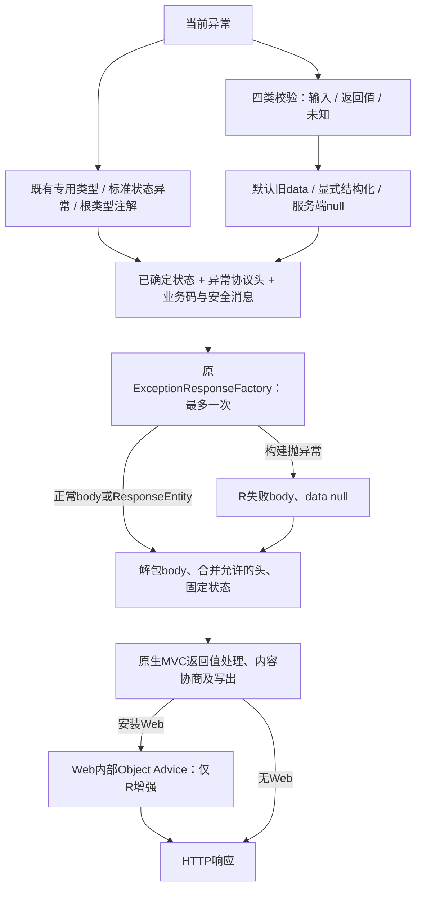

# Exception HTTP 与校验错误设计

导航：[需求大纲](./brainstorm.md) · [规格](./spec.md) · [实施计划](./plan.md) · [版本大纲](../brainstorm.md)

## Context

当前 `MimirExceptionHandler` 的通用 Exception 处理先于 Spring 的状态异常 resolver，未识别的标准状态异常与类型注解会被写成 500；405 分支只把支持方法拼入消息，没有输出 Allow。部分新分支已通过 ResponseEntity 固定状态，旧分支还依赖方法级 `@ResponseStatus`，返回工厂 ResponseEntity 时行为不统一。

校验 data 目前分为字符串列表和 null；方法返回值校验已有 500 分支，而 ConstraintViolationException 不区分输入输出，一律为 400。推荐先保持默认格式，再通过显式配置引入结构化协议，并独立修正返回值状态。

本文仅为推荐 SDD，D-36 至 D-38 维持历史含义；除 D-98（空集合与纯 Bean 路径改为 500，见 I5）外，配置名、来源判定、限长及优先级尚非用户逐项确认，没有实施 Java/POM 变更。

### 已核实本地依据

| 源码 | 事实与影响 |
|---|---|
| [MimirExceptionHandler](../../../../mimir-boot-starters/mimir-boot-starter-exception/src/main/java/com/yggdrasil/labs/exception/handler/MimirExceptionHandler.java) | public handler 返回类型均为 Object；Biz/System/Base 分别固定 200/500/500；不得为包装 ResponseEntity 修改这些公开方法描述符 |
| [ExceptionResponseFactory](../../../../mimir-boot-starters/mimir-boot-starter-exception/src/main/java/com/yggdrasil/labs/exception/handler/ExceptionResponseFactory.java) | 原三参接口只构建 body；动态分支已支持解包工厂 ResponseEntity 并覆盖其状态 |
| [DefaultExceptionResponseFactory](../../../../mimir-boot-starters/mimir-boot-starter-exception/src/main/java/com/yggdrasil/labs/exception/handler/DefaultExceptionResponseFactory.java) | 只有 Serializable data 才放进 R；新结构化包装与条目必须可序列化 |
| [ExceptionProperties](../../../../mimir-boot-starters/mimir-boot-starter-exception/src/main/java/com/yggdrasil/labs/exception/config/ExceptionProperties.java)、[自动配置](../../../../mimir-boot-starters/mimir-boot-starter-exception/src/main/java/com/yggdrasil/labs/exception/config/ExceptionAutoConfiguration.java) | 当前只有 enabled，保留总开关和缺省 Bean 条件 |
| [现有处理器测试](../../../../mimir-boot-starters/mimir-boot-starter-exception/src/test/java/com/yggdrasil/labs/exception/handler/MimirExceptionHandlerTest.java) | 已验证原始校验响应文本与日志清洗分离；有 MVC 用例确认动态分支忽略工厂错误状态。不能直接重写旧字符串消息 |
| 本地 Spring Boot 3.3.13 BOM / Spring 6.1.21 源码包 | `ResponseStatusException` 继承 `ErrorResponseException`；`getHeaders()` 是协议头入口；HandlerMethodValidationException 又继承 ResponseStatusException，需专用校验分支优先 |
| 本地 Spring 6.1.21 ResponseStatusExceptionResolver | 使用 merged annotation，并会递归 cause、sendError；本设计保留统一工厂，仅解析当前异常，不照搬递归和 sendError |
| 本地 ParameterValidationResult / ParameterErrors 源码 | 可获取参数索引、错误集合和容器位置；也暴露 argument/container/key，结构化输出必须避免读取和序列化这些值 |
| 本地 Spring 6.1.21 AbstractMessageConverterMethodProcessor / ExceptionHandlerExceptionResolver 源码 | 无匹配媒体或 Advice 返回值处理失败时，原生 MVC 不保证保留已解析状态或形成空体；本设计沿用其处理，不额外接管媒体选择 |
| [ResponseBodyEnhancer](../../../../mimir-boot-starters/mimir-boot-starter-web/src/main/java/com/yggdrasil/labs/web/advice/ResponseBodyEnhancer.java)、[内部 Advice 工厂](../../../../mimir-boot-starters/mimir-boot-starter-web/src/main/java/com/yggdrasil/labs/web/config/ResponseBodyEnhancerAdviceFactory.java) | 默认增强器实现 ResponseBodyAdvice<R<?>>，HttpEntity 分支依声明泛型判断；实际 MVC 入口为 ResponseBodyAdvice<Object>，先检查 body instanceof R 再委托，supports 原样委托用户可替换增强器 |
| [既有 Web MVC 回归](../../../../mimir-boot-starters/mimir-boot-starter-web/src/test/java/com/yggdrasil/labs/web/advice/ResponseBodyEnhancerMvcIntegrationTest.java) / 本地 Spring 类型探针 | 既有测试要求默认异常 body 含 traceId；Object 声明的 handler 实际返回 ResponseEntity 时，运行期参数类型为 ResponseEntity、泛型仍为 Object，现有增强器 supports 返回 false；直接 R 对照为 true。（审查更正）这不是“统一后才失效”：当前已经经 `createResponse` 返回 ResponseEntity 的 8 个分支（HandlerMethodValidationException、ConstraintViolationException、缺请求头、缺路径变量、406、415、413、NoResourceFoundException）在 `ResponseBodyEnhancer.java:70-86` 的判定下已缺失 traceId，属于既有缺陷；统一封装会把同一问题扩展到其余分支，由 W-TC/W-T4 联合交付一并修复 |

本地源包位于 Maven 缓存对应 `org.springframework` 6.1.21 坐标。本轮未运行 MVC 或真实消费者；以上不代表运行验收。

## Goal

- E1/E2：正常可写响应保留已解析 HTTP 状态与必要合法头；异常映射中的 Biz/System 200/500 语义不变。
- E3：每次最多一次响应工厂调用；工厂失败不改变已解析状态及异常头，回退 body 一并交给原生 MVC。
- E4：默认 data 与现状相同；显式开启后四类现有校验入口共用结构化协议，不含拒绝值和动态参数内容。
- E5：所有明确返回值违例以及无法证明为输入的约束异常，返回 500 和 null data。
- E6：安装 Web 时，统一 ResponseEntity 包装后的可写 R 仍保留既有 traceId 增强；非 R 和 null 不误增强，用户接管与原开关仍生效。

## Non-Goal

- 不增加 E-03 安全框架异常、异步超时、客户端断开处理，也不通过“所有 ErrorResponse 一律处理”间接纳入这些类型。
- 不增加全局 cause 链状态查找、自动国际化、错误执行器或新的异常模块。
- 不改响应工厂签名，不强制 COLA/R 格式，不改变 Common 的异常类型与字符串构造。
- 不承诺响应已提交后修复 HTTP，不把消息转换器失败视为已经被工厂回退处理。
- 不接管媒体协商、Resource、条件或 Range 请求；这些原生 MVC 路径不承诺保留原状态、完整 body 或空体。
- 不在结构化模式透传任意自定义插值消息；旧格式保持其现有消息，不宣称已消除业务自定义消息的泄漏风险。

## Architecture



异常元信息、校验数据和 body 构建分开；Advice 解析的 HTTP 状态与异常协议头不由 body 工厂决定，合并后交给原生 MVC。不可表示格式、Resource、条件/Range 请求等仍可触发框架原生处理，不以固定状态或空体兜底覆盖。业务更高优先级 Advice 和自定义 MimirExceptionHandler Bean 保持原接管能力。框架 Advice 继续 `LOWEST_PRECEDENCE`，不增加 resolver 或返回值处理器。

## Interface Contract

### I1：公开入口与兼容（E1、E2、E3）

保留所有既有 public handler 的方法名、参数类型、`Object` 返回描述符。实际返回可以统一为 `ResponseEntity<?>`，不能把源码返回类型改成 ResponseEntity。原单参构造保留，使用默认属性；新增配置构造供自动配置使用：

```java
public MimirExceptionHandler(ExceptionResponseFactory responseFactory);
public MimirExceptionHandler(
        ExceptionResponseFactory responseFactory, ExceptionProperties properties);

public Object handleResponseStatusException(
        ResponseStatusException exception, HttpServletRequest request);
public Object handleErrorResponseException(
        ErrorResponseException exception, HttpServletRequest request);

// 保留的扩展点，不增加 status 或 headers 参数：
Object ExceptionResponseFactory.createResponse(String code, String message, Object data);
```

两个新方法的 `@ExceptionHandler` 分别声明 ResponseStatusException、ErrorResponseException。（审查更正）Spring 按异常继承深度选择最近的已声明类型，并非只匹配精确类型：业务自定义的 ResponseStatusException / ErrorResponseException 子类，以及没有更具体专用分支的框架子类，都会进入这两个新分支并按其 getStatusCode/getHeaders 处理，需列入迁移说明。HandlerMethodValidationException 专用分支因继承距离更近，始终优先于其父类 ResponseStatusException；既有专用 HTTP 分支继续匹配原类型。未知类型不按 ErrorResponse 接口无限扩展。

既有方法级 `@ResponseStatus` 保留，兼容覆盖旧方法并返回普通对象的处理器子类；默认实现由实际 ResponseEntity 统一表达最终状态，动态状态不能只靠静态注解判断。既有状态映射不变，后续写出仍遵循原生 MVC 边界；旧 Java 调用和字节码描述符保留。

#### 兼容性：子类化处理器与运行期返回类型（审查补充）

- 自动配置保留原 `@Bean mimirExceptionHandler(ExceptionResponseFactory)` 方法，默认实现明确使用 `@EnableConfigurationProperties` 注册的命名属性 Bean，额外的同类型 Bean 不参与选择；消费者仅覆盖旧方法时仍调用该覆盖方法。直接构造自动配置类时使用默认属性，自定义处理器的构造参数仍由消费者决定。
- 自动配置以 `@ConditionalOnMissingBean(MimirExceptionHandler.class)` 退让给用户 Bean。若业务子类已用其他方法名声明 `@ExceptionHandler(ResponseStatusException.class)` 或 `ErrorResponseException.class`，新增的同类型父类方法会使同一 Advice 内出现两个映射，Spring 在启动解析时报 Ambiguous `@ExceptionHandler` 映射错误；同名覆盖父类方法则不受影响。迁移说明须给出“改为覆盖新方法或删除重复映射”的处理方式。
- 子类仍调用原单参构造时使用默认属性，`structured-details-enabled` 固定为 false，配置开启也不生效；需改用双参构造并接收自动配置注入的 `ExceptionProperties`。不为此改变单参构造语义。
- 下游自定义 `ResponseBodyAdvice` 将在全部分支看到运行期 ResponseEntity 外层（MethodParameter 参数类型为 ResponseEntity、body 为 R 或工厂对象），而非原 Object/R。按 `MethodParameter.getParameterType()` 是否为 R 或按声明泛型判断 `supports` 的签名、加密、包装类 Advice 可能静默不再生效；须改为在 `beforeBodyWrite` 按运行期 body 类型判断。本设计不为此改写 MethodParameter，仅在迁移说明中列出。
- 处理器入参依赖 `HttpServletRequest`，只适用于 Servlet MVC。现有自动配置的 `@ConditionalOnWebApplication` 未限定类型（既有问题）；推荐在 T3 低风险地改为 `type = SERVLET`，使 Reactive 应用明确不装配，并在 README 声明 Servlet-only 作用域；如实施时判定不纳入，至少在 README 记录为范围外。（审查推荐）条件保留在类级而非仅放到处理器 `@Bean`：类级条件同时使 `ExceptionResponseFactory` 缺省 Bean 在 Reactive 应用中不再注册。仓库内该工厂只被本处理器消费，处理器在 Reactive 下本就无法工作，因此只影响显式 Reactive 且自行注入该工厂 Bean 的应用；README 迁移说明须列出这一点，需要时由应用自行声明工厂 Bean。（审查补充）同一类级条件还会使类上的 `@EnableConfigurationProperties(ExceptionProperties.class)`（`ExceptionAutoConfiguration.java:35`）在 Reactive 应用中不再生效，`mimir.boot.exception.*` 不再绑定为 `ExceptionProperties` Bean；在 Reactive 应用中注入该 Bean 的业务代码会因缺少 Bean 启动失败。README 迁移说明一并列出，需要时由应用自行 `@EnableConfigurationProperties(ExceptionProperties.class)`。

### I2：解析优先级与业务错误码（E1、E2、E5）

| 顺序 | 当前异常类型 | 状态/响应体 |
|---|---|---|
| 1 | BizException、SystemException、其他 BaseException | 固定 200、500、500；保留自身 code/message；子类注解不覆盖这些契约 |
| 2 | 已有专用校验与 HTTP 类型 | 保持下表既有映射；校验返回值/未知来源按 I5；已纳入且实现 ErrorResponse 的类型读取其 headers |
| 3 | ResponseStatusException、ErrorResponseException | 精确保留 getStatusCode 与合法 getHeaders，不使用 ProblemDetail 替代工厂 body |
| 4 | 当前普通异常类型的 merged `@ResponseStatus` | 使用注解 code；包含继承与组合注解，不查 cause；同时实现 IException 时保留其 code/message，否则按状态映射 |
| 5 | 其他实现 IException 的当前异常 | 沿用 500 和自身 code/message |
| 6 | 其他 Exception | 沿用 500、SYSTEM_ERROR、通用消息 |

`@ResponseStatus` 和新标准 HTTP 分支不默认输出 raw exception.getMessage、reason、ProblemDetail.detail。没有既有业务错误接口时使用固定 ErrorCode 默认文案，不从自定义插值或异常嵌套数据取消息。保留原业务异常及旧专用分支文案，是兼容性边界，不静默改写全部既有消息。

| 分支/HTTP | ErrorCode | 状态备注 |
|---|---|---|
| MethodArgumentNotValidException、BindException、可确认输入的方法/约束校验、参数类型不匹配、不可读请求体 | PARAM_INVALID `00004` | 400；旧专用消息保留 |
| 缺请求参数/请求头 | PARAM_MISSING `00003` | 400 |
| 返回值校验、未知来源约束、缺路径变量 | SYSTEM_ERROR `10000` | 500 |
| 404 / NoHandlerFoundException / NoResourceFoundException | DATA_NOT_FOUND `20001` | 404 |
| 405、406、415 | OPERATION_NOT_ALLOWED `20004` | 保留各自状态 |
| 413 | PARAM_INVALID `00004` | 413 |
| 新标准分支的 401 / 403 | UNAUTHORIZED `30000` / FORBIDDEN `30001` | 只处理显式 HTTP 状态，不新增安全框架异常适配 |
| 新标准分支其余 4xx（含 429） | PARAM_ERROR `00002` | 保留原状态，不新增枚举 |
| 新标准分支其余 5xx | SYSTEM_ERROR `10000` | 保留原状态，包括非枚举扩展码 |
| 显式状态异常其他合法状态 | FAIL `00001` | 精确保留；无实体状态遵循 HTTP/Spring 输出规则 |

只用当前异常的状态，不因 code 值或文本推断 HTTP。cause 内的类型注解不生效是推荐范围限制，与 Spring 默认递归行为不同；必须给出包装异常 500 的迁移例子。

### I3：协议头与响应工厂合并（E1、E3）

先快照解析状态和异常头，后调用工厂一次；响应工厂可以返回普通对象、null 或 ResponseEntity。返回 ResponseEntity 时只解包其 body 和可接受的头，Advice 构建的 ResponseEntity 使用已解析状态，工厂不得覆盖。原动态分支已有这种状态固定行为，本次统一到全部纳入分支；旧静态分支中依赖工厂覆盖状态的消费者会受影响，升级需说明。这一规则不覆盖后续原生 MVC 的协商和请求处理。

合并顺序与冲突规则：

1. 不清空 Servlet response 中过滤器已经写入的头；框架自己的 ResponseEntity 只写本次相关字段。
2. 收集工厂 ResponseEntity 的合法端到端头；排除逐跳头、实体 Content-Length、Content-Encoding，长度/编码由实际转换链计算。
3. 异常提供的合法端到端头对同名键优先，整体替换工厂同名值；保留源头的多值和顺序，不拼接成单字符串。405 的 Allow、429/503 的 Retry-After、Accept/Accept-Patch、Location、WWW-Authenticate 及合法自定义头均可保留，不只允许固定小白名单。
4. 逐跳头按大小写不敏感排除 Connection、Keep-Alive、Proxy-Connection、TE、Trailer、Transfer-Encoding、Upgrade 以及 Connection 所列的动态头名；Proxy-Authenticate、Proxy-Authorization 同样排除。头名需符合 HTTP token，头值包含 CR/LF/NUL 的项丢弃，仅记录不含值的诊断。
5. 异常的 Content-Type 描述的是原异常实体，不直接复制；工厂合法的显式 Content-Type 随 body 交给原生 MVC，未指定时由 MVC 选择。降级 body 不沿用失败工厂的实体相关头，避免默认 R 被标成 ProblemDetail 或别的编码。
6. 工厂抛 Exception 时直接使用 `R.fail(resolvedCode,resolvedMessage)`，data=null；保留快照状态和异常头；不第二次调用工厂，不捕获 JVM Error 并伪装成功。工厂返回 null 视为主动无 body，不视为异常。

异常头可以覆盖同名 HTTP 协议信息；不涉及的过滤器追踪/CORS 头保留。若源异常明确提供同名头，它属于显式协议决定，不能同时保证保留互相冲突的过滤器值。响应尚未提交是上述组合生效前提。

Advice组装ResponseEntity时，对无实体状态（1xx、204、205、304）使用null body，不构造统一错误body；这是状态判断，不做媒体预判。其他body与合并后的状态、头直接交给原生 MVC，由其处理内容协商、HEAD、Resource、条件和 Range 请求。不可表示格式时不人为改为空体，也不保证原状态；不复制 MVC 协商算法或屏蔽请求头。工厂返回 null 不触发降级 body；工厂完成后发生的协商或序列化错误另属 MVC 失败，不纳入此处回退成功承诺。

### I3b：Web 追踪增强兼容协作（E6）

统一 ResponseEntity 不能只在 Exception 内完成并假定原 Web 增强自动继续生效。（审查更正）当前已返回 ResponseEntity 的 8 个分支本就缺失 traceId，这是既有缺陷而非统一后才出现的回归；W-TC/W-T4 联合交付在修复统一后路径的同时修复这 8 个分支，并纳入回归清单。旧 handler 保持 Object 声明，Spring 运行期 MethodParameter 却体现 ResponseEntity；现有增强器进入 HttpEntity 泛型分支后无法解析到 R。兼容适配由 [Web W4](../web-binding/design.md#w4异常封装与响应增强兼容) 的默认 ResponseBodyEnhancer 类型候选判定承担，Exception 不填 traceId、不访问 WebProperties、不新增对 Web 的依赖。

Web 保留 `ResponseBodyEnhancer implements ResponseBodyAdvice<R<?>>`、原构造和方法。只补充“RestControllerAdvice 中声明 Object、运行期实际 ResponseEntity”的候选；是否真正增强取决于既有内部 Object Advice 对解包后 body 的 `instanceof R<?>` 检查，不能将所有未知 HttpEntity 泛型都认定为 R、直接交给泛型桥接方法。原 wrapper 的 supports 继续直接委托可替换增强器，用户返回 false 时不额外兜底；不在 Exception 另建第二条增强路径。

这里的声明类型/运行期外层类型只用于增强候选判定，运行值用于增强前的 R 检查。必须沿用原 MethodParameter 及 containing class，不能为恢复增强伪造 ResponseEntity<R> 泛型或改写传给 MVC 的元信息。可写 R 只经既有 MVC Advice 链增强一次；默认增强器不为 null 构造 body，也不改写原生协商和请求处理结果。

默认增强规则保持：body 已有非空 traceId 不覆盖；否则 MDC traceId 优先于 requestId，均无时不生成。Web 总开关、response.enabled、response.auto-fill-trace-id 保持各自作用，业务增强器仍可接管。Exception 的联合验收消费 Web 的真实 MVC 结果；测试和实现归属见两份 Plan，不把文档协作变成模块反向依赖。

### I4：结构化配置与模型（E4）

配置：`mimir.boot.exception.validation.structured-details-enabled`，boolean，默认 false。新增 `ExceptionProperties.Validation` 嵌套属性，仅控制 data 格式，不控制 HTTP 类型识别或返回值校验。`mimir.boot.exception.enabled=false` 原总开关继续使自动配置退让。非法布尔值按 Boot 绑定失败处理。

推荐公开只读输出模型放在 `com.yggdrasil.labs.exception.validation`：

```java
public enum ValidationErrorSource { FIELD, PARAMETER, OBJECT }

public record ValidationErrorDetail(
        ValidationErrorSource source,
        String path,
        Integer parameterIndex,
        String constraint,
        String message) implements Serializable {}

public record ValidationErrorData(
        List<ValidationErrorDetail> errors,
        int totalCount,
        boolean truncated) implements Serializable {}
```

构造器拷贝 errors 为不可修改列表，拒绝 null 列表/条目；总数 ≥ errors.size，truncated 等价于 totalCount > errors.size；所有字符串非 null，按下表边界构造。record 组件的 Java/JSON 名称固定；定义 serialVersionUID，数据图仅含 String、Integer、enum 和可序列化列表，可直接交给原 DefaultExceptionResponseFactory。

| 字段 | 规则 |
|---|---|
| source | 属性/容器属性为 FIELD，方法形参约束为 PARAMETER，整体 Bean/跨参数约束为 OBJECT |
| path | FIELD 使用可确认的声明属性路径，数组/List 数值位置保留；Map key 或未知容器位置写 `[*]`，不输出 key.toString；字段位置无法由声明确认时用 `$`；参数使用可发现的声明参数名，否则 argN；对象级统一 `$` |
| parameterIndex | 方法参数已知时为 0 起始索引，其余为 null；跨参数为 null，不暴露方法/类签名 |
| constraint | FieldError/ObjectError取getCode；一般MessageSourceResolvable从codes末尾取第一个合法标识；ConstraintViolation取约束注解类型simpleName，不读取注解参数。不附对象名；仅接受 `[A-Za-z][A-Za-z0-9_.-]{0,63}`，不满足时用 Validation；未知自定义标识可保留，但其消息走固定兜底 |
| message | 固定安全消息，不读 rejectedValue/invalidValue、不读 error arguments 或自定义插值后的 defaultMessage；长度 ≤256 字符 |
| totalCount / truncated | 原始可归类输入错误数；排序后只保留前 100 项，总数不因截断改变；重复错误不去重 |

安全消息固定映射：NotNull/NotBlank/NotEmpty → “不能为空”；Min/Max/DecimalMin/DecimalMax/Positive/PositiveOrZero/Negative/NegativeOrZero → “数值不符合约束”；Size/Length → “长度不符合约束”；Email/Pattern → “格式不符合约束”；typeMismatch → “类型不匹配”；其余包括自定义约束 → “参数不符合约束”。不把注解 min/max/regexp 或动态消息参数写入 data。本轮不增加额外消息定制 SPI，消费者需要自定义时可在现有响应工厂处理已安全提取的元数据。

字段路径按声明属性名和数字下标构造，禁止从容器值推导。所有新字符串移除控制字符，并按 Unicode code point 截断；path 上限 256，constraint 上限 64，message 上限 256。排序使用输出规范化后的 `(source枚举顺序FIELD/PARAMETER/OBJECT, parameterIndex空值排末, path, constraint, message)`；字符串按 Java 字典序。重复项保留，完全相同项交换不影响输出；先排序后取前 100，不依赖 HashSet 遍历顺序。

实施补充：`BindException` 中的 Bean Validation 字段错误可从包装的 `ConstraintViolation` 获取根声明类型，并优先按结构化路径节点隐藏动态 Map 键。只有扁平字段名时无法可靠区分 Map 键内容与后续属性，路径在该 Map 的 `[*]` 处截断。手工字段错误和类型转换错误若缺少可确认的声明类型，则保留 FIELD 来源并以 `$` 表示位置未知。自定义校验器生成的属性节点也须按声明类型核验，不能将动态键当作属性名。方法校验的整体容器约束与元素约束若仅凭允许读取的声明元数据无法区分，则保守定位到参数名；这些降级仅适用于新结构化模式。

默认 false 的四类 data 精确保留：

| 异常 | 默认 data | 开启后输入侧 data |
|---|---|---|
| MethodArgumentNotValidException | fieldErrors 原顺序的 `field + ": " + defaultMessage` 字符串列表 | FieldError + ObjectError 共用包装 |
| BindException | fieldErrors 原顺序的 defaultMessage 列表 | FieldError + ObjectError 共用包装 |
| HandlerMethodValidationException | null | 当前版本可提供的参数、字段及 Bean 全局错误共用包装，不承诺跨参数结果 |
| ConstraintViolationException | null | 仅 I5 证明为输入的路径共用包装 |

默认路径不强加新的顺序、限长、对象级错误或安全消息表；旧自定义消息可能包含值，这一兼容事实须写在 README，不能宣称本轮已清洗所有历史输出。结构化零项输出 `{errors:[],totalCount:0,truncated:false}`；无法证明来源的 ConstraintViolationException 不走零项输入包装，见 I5。

### I5：输入与返回值分类（E5）

- HandlerMethodValidationException 使用 `isForReturnValue()`：true →500/SYSTEM_ERROR/data=null；false →400/PARAM_INVALID，按 I4 转换 `getAllValidationResults()`，ParameterErrors 的全局错误纳入 OBJECT。不调用 `getArgument()`、`getContainer()`、`getContainerKey()`。
- Spring 6.1.21 的方法校验适配仅公开 PARAMETER/RETURN_VALUE 结果，不能从 HandlerMethodValidationException 提取不存在的 CROSS_PARAMETER 结果。跨参数明细仅在 ConstraintViolationException 实际提供 CROSS_PARAMETER 路径时承接；不通过升级框架或新建校验拦截层补齐该框架限制。
- ConstraintViolationException 用 Jakarta `Path.Node.getKind()`，不靠 path.toString 包含某个关键词来猜：任意 RETURN_VALUE 节点优先判为输出；无输出时，必须每条路径都含 PARAMETER 或 CROSS_PARAMETER 才算输入。一个集合混入无法证明是输入的 Bean 路径时整批归未知。
- 输出或未知 →500/SYSTEM_ERROR/通用“系统错误”/data=null，不暴露部分输入或返回值明细。空集合归未知。输入 →400/PARAM_INVALID，并按开关选择 null 或结构化包装。
- 纯 Bean 属性路径没有调用语境，不能证明属于 HTTP 输入；返回保守 500（D-98 已确认，不提供恢复 400 的开关）。这改变当前 ConstraintViolationException 一律 400 的行为，必须作为 E-02 升级变化显式列出，不能隐藏在格式开关下。业务若明确知道属于输入，可在自己的边界转换为已有输入校验异常或用更高优先级 Advice 表达。
- 不新增 Spring MethodValidationException 的适配或全量 BeanValidation 代理配置；本轮只覆盖当前四类入口，未知异常仍遵循既有兜底。

## Data Model

内部可拆为包内可见 `ExceptionHttpMetadata`（HttpStatusCode、HttpHeaders、code、message）与校验数据提取器，不增加面向业务的元信息 SPI。HttpHeaders 先复制再合并，避免修改异常持有的对象或工厂返回的对象。结构化明细模型只含 I4 列出的输出字段，无请求、BindingResult、ConstraintViolation、Throwable、原始参数或框架对象引用。

默认工厂输出形态示例（外层 R 的 fail 是否出现另由 Common/Web C-07 决定）：

```json
{
  "code": "00004",
  "message": "参数无效",
  "data": {
    "errors": [{"source": "FIELD", "path": "name", "parameterIndex": null, "constraint": "NotBlank", "message": "不能为空"}],
    "totalCount": 1,
    "truncated": false
  }
}
```

JSON 空字段是否被省略仍由 mapper inclusion 策略控制，不能把 parameterIndex:null 必须出现当作跨 mapper 的保证。字段含义与 getter/record component 固定。

（审查补充）Common 允许默认消息为 null；工厂收到 null message 时，在 NON_NULL 策略下 `message` 键会整体缺失而非输出 null。Exception 不为此补默认文案，最终输出形态（含 `message` 缺失与 C-07 fail 字段）由 Web W-T4 联合验收核对，并在 README 说明。

## Error Handling

已解析 HTTP 元信息不依赖工厂成功。工厂构建失败使用直接 R 兜底；新增结构化提取器只处理预期框架输入，不捕获全部 Error。若第三方校验元数据访问异常，推荐降级为既定 HTTP 状态下 data=null、通用消息，并记录异常类型/阶段，不返回元数据内容；输入/输出分类本身无法完成时按 500，不继续假设输入400。

新增诊断不记录请求体、参数值、拒绝值、动态 key、原始校验异常 message；沿用 LogSanitizer 处理必要名称。旧业务异常日志语义保持，不夹带整个日志体系重构。无数据库或外部服务依赖；无重试、无自动采集原值。

## Non-Functional Requirements

| 维度 | 验收约束 |
|---|---|
| 兼容 | 原工厂签名、既有 public handler 描述符、单参构造删除数 0；默认结构化=false |
| Web协作 | 既有增强器公开构造、方法与ResponseBodyAdvice<R<?>>接口不变；不新增Exception到Web依赖，保留原MethodParameter及containing class |
| 输出规模 | 结构化最多100项，path/constraint/message上限256/64/256 code points；不影响旧列表 |
| 算法 | n项规范化O(n)，确定排序O(n log n)，空间O(n)；不新增线程或I/O，不为没有基线的P95编造数字 |
| 安全 | 新模型无拒绝值、请求值、constraint arguments、动态Map key及任意插值消息；返回值明细项数0 |
| 降级 | 工厂最多调用1次，失败重试0次；工厂失败不改写Advice已解析状态和合法异常头，后续交给原生MVC |
| 作用域 | 不增加E-03异常处理；不依赖COLA运行库或强制验证提供器 |

## Alternatives Considered

| 备选 | 收益 | 未选原因 |
|---|---|---|
| 让 Spring 默认 resolver 处理所有状态异常 | 直接复用原状态逻辑 | 统一工厂与body格式可能被绕开，默认sendError行为也不同 |
| 全局按 ErrorResponse 接口适配 | 覆盖面大 | 会意外纳入异步超时等E-03类型；选择明确类型与现有分支 |
| 注解优先于 Biz/System 固定语义 | 单个子类可改状态 | 会破坏现有业务200/系统500约定；普通自定义异常仍支持注解 |
| 遍历 cause 查找注解 | 更接近默认resolver | 扩大包装异常的可见语义，本轮只处理当前根类型 |
| 所有 ConstraintViolationException 都400 | 完全保留现状 | 返回值校验被错误归为客户端问题；选择按Path节点判定 |
| 新模式原样回传 defaultMessage | 保留业务个性文案 | 自定义插值可能含原值；选择安全固定消息及业务工厂可控定制 |
| 强制全量改结构化 | 客户端单一协议 | 违背D-38默认旧data；采用独立开关 |

## Testing Strategy

| 接口/行为 | 层级 | 验收要点 |
|---|---|---|
| I1新标准异常入口 | 单元+真实MVC | 429 Retry-After/自定义头，ErrorResponseException 503，业务工厂体可用 |
| I1旧公开描述符 | 反射/编译兼容 | 原handler方法Object返回及参数不变，单参构造仍可用 |
| I1子类兼容（审查补充） | ApplicationContextRunner+MVC | 子类以其他方法名映射ResponseStatusException时启动报二义映射（作为已知迁移结果断言）；同名覆盖可启动；单参构造子类开启配置后仍为旧data；用户RSE子类进入新分支；自动配置仅Servlet装配（若纳入type=SERVLET） |
| I1下游Advice（审查补充） | 真实MVC | 按运行期body类型判断的自定义ResponseBodyAdvice仍生效；仅按声明类型判断R的Advice不生效作为迁移示例记录 |
| I2优先级 | MVC | Biz200/System500/基础500；普通注解404、组合/继承；IException+注解；包装cause不透传；高优先级Advice接管 |
| I3头与工厂 | 正常可写MVC | 405 Allow、重复合法头、协议头冲突、过滤器追踪头、工厂ResponseEntity状态无效、工厂抛异常仍保留状态头 |
| I3无实体状态 | 单元+MVC | 1xx/204/205/304的ResponseEntity body为null，不构造错误body，合法协议头保留；HEAD沿用原生MVC |
| I3原生MVC边界 | 真实MVC回归 | 消费者converter继续可用，工厂null不触发默认body；内容协商和Resource/条件/Range沿用框架，不增设固定状态或空体恢复逻辑，实际写出失败不计为工厂降级 |
| I3b/Web W4联合 | Web模块真实MVC，依赖Exception统一封装 | Biz200/System500/普通500及工厂失败回退的可写R均填traceId；既有缺失traceId的8个ResponseEntity分支（HMVE、CVE、缺请求头、缺路径变量、406、415、413、NoResource）补traceId作为回归；null message输出形态一并核对；body已有值不覆盖、MDC traceId优先/requestId回退、均无不生成；Web/response/auto-fill关闭、用户supports拒绝均不补填；非R/null不强转或造body；普通R及ResponseEntity<R>保持原增强，原MethodParameter及containing class不被改写；（审查补充）下游自定义ResponseBodyAdvice在运行期ResponseEntity外层下的supports结果与所见body记录在案，与Web W4一致 |
| I4属性 | ApplicationContextRunner/配置测试 | false缺省、true显式、非法布尔失败、总开关禁用；旧构造默认false |
| I4默认模式 | 既有测试+MVC | 两种旧字符串列表内容/顺序、另外两种null；不改变日志与响应文本分离基线 |
| I4新模型/四入口 | 单元+实际验证提供器MVC | FIELD/PARAMETER/OBJECT、参数名缺失、容器索引/动态key、重复、100/101边界、确定排序、恶意插值不出现在data |
| I5输入/输出/未知 | 单元+方法校验MVC | 参数400；返回值/混合/纯Bean/空集合500且data null；两种模式均一致 |
| I3/I4跨工厂 | MVC+序列化 | 自定义工厂获完整data；默认R不丢Serializable包装；工厂失败data null；不把构建异常文本输出 |

真实 MVC 用例需通过 DispatcherServlet 的 resolver、Advice、转换器链；直接调用 handler 只证明局部逻辑。实施命令与文件归属见[计划](./plan.md)，以上验证本轮均未运行。
