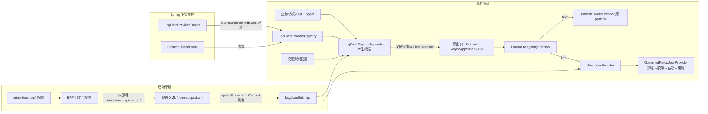

# Log JSON 日志治理设计

## Context

本设计承接 [spec](./spec.md) 的八项行为，基线为 Java 17 / Boot 3.3.13 / Logback 1.5.18 / SLF4J 2.0.17 / Jackson 2.17.3（Boot BOM 管理）。范围与取舍来自[方案大纲](./brainstorm.md)及 D-111～D-113，尚未实施。

当前事实（2026-11-08 核对 `mimir-boot-starter-log`）：

- 预设由 `logging.config` 指向 `classpath:com/yggdrasil/labs/log/logback/container.xml` 或 `server.xml` 选定。[`LogPresetEnvironmentPostProcessor`](../../../../mimir-boot-starters/mimir-boot-starter-log/src/main/java/com/yggdrasil/labs/log/config/LogPresetEnvironmentPostProcessor.java)（以下简称 EPP）在 Logback 正式初始化前严格绑定，`addFirst` 内部源 `mimirLogPresetResolved`，XML 以带 `defaultValue` 的 `springProperty` 读取 `mimir.boot.log.internal.*`；未选预设时直接返回。
- 预设 encoder 全部为 `PatternLayoutEncoder`；脱敏只在 `%mask`、`%maskThrowable` 转换器中处理消息与异常文本，规则为 [`SensitiveDataConverter`](../../../../mimir-boot-starters/mimir-boot-starter-log/src/main/java/com/yggdrasil/labs/log/converter/SensitiveDataConverter.java) 的静态不可变快照（`AtomicReference`），由 `LogMaskAutoConfiguration` 在 `ContextRefreshedEvent` 发布或经编程式入口作废重建。字段名规则按“键名以别名结尾、忽略大小写”匹配（`KeyValueMasker`），值规则、自定义与编程式正则作用于整段文本。
- server 预设 root 同时挂 `ASYNC_FILE_INFO`、`ASYNC_FILE_ERROR`（后者入队前 `LevelFilter` 只收 ERROR）；`access.log`、`SQL.JSON`、`SQL.SLOW` 均 `additivity=false`。
- `AccessLogFilter` 以占位符拼接消息输出 `access.log`，无 MDC 或键值对。`SQL.JSON`、`SQL.SLOW` 的消息由 MyBatis Starter 以 fastjson2 生成并预脱敏。
- 模块无关闭阶段监听；traceId/spanId 由业务引入的 Micrometer 写入 MDC 键 `traceId`、`spanId`。
- Logback 1.5.18 无免 Janino 的属性条件（`<if>` 需 Janino），`LoggingEvent` 提供 `addKeyValuePair`；`AsyncAppender.preprocess` 在调用线程执行。
- `logstash-logback-encoder 8.1`：唯一非可选传递依赖为 `jackson-databind`（Logback 为 optional/provided）；`LoggingEventCompositeJsonEncoder` 支持 `setProviders`，Provider 接口 `writeTo(JsonGenerator, Event)` 抛出 `IOException` 时整条事件被丢弃。

## Goal

- 预设下 `mimir.boot.log.format=json` 时，应用、访问、SQL 日志每事件一行合法 JSON，字段符合 spec；未启用时 container、server、旧默认 XML 的输出逐字节不变，依赖树不变。
- 自定义 XML 按公开约定引用编码器与字段捕获出口即可获得同样字段。
- 字段扩展组件每事件在产生线程最多调用一次；任何扩展失败不丢失基础事件、不改变级别。
- 交付 text/json 性能基准记录（不设门槛，D-113）。

## Non-Goal

- 不改旧 `logback-spring.xml`，不为其提供 JSON；不新增配置热更新。
- 不解析 `message` 内嵌 JSON；不改 MyBatis 的 SQL 生成、开关与脱敏。
- 不创建 Span、不引入 tracing/指标 SDK，不做访问采样、分路径慢阈值、业务步骤链路。
- 不提供整条日志大小上限，不承诺 banner、直接标准输出与 Logback 状态诊断为 JSON。
- 不公开 logstash Provider 组合方式；自定义 XML 只承诺本文列出的公开约定。
- 不对自定义 XML 的其他出口隐藏访问日志新增的键值对（最多 9 个，成功终态无 `errorType`）：使用 `%kvp`、logstash `LogstashEncoder`（默认含键值对 Provider）或 Logback `JsonEncoder` 的自定义配置在升级后会额外输出这些键值对，即使未启用 Mimir JSON；作为显式兼容说明写入 README 与版本升级说明，预设与旧默认 XML 不受影响。
- 不隐藏保留键值对 `mimir.log.fields` 对其他出口的可见性：挂载对象是 `KeyValuePair` 子类，公开字段 `value` 恒为字符串 `[mimir-fields]`，快照只存放在子类的非公开字段中；因此 `%kvp`、Logback `JsonEncoder` 与 logstash `KeyValuePairsJsonProvider`（以 `writeObject(value)` 序列化值）都只会输出该字符串，不会序列化快照或导致事件被丢弃。README 说明该键，并给出 logstash `<excludeKeyName>mimir.log.fields</excludeKeyName>` 示例供需要时过滤。

## Architecture



数据路径：

1. **启动**：EPP 在原预设处理之外，对所有非 legacy bootstrap 的环境（含非 Logback 后端，有意为之：非法 `json.*` 配置一律启动失败）绑定并校验 `format`、`environment`、`instance`、`json.*`，写入内部键；`format=json` 时校验预设与依赖。XML 经 `json-support.xml` 把内部键写成 Context 属性；`MimirJsonEncoder.start()` 读取为不可变 `LogJsonSettings`。
2. **捕获（产生线程）**：每个预设 Logger 的第一个出口是 `LogFieldCaptureAppender`。它复制 MDC、规范化事件键值对、在注册表就绪且非重入时依序调用扩展，记录规范化错误，并引用当前脱敏规则快照，构成不可变 `FieldSnapshot`，以保留键值对 `mimir.log.fields` 挂到事件上（见 Data Model）。同一事件后续出口（含 ERROR 的两个异步出口）复用该快照。
3. **输出（出口线程）**：`FormatDelegatingEncoder` 按 Context 属性选择原 `PatternLayoutEncoder` 或 `MimirJsonEncoder`。JSON 下 `GovernedFieldsJsonProvider` 取事件快照（缺失时就地构建不含扩展的基础快照），执行 MDC 排除 → 脱敏 → 截断 → 类型安全写出，并汇总 `processing`。

常量归属：两个内部属性源名称在 `LogPresetSupport`；全部 JSON 相关内部键名（含 `internal.format`、`internal.json.*`）、Context 属性名、保留键与字段集合在 `LogJsonKeys`。

包与依赖方向（满足 `LogArchitectureTest` 的 `noCycles`）：`field`（公开 SPI，仅依赖 JDK）← `json` → `converter`；`config` → `json`；`web` → `json`（仅常量）。`json` 不依赖 `config`、`web`。跨包使用的 `JsonPointer`、`LogJsonSettingsCodec`、`LogFieldProviderRegistry` 与常量类 `LogJsonKeys`（内部键名、Context 属性名、保留键 `mimir.log.fields`、`TOP_LEVEL_FIELDS`、`ACCESS_FIELDS`）为 public 并标注内部实现、非公共 API。

## Interface Contract

### IC-1 选择输出格式（Behavior: 选择输出格式）

配置（前缀 `mimir.boot.log`，绑定类 `LogJsonProperties`，由 EPP 绑定，不注册为 Bean；补 configuration-processor 元数据）：

| 属性 | 类型 | 默认 | 校验 |
|---|---|---|---|
| `format` | 枚举 `LogFormat { TEXT, JSON }` | `TEXT` | 绑定失败 → 启动失败 |
| `environment` | String | 未设置 | 空白视为未设置 |
| `instance` | String | 未设置 | 空白视为未设置；环境变量 `MIMIR_BOOT_LOG_INSTANCE` 经宽松绑定生效 |
| `json.exclude-mdc-keys` | `List<String>` | 空 | 无 |
| `json.field-length-limits` | `Map<String, Integer>` | 空 | 键为合法 JSON Pointer 且以 `/` 开头、非空；值 ≥ 1 |

EPP 处理顺序（扩展现有 `postProcessEnvironment`，保持“全部校验先于写入”）：

```text
remove 两个内部源; bootstrap → return; moveToEnd(defaultProperties)
preset = resolve(logging.config)
json = bindJson(environment)                   // 逐属性 bindStrict，诊断为该属性名，不含值
validate(json)                                  // 指针语法与值范围；不含值
if !isLogbackBackend:
    json.format == JSON → fail("JSON 输出需要 container、server 预设及 Logback 后端")   // 先于预设失败分支
    preset 非空 → 原失败
    return
if json.format == JSON:
    preset == null → fail("mimir.boot.log.format=json 仅适用于 container、server 预设 …")
    缺 net.logstash.logback.encoder.LoggingEventCompositeJsonEncoder
      或 com.fasterxml.jackson.databind.ObjectMapper → fail("启用 JSON 需声明 net.logstash.logback:logstash-logback-encoder")
if preset != null: 原 resolvePreset，并在其内部键中追加 format / capture-active
jsonKeys = jsonInternalKeys(json, environment)
if jsonKeys 非空: addFirst(mimirLogJsonResolved, jsonKeys)   // 独立属性源
```

内部键（前两项写入原预设属性源 `mimirLogPresetResolved`，其余 `json.*` 写入独立属性源 `mimirLogJsonResolved`，预设与非预设一致）：

| 内部键 | 值 |
|---|---|
| `mimir.boot.log.internal.format` | `text` / `json`；写入 `mimirLogPresetResolved`，仅 preset 非空时 |
| `mimir.boot.log.internal.json.capture-active` | `true`；写入 `mimirLogPresetResolved`，仅 preset 非空且 JSON 时 |
| `mimir.boot.log.internal.json.environment` | 显式值，否则 `environment.getActiveProfiles()` 恰为 1 个时取该值，否则不写；经 `LogJsonSettingsCodec` 编码 |
| `mimir.boot.log.internal.json.instance` | 显式值，否则不写；经编码 |
| `mimir.boot.log.internal.json.exclude-mdc-keys` | 每项编码后以 `,` 连接 |
| `mimir.boot.log.internal.json.field-length-limits` | 每项 `编码后指针=limit`，以 `,` 连接 |

`LogJsonSettingsCodec`（`json` 包，public，标注内部实现）对每个值做 UTF-8 百分号编码（仅保留 `A-Z a-z 0-9 - . _`），因此编码结果不含 `,`、`=`、`$`、`{`，列表与 Map 可无损往返，且 `springProperty` 解析占位符时不会遇到 `${` 而回显原值。不复用面向正则的 `MaskListCodec`（其拆分不还原 `\,`、在括号内不拆分）。`field-length-limits` 的键须以 `[...]` 括号写法配置以保留 `/`；校验失败诊断提示该写法。

`LogPresetProperties` 以 `bindOrCreate("mimir.boot.log", …)` 绑定，Binder 默认忽略未知字段，新增属性不影响其绑定。`json.*` 使用独立属性源，旧默认 XML 与自定义 XML 下同样写入供 IC-7 读取；因 `environment` 可由唯一 active Profile 回退，未配置任何新属性的应用也可能新增该属性源，除此之外不改动其他属性源；`mimirLogPresetResolved` 仍只在选中预设时存在，`LogMaskAutoConfiguration` 依赖它的预设父上下文守卫不受影响。

预设 XML 变更：

- `common.xml`：`<include resource="com/yggdrasil/labs/log/logback/json-support.xml"/>`；新增 `springProperty scope="context" name="mimir.boot.log.json.format" source="mimir.boot.log.internal.format" defaultValue="text"` 与 `MIMIR_JSON_CAPTURE_ACTIVE`（`defaultValue="false"`）；定义 `<appender name="MIMIR_LOG_FIELDS" class="com.yggdrasil.labs.log.json.LogFieldCaptureAppender"><active>${MIMIR_JSON_CAPTURE_ACTIVE}</active></appender>`。
- `container.xml`、`server.xml`：每个 `<encoder>` 改为 `<encoder class="com.yggdrasil.labs.log.json.FormatDelegatingEncoder">`，保留原 `<pattern>`、`<charset>`；`access.log`、`SQL.JSON`、`SQL.SLOW`、root 的第一个 `appender-ref` 为 `MIMIR_LOG_FIELDS`。

`FormatDelegatingEncoder`（public 类，供 XML 实例化，标注内部实现、非公共 API；`JsonEncoderFactory.create(Context)` 的声明返回类型为 `Encoder<ILoggingEvent>`，委派字段同为该类型，避免字节码校验在 text 下加载 logstash 类）：

```java
public class FormatDelegatingEncoder extends EncoderBase<ILoggingEvent> {
    public void setPattern(String pattern);
    public void setCharset(Charset charset);
    // start(): 读 Context 属性 mimir.boot.log.json.format；
    //   "json" → 经 JsonEncoderFactory（独立类，避免 text 下加载 logstash 类）创建 MimirJsonEncoder
    //   其他 → 创建 PatternLayoutEncoder(pattern, charset)，setContext(本 encoder 的 Context) 后 start；
    //      immediateFlush 由出口控制，不依赖 encoder 的 parent
    // headerBytes/encode/footerBytes/stop 委派
}
```

错误：委派 encoder 启动失败时本 encoder 不置为 started，并添加 Logback error status（Boot 据此报告配置错误）。

### IC-2 JSON 公共外层（Behavior: JSON 公共外层）

`MimirJsonEncoder`（public，自定义 XML 公开约定）：

```java
public class MimirJsonEncoder extends LoggingEventCompositeJsonEncoder {
    // start(): 若未显式 setProviders，则装配固定 Provider 列表；从 Context 属性读取 LogJsonSettings
}
```

Provider 列表与字段（顺序非契约）：

| 字段 | 来源 |
|---|---|
| `timestamp` | 事件时间，固定格式 `yyyy-MM-dd'T'HH:mm:ss.SSSXXX`（如 `2026-11-06T10:20:30.120+08:00`、UTC 为 `Z`），JVM 默认时区 |
| `level` | `event.getLevel().toString()` |
| `service` | Context 属性 `mimir.boot.log.json.service`（`json-support.xml` 由 `spring.application.name` 映射，缺省 `application`） |
| `environment`、`instance` | Context 属性，空则省略 |
| `thread`、`logger` | 事件线程名、Logger 名 |
| `message`、`traceId`、`spanId`、`context`、`attributes`、`exception`、`processing` | `GovernedFieldsJsonProvider`，见 IC-4、IC-6 |

`traceId`、`spanId` 取自快照 MDC 同名键，非空时输出并从 `context` 移除。`context` 为 MDC 去除这两个键与 `exclude-mdc-keys` 后的结果，空则省略。异常字段：`type` = `IThrowableProxy.getClassName()`，`message` = 脱敏后 `getMessage()`（null 省略），`stackTrace` = 脱敏后 `ThrowableProxyUtil.asString(proxy)`（含原因链与 suppressed）。JSON 字符串由 Jackson 转义，保证单行。

### IC-3 访问与 SQL 日志（Behavior: 访问与 SQL 日志）

`AccessLogFilter.logAccessByStatus` 改用 SLF4J 2 流式 API，消息模板与参数不变，追加键值对：

```java
ACCESS_LOG.atLevel(level).setMessage(message).addArgument(...)... // 参数顺序与原 args 一致
    .addKeyValue("method", method).addKeyValue("path", uri)
    .addKeyValue("statusCode", statusCode)           // Integer
    .addKeyValue("durationMs", durationMs)           // Long
    .addKeyValue("clientIp", ip).addKeyValue("userAgent", userAgent)
    .addKeyValue("outcome", outcome)
    .addKeyValue("errorType", errorType)             // 仅非 null 且非占位符 "-" 时添加
    .addKeyValue("slow", isSlow)                     // Boolean
    .log();
```

级别判定、`[慢接口]` 后缀、排除路径、终态归并保持原实现。文本 pattern 无 `%kvp`，文本输出不变。框架访问字段集合 `ACCESS_FIELDS = {method, path, statusCode, durationMs, clientIp, userAgent, outcome, errorType, slow}` 在 `logger == "access.log"` 时受保护（IC-5）。SQL 无代码改动，`message` 原样输出。

### IC-4 结构化脱敏（Behavior: 结构化脱敏）

**规则上下文绑定**：现有快照只在 `%mask` 转换器 `start()` 时绑定 LoggerContext 并按 Context 属性作废旧快照（`SensitiveDataConverter.java:48-63`），重建时只读该 Context 或系统属性。JSON 分支没有 `%mask` 转换器，因此 `StructuredMaskSupport.bindContext(Context)` 复用 `start()` 中同一段绑定与作废逻辑（抽为包内静态方法，两处调用），由 `MimirJsonEncoder.start()` 调用。保证 JSON 下：日志初始化后的早期事件读到预设写入 Context 的缺省规则；编程式入口作废快照后按 Context 重建，不丢失已发布规则；Logback 重新配置时切换到新规则代次。

在 `converter` 包新增 public `StructuredMaskSupport`（标注内部实现、非公共 API）与快照访问：

```java
public final class StructuredMaskSupport {
    /** 与 %mask 转换器 start() 相同的 Context 绑定与快照作废 */
    public static void bindContext(Context context);
    /** 取当前有效规则快照（与 %mask 同一代）；不为 null，规则为空时各方法原样返回 */
    public static MaskRules currentRules();

    public interface MaskRules {
        String maskText(String text);          // 与 %mask 相同：键值扫描 + 全部正则
        boolean isSensitiveKey(String key);    // 键名以任一启用别名结尾（忽略大小写），与文本扫描一致
        String maskValue(String value);        // 仅值正则（预置纯值 + 自定义 + 编程式），替换逻辑同 maskValue
        String replacement();
    }
}
```

规则应用：

| 位置 | 处理 |
|---|---|
| `message`、`exception.message`、`exception.stackTrace` | `maskText` |
| `context` 每项 | `isSensitiveKey(key)` → 替换串；否则 `maskValue(value)` |
| `attributes` 递归 | 任一层键 `isSensitiveKey` → 整个值（含对象/数组）替换为替换串；字符串叶子 `maskValue`；数字、布尔以 `String.valueOf` 匹配，结果变化则改为该字符串，否则保持原类型；null 不变 |

`SensitiveDataConverter` 将私有 `currentConfiguration()` 的快照经包内方法暴露给 `StructuredMaskSupport`，不改变发布、作废与编程式入口语义。

### IC-5 字段扩展组件（Behavior: 字段扩展组件）

公开 SPI（包 `com.yggdrasil.labs.log.field`，仅 JDK 类型）：

```java
@FunctionalInterface
public interface LogFieldProvider {
    /** 返回补充到 attributes 的字段；null 或空 Map 表示无补充。不得阻塞或执行 I/O。 */
    Map<String, ?> provide(LogEventView event);
}

public interface LogEventView {
    Instant timestamp(); String level(); String service();
    Optional<String> environment(); Optional<String> instance();
    String logger(); String thread(); Optional<String> message();
    Optional<String> traceId(); Optional<String> spanId();
    Map<String, String> context();            // 不可变，含全部 MDC（排除前、脱敏前）
    Map<String, Object> attributes();         // 不可变深拷贝，事件自带且已通过类型检查的键值对
    Optional<LogExceptionView> exception();
}

public interface LogExceptionView { String type(); Optional<String> message(); }
```

`LogEventView` 中 `message` 为格式化后的原消息（脱敏前）；`exception().message()` 为原异常的 `getMessage()` 全文（不截断、脱敏前），类型为类全名。视图对所有扩展为同一不可变实例。

`LogFieldProviderRegistry`（`json` 包，public，标注内部实现；供 `config` 包注册）：

```java
public final class LogFieldProviderRegistry {
    public static void register(Object owner, List<NamedProvider> providers);  // 覆盖式发布
    public static void clear(Object owner);                                    // 仅 owner 匹配时清空
    public static List<NamedProvider> current();                               // 未就绪为空列表
    public record NamedProvider(String beanName, LogFieldProvider provider) {}
}
```

`LogFieldAutoConfiguration`（`@ConditionalOnClass` Logback，加入 AutoConfiguration.imports）：

- `ContextRefreshedEvent`：只处理本上下文的刷新；legacy bootstrap 环境跳过（D-100 同一判断）；仅主应用上下文注册：`getParent() == null`，或父上下文 `getId()` 为 `"bootstrap"`（Spring Cloud `BootstrapApplicationListener` 固定设置该 id；其 Environment 中的 `bootstrap` 属性源在主上下文刷新前已被移除，不能以 D-100 的属性源判断识别父上下文）；`SpringApplicationBuilder` 普通父子层级下的子上下文及其他子上下文不注册扩展（不同于脱敏的“最后刷新者发布”，扩展 Bean 归属主应用，子上下文中的 `LogFieldProvider` Bean 不生效，README 说明）；收集 `LogFieldProvider` Bean，排序与 Spring `ObjectProvider.orderedStream()` 一致（含 `@Bean` 方法上的 `@Order`），同序按 Bean 名升序；`register(applicationContext, …)`。
- `ContextClosedEvent`（同一上下文）：`clear(applicationContext)`，在 Bean 销毁前生效。

`LogFieldCaptureAppender` 在 `start()` 读取与编码器相同的 Context 属性构建 `LogJsonSettings`，用于视图中的 `service`、`environment`、`instance`：`service` 为 `springProperty` 映射的原值，`environment`、`instance` 及 `json.*` 列表值经 `LogJsonSettingsCodec` 解码。

`LogFieldCaptureAppender`（public）继承 `UnsynchronizedAppenderBase<ILoggingEvent>`（不加全局锁，扩展不在锁内执行）。`append` 时若事件已含保留键则直接返回（同一事件经多个捕获出口只捕获一次）；`active=false` 时直接返回。它必须位于同一 Logger 的其他出口之前，排在异步出口之后属不支持的配置（后台线程与调用线程并发访问键值对列表）。

调用与合并（在 `LogFieldCaptureAppender` 内，产生线程）：

```text
if IN_PROVIDER.get() or registry 为空: 不调用扩展
IN_PROVIDER.set(true)
try:
  for p in providers (优先级降序):
     try:
        raw = p.provide(view)
        if raw 为 null 或空: continue                                     // 无字段、无标记
        entries = 复制 raw 的条目快照 (遍历在此完成)
     catch Exception 或 LinkageError: error(provider_error, provider=p.name); continue   // 含惰性/并发 Map 遍历异常
     // 其他 Error（如 VirtualMachineError）不捕获，按 JVM 致命错误向调用方传播
     for (k, v) in entries:
        if k 为 null 或非 String: error(invalid_value, provider=p.name)，无 field; continue
        if k ∈ TOP_LEVEL_FIELDS or (access.log 且 k ∈ ACCESS_FIELDS): error(/attributes/k, protected_field, p.name); continue
        if k 已由更高优先级扩展写入: continue
        norm = normalize(v, /attributes/k)  → 失败字段记 error(带 provider)
        attributes[k] = norm                 // 覆盖事件自带同名键
finally: IN_PROVIDER.remove()
```

`TOP_LEVEL_FIELDS = {timestamp, level, service, environment, instance, thread, logger, message, traceId, spanId, context, attributes, exception, processing}`。视图不可变容器的写操作抛 `UnsupportedOperationException`，按 `provider_error` 记录。

### IC-6 事件键值对、截断与处理标记（Behavior: 事件自带键值对 / 字段截断与处理标记）

`ValueNormalizer.normalize(Object value, JsonPointer path, int depth, IdentityStack seen)` 返回不可变规范值或失败：

| 输入 | 结果 |
|---|---|
| `null`、`String`、`Boolean` | 原值 |
| `Integer`、`Long`、`Short`、`Byte`、`BigInteger`、`BigDecimal`、有限 `Float`/`Double` | 原值 |
| NaN / ±Infinity | `invalid_value` |
| `Map`：键全为 `String` | 递归得保持插入顺序的不可变 Map；成员失败只移除该成员并以成员路径记录，Map 本身保留 |
| `Map` 含非 `String` 键 | 整个 Map 以自身路径记 `invalid_value` 并移除 |
| `List` | 递归；失败元素被移除，路径用原索引 |
| 已在当前路径上的同一实例 | 该成员以成员路径记 `circular_reference` 并移除，如 `/attributes/m/self` |
| 深度 > 32 | `invalid_value` |
| 其他（JavaBean、数组、Set、枚举、`Character` 等） | `unsupported_type`，不调用 `toString()` |
| 规范化抛出意外异常 | `field_error`（捕获阶段） |

事件键值对来源为 `event.getKeyValuePairs()`，跳过保留键 `mimir.log.fields`；同名键后者覆盖前者。

`JsonPointer`：解析 RFC 6901（`~0`、`~1`，非法转义拒绝），与写出路径同一实现。截断在脱敏后对字符串叶子执行：`limit` 码点内不变；超出时截到 `s.substring(0, s.offsetByCodePoints(0, limit))` 并记录 `truncatedFields`；指向非字符串或不存在的字段忽略。

`processing` 写出规则：`truncatedFields` 为集合语义（实现按写出顺序列出，不作为契约）；`errors` 依次为捕获阶段（键值对、扩展按调用顺序，含规范化的 `field_error`）与输出阶段（排除、脱敏、截断、写出中的 `field_error`）；`field_error` 两个阶段都可能产生，按发生阶段排序。两者都空时不输出 `processing`。

### IC-7 自定义 XML 接入（Behavior: 自定义 XML 接入）

公开约定（写入 log starter README）：

```xml
<include resource="com/yggdrasil/labs/log/logback/json-support.xml"/>
<appender name="MIMIR_LOG_FIELDS" class="com.yggdrasil.labs.log.json.LogFieldCaptureAppender"/>
<appender name="CONSOLE" class="ch.qos.logback.core.ConsoleAppender">
    <encoder class="com.yggdrasil.labs.log.json.MimirJsonEncoder"/>
</appender>
<root level="INFO">
    <appender-ref ref="MIMIR_LOG_FIELDS"/>   <!-- 必须位于同一 Logger 的其他出口之前 -->
    <appender-ref ref="CONSOLE"/>
</root>
```

- `json-support.xml`（public 资源）：只含 `springProperty scope="context"`，把 `spring.application.name`（缺省 `application`）与 `mimir.boot.log.internal.json.*` 映射为 `mimir.boot.log.json.{service,environment,instance,excludeMdcKeys,fieldLengthLimits}`，`service` 缺省 `application`，其余缺省为空串；不定义出口、不改变级别。
- `LogFieldCaptureAppender`：`active` 缺省 `true`；不输出任何内容；未声明时编码器构建基础快照，扩展不被调用。
- 脱敏规则：非预设应用沿用原发布时机（刷新后由 `LogMaskAutoConfiguration` 发布），刷新前的事件按当时有效规则处理，与文本 `%mask` 一致。
- 编码器依赖缺失时，Logback 加载 `MimirJsonEncoder` 抛出 `NoClassDefFoundError`（Joran 只捕获 `Exception`，不产生 error status），该 Error 直接向上传播使启动失败，原因链含缺失的 `net.logstash...` 类名；不保证表现为 Boot 的 “Logback configuration error detected”。

### IC-8 配置仅在启动时生效（Behavior: 配置仅在启动时生效）

`LogJsonSettings` 在编码器 `start()` 读取一次；不监听 `EnvironmentChangeEvent`。脱敏规则快照在捕获阶段固定引用（`FieldSnapshot.maskRules`），输出阶段使用该引用；未经捕获出口的事件在编码时取 `currentRules()`。编程式入口作废全局快照后，下一条被捕获的事件取得新规则。

## Data Model

| 结构 | 字段 | 约束 |
|---|---|---|
| `LogJsonProperties` | `format: LogFormat`、`environment: String`、`instance: String`、`json.excludeMdcKeys: List<String>`、`json.fieldLengthLimits: Map<String,Integer>` | 启动期绑定，只读 |
| `LogJsonSettings` | `service`、`environment?`、`instance?`、`excludeMdcKeys: Set<String>`、`limits: Map<JsonPointer,Integer>` | 编码器生命周期内不可变 |
| `FieldSnapshot` | `mdc: Map<String,String>`、`attributes: Map<String,Object>`（规范化、合并后）、`errors: List<ProcessingError>`、`maskRules: MaskRules`、`extended: boolean` | 不可变；经 `FieldSnapshotKeyValuePair extends org.slf4j.event.KeyValuePair`（key `mimir.log.fields`，`value` 恒为字符串 `[mimir-fields]`，快照存于包内字段）挂载；编码器以 `instanceof` 取回快照 |
| `ProcessingError` | `field?: String(JSON Pointer)`、`provider?: String`、`reason: String` | `reason` ∈ {`unsupported_type`,`invalid_value`,`circular_reference`,`protected_field`,`provider_error`,`field_error`} |
| `JsonPointer` | `tokens: List<String>` | RFC 6901；`toString()` 输出转义形式 |

## Error Handling

| 失败点 | 策略 |
|---|---|
| 配置绑定/校验失败 | EPP 抛 `IllegalStateException`，消息含属性名不含值，启动失败，不写内部源 |
| JSON 依赖缺失（预设 + json） | EPP 失败，提示坐标 |
| 自定义 XML 引用编码器但缺依赖 | `NoClassDefFoundError` 传播，启动失败（不经 Logback status） |
| 扩展 `provide()` 抛 `Exception`/`LinkageError` 或返回非法值 | 隔离为 `processing.errors`，不回显值与异常消息，事件照常输出 |
| 扩展内部再打日志 | 重入标志跳过扩展；Logback 出口自身的重入保护可能丢弃嵌套事件（不承诺输出） |
| 治理处理意外异常（单字段） | 移除该字段，记 `field_error` |
| JsonGenerator `IOException` | 由 logstash 编码器丢弃该事件并记录 Logback status；Mimir Provider 不主动抛出 |
| 队列满 | 沿用 server 预设 `neverBlock=false` 阻塞语义，不改变 |
| 关闭阶段 | 注册表清空后基础字段照常输出；异步队列按原 `maxFlushTime` 排空 |

## Non-Functional Requirements

| 维度 | 指标 |
|---|---|
| 性能 | 只做基准（D-113）：预热后固定事件数的基准下 text/json × 0/3 扩展 × 同步控制台/server 异步文件，记录吞吐与 P95/P99；结果写入版本记录，不设门槛 |
| 内存 | 每事件额外分配 1 个 `FieldSnapshot` 与规范化副本；无跨事件缓存 |
| 安全 | 处理标记不含原值与异常消息；不调用未知对象 `toString()`；访问日志不含查询串 |
| 可用性 | 扩展失败只影响对应字段；JSON 关闭时 text 分支由原 `PatternLayoutEncoder` 编码，捕获出口 inactive 立即返回，输出字节不变 |
| 可观测性 | `processing` 字段即加工诊断；不新增指标 |

## Alternatives Considered

| 方案 | 优点 | 缺点 | 不选原因 |
|---|---|---|---|
| logstash 内置 MDC/KeyValuePairs Provider + `MaskingJsonGeneratorDecorator` | 代码少 | 路径/值脱敏语义与原别名后缀规则不同；非 JSON 类型走序列化；无处理标记 | 违背“沿用原规则”和类型规则 |
| Logback 内置 `JsonEncoder` | 无新依赖 | 字段结构固定，无法嵌套 context/attributes | 不满足字段协议 |
| Logback `<if>` 按属性切换 encoder | XML 直观 | 需 Janino 依赖 | 新增依赖 |
| 扩展在编码器内执行 | 无需捕获出口 | 异步出口在后台线程执行，ERROR 双出口调用两次 | 违背产生线程、单次调用决策 |
| 继承 AsyncAppender 在 `preprocess` 捕获 | 不新增出口 | 同步 Console 需另一入口；自定义 XML 用原 AsyncAppender 时扩展在后台线程以错误上下文执行 | 失败模式比“未声明则无扩展字段”更隐蔽 |
| Encoder 作为 starter 直接依赖 | 开箱即用 | 所有应用新增 Jackson | D-112 选 optional |

## Testing Strategy

| 测试对象 | 层级 | 验证方法 | 通过标准 |
|---|---|---|---|
| IC-1 EPP 校验 | 单元 | `LogPresetEnvironmentPostProcessorTest` 扩展：非法 format、非预设 json、缺类（隔离类加载器）、非法指针/值 | 失败消息含属性名不含值；成功时内部键与表一致 |
| IC-1 文本兼容 | 单元 + 集成 | 同一构造事件（固定时间戳、线程名，含访问、SQL、异常）分别经原 `PatternLayoutEncoder` 与 `FormatDelegatingEncoder` text 分支编码；两预设启动后按原有输出集成测试断言 | 字节相同；原有输出测试不改期望通过 |
| IC-5 普通父子上下文 | 单元（`LogFieldAutoConfigurationTest`） | `SpringApplicationBuilder` 父子层级：子上下文 Provider 不生效；子上下文关闭不清空父注册 | 均成立 |
| IC-5 legacy bootstrap 注册 | 集成（隔离 JVM，复用 `LegacyBootstrapScenarios`） | 主应用父上下文为 bootstrap 时注册扩展 | 扩展字段出现；bootstrap 上下文自身不注册 |
| IC-1 无 Encoder 的 text | 集成（隔离 JVM，classpath 剔除 logstash 与 Jackson） | 两预设 text 启动并输出 | 启动成功、无 `NoClassDefFoundError`、输出与上一行一致 |
| 依赖隔离 | 架构（`LogArchitectureTest` 追加 ArchUnit 规则） | `field` 包与 `LogFieldCaptureAppender`、`FieldSnapshot`、`ValueNormalizer`、`LogFieldProviderRegistry`、`LogJsonKeys`、`LogJsonSettings`、`FieldSnapshotKeyValuePair`、`JsonPointer`、`LogJsonSettingsCodec`、`FormatDelegatingEncoder` 及 `converter.StructuredMaskSupport` 不依赖 `net.logstash..`、`com.fasterxml..` | 规则通过 |
| IC-1 依赖缺失 | 集成（隔离 JVM，复用 `LogIsolatedJvmIntegrationTest` 机制） | 无 encoder 的 classpath 启动 json | 启动失败、无日志文件 |
| IC-2 外层字段 | 集成 | 捕获控制台输出逐行 Jackson 解析 | spec 外层场景全部断言通过 |
| IC-2 server 分流 | 集成 | server 预设 json，读 info/error 文件 | ERROR 两处各一次且字段相同 |
| IC-3 访问日志 | 集成（MockMvc/真实 Tomcat） | 同步、异步完成、超时、重复回调 | attributes 类型与值、message 与 text 一致、单次记录 |
| IC-4 规则绑定 | 集成 | JSON 预设下：刷新前事件命中四组缺省规则；调用 `addCustomPattern` 后 password 规则仍生效 | 均被遮蔽 |
| IC-4 结构化脱敏 | 单元 | `StructuredMaskSupportTest`：别名后缀、嵌套整体遮蔽、数字转字符串、空规则、旧正则不改写 | 与 spec 场景一致 |
| IC-5 扩展 | 单元 + 集成 | 排序/同级名称、受保护字段、异常、只读视图、重入、调用线程与次数、注册前/关闭后 | 与 spec 场景一致 |
| IC-6 规范化与截断 | 单元 | `ValueNormalizerTest`、`JsonPointerTest`、截断含补充平面字符 | 原因码与路径正确，无孤立代理项 |
| IC-7 自定义 XML | 集成 | 测试资源 XML 按公开约定；另一份不声明捕获出口 | 字段一致；未声明时无扩展字段且无处理标记 |
| IC-8 启动期配置 | 集成 | 刷新 Environment 后输出；编程式入口新增正则；排队后变更规则 | 设置不变；新正则作用于后续事件；排队事件两出口一致 |
| 性能基准 | 基准 | 沿用 `SensitiveDataConverterBenchmark` 模式：非 `*Test` 命名的 `LogJsonEncoderBenchmark`，以 `-Dtest=` 手工运行，默认构建不执行，不引入 JMH | 产出数值写入版本记录，无门槛断言 |
