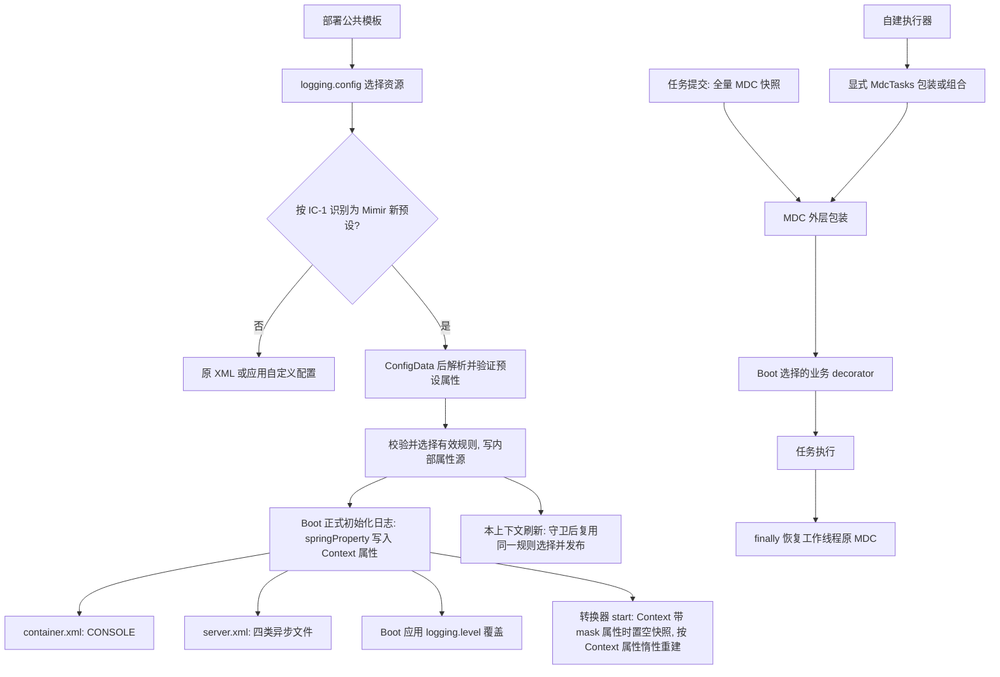

# Log 日志预设与任务上下文设计

## Context

本设计承接 [spec](./spec.md) 的六项行为，基线为 Java 17 / Boot 3.3.13 / Spring 6.1.21 / Logback 1.5.18。具体配置名、默认值和实现选择均为本轮推荐草案，尚未实施，不将其追加为用户确认的版本决定。

当前事实：Starter classpath 根的 `logback-spring.xml` 已自动生效；prod root 为 WARN，访问与 SQL 日志只进文件；滚动和异步参数写死。`LogMaskAutoConfiguration.transferConfig` 在 `ContextRefreshedEvent` 发布规则，转换器用静态快照和首个 Logback Context 引用。`MdcUtil` 仅封装 MDC 操作，没有任务传播实现。

对应版本依赖源码已在本地核对：

- Boot `LoggingApplicationListener.initialize` 先加载 `logging.config`，后设置 `logging.level.*`；默认监听顺序是最高优先级 +20。
- ConfigData 的 EnvironmentPostProcessor 顺序是最高优先级 +10，适合在 ConfigData 后、日志正式初始化前处理新预设默认值。
- `SpringApplication.prepareEnvironment` 在环境准备事件结束后调用 `DefaultPropertiesPropertySource.moveToEnd`。本设计在早期读取预设和脱敏属性前做相同归位，使早期绑定与刷新绑定的默认源优先级一致；保留已有源及全部键值。四组缺省规则在选择有效列表时确定，不写入 Environment。
- `SensitiveDataConverter` 继承 Logback `ClassicConverter`；原 `LogMaskAutoConfiguration` 有 `@ConditionalOnClass` 保护，spring.factories 的 EPP/监听器没有该保护。早期入口必须先完成类存在性及 Boot 后端选择检查，再加载转换器桥接代码。
- `TaskExecutorConfigurations` 的默认平台执行器在无任何 `Executor` Bean 时创建，别名为 `applicationTaskExecutor`、`taskExecutor`；优先使用唯一的 `ThreadPoolTaskExecutorBuilder`，否则使用旧 `TaskExecutorBuilder`。
- 两种 Builder 均支持 `configure(T extends ThreadPoolTaskExecutor)`，先设置 decorator 再执行 customizers；新 Builder 还适配旧 `TaskExecutorCustomizer`。所有路径都经公开 `setTaskDecorator(TaskDecorator)`，无需反射。
- Builder 用 `ObjectProvider<TaskDecorator>.getIfUnique()` 选择业务装饰器。新增普通 Mimir `TaskDecorator` Bean 会污染这一选择。
- （D-101 前现状依据，结论已由 IC-4 修订替代）Boot `LoggingApplicationListener` 收到 `ApplicationFailedEvent` 会清理日志系统，不以 Mimir 启动令牌判断所有权；Logback 清理移除初始化标记，后续 SpringApplication 可重置共享 LoggerContext。活跃子上下文发布的失败事件还会向父上下文传播，仅移除子应用自己的日志监听器不足以隔离该路径。
- （审查补充）`SpringApplication.handleRunFailure` 先 `listeners.failed` 发布 ApplicationFailedEvent，再在 finally 中 `reportFailure` 输出“Application run failed”及完整堆栈，随后关闭上下文；`ContextClosedEvent` 也早于 Bean 销毁回调发布。`SensitiveDataConverter` 快照为空时经 `readConfiguration` 读取 Context 属性，Context 引用为空则回退系统属性（`SensitiveDataConverter.java:183-192`（main 分支 2.3.0 行号））。若在这两个事件中清空快照或 Context 引用，失败堆栈与关闭阶段日志会以空规则输出。
- （D-101 前现状依据，结论已由 IC-4 修订替代）（审查补充）公开的 `addCustomPattern` / `reloadConfig`（`SensitiveDataConverter.java:72-91`（main 分支 2.3.0 行号））只把快照置空，下一次转换从 LoggerContext 属性重建；该属性当前只在刷新时由 `LogMaskAutoConfiguration` 写入，且 Boot 日志初始化会重置 LoggerContext。Bean 创建期调用这两个入口会丢失 EPP 发布的四组缺省规则。
- （D-101 前现状依据，结论已由 IC-4 修订替代）（审查补充）快照为空时 `currentConfiguration` 在锁内按 Context 属性/系统属性重建并写回快照（`SensitiveDataConverter.java:113-121`（main 分支 2.3.0 行号））。若 EPP 在取得令牌后先置空快照、到发布时才写入，其间其他线程的日志会以系统属性构建的空规则写入快照，形成“空快照窗口”。
- （审查补充）spring-cloud-context 4.1.6 的 spring.factories 无条件注册 `LoggingSystemShutdownListener`（`ApplicationEnvironmentPreparedEvent`，最高优先级 +6），对每个 SpringApplication 都执行 `LoggingSystem.cleanUp()` 与 `beforeInitialize()`，与 bootstrap 是否开启无关；`spring-cloud-starter-openfeign` 经 `spring-cloud-starter` 传递引入该模块，Mimir Feign Starter 的消费者因此默认受影响。`BootstrapApplicationListener` 构建 bootstrap Environment 时把主 Environment 当时全部非 Stub 属性源（命令行、系统属性、环境变量及应用默认属性等）追加到 `bootstrap` 源之后，这些源中的 `logging.config` 对 bootstrap 应用可见。Boot `LogbackLoggingSystem.initialize` 仅以初始化标记决定是否跳过加载，`LoggingApplicationListener.initializeFinalLoggingLevels` 不受该标记限制；Logback 配置出现状态错误时 Boot 抛 `IllegalStateException` 终止启动。
- （D-100 依据）spring-cloud-context 4.1.6（Spring Cloud 2023.0.6 BOM 管理版本）在 `spring.cloud.bootstrap.enabled=true`、`spring.config.use-legacy-processing=true` 或存在 `spring-cloud-starter-bootstrap` 标记类时，由 `BootstrapApplicationListener`（`ApplicationEnvironmentPreparedEvent`，最高优先级 +5）同步运行一个 bootstrap SpringApplication：其 Environment 以名为 `bootstrap`（`BOOTSTRAP_PROPERTY_SOURCE_NAME`）的属性源置首，并设置 `spring.config.name` 为 `${spring.cloud.bootstrap.name:bootstrap}`，该源在 `builder.run()` 返回后才移除；此时主应用的 ConfigData（最高优先级 +10）尚未执行，bootstrap 应用看不到 `application.yml` 中的 `logging.config` 与 mask 配置。正常启动时 bootstrap 应用使用 spring.factories 的全部监听器（含 Boot `LoggingApplicationListener`）；仅在环境含 `refreshArgs`（`LegacyContextRefresher` 运行期刷新）时由 `filterListeners` 去掉 `LoggingApplicationListener` 与 `LoggingSystemShutdownListener`。两种路径都会执行 Mimir 的 EPP。随后主应用的 `LoggingSystemShutdownListener`（+6）执行 `cleanUp` 移除 Logback 初始化标记并 `beforeInitialize`，主应用 `LoggingApplicationListener`（+20）重新初始化（`stopAndReset` 会清空 LoggerContext 属性）。bootstrap 上下文经 `AncestorInitializer` 成为主上下文的父上下文。

上述是源码静态证据，不等于已跑通应用。模块入口见[讨论中的现状依据](./brainstorm.md#现状与依据)，实现阶段须验证下文条件顺序和早期日志。

## Goal

- 两个明确可选预设，未选择时 0 个新输出默认值；容器每事件标准输出 1 次，服务器按四类文件分流。
- 新预设默认四组脱敏覆盖日志正式初始化后、Bean 创建期与上下文刷新后 3 个阶段。
- 默认业务执行器传播 100% 的 MDC Map 条目，正常、异常、空上下文和嵌套任务退出时均恢复原 Map。

## Non-Goal

- 不引入完整 JSON 编码器、日志采样、逐路径访问阈值、日志采集代理或新 tracing 体系。
- 不自动配置所有用户执行器、虚拟线程执行器、调度器、原生线程和第三方线程池；不接管用户自定义 `logging.config`。
- 不为同一类加载器中的独立子 SpringApplication 协调 Boot 全局日志初始化、失败清理或重试；父子保障限于不另启 Boot 日志生命周期的普通子上下文。不同配置的多 LoggerContext、并行独立应用同样不在范围内。
- 不修改 SQL 日志生产开关与结构，不增加 Log → MyBatis 或 MyBatis → Log 运行时依赖；本轮不执行产品代码修改、部署或发版。

## Architecture



运行时代码全部位于 `mimir-boot-starter-log`。选用独立 XML 而不新增 `mimir...preset` 枚举；部署公共模板直接指定资源，应用的显式 `logging.config` 继续受 Spring Environment 优先级控制。

## Interface Contract

### IC-1 选择日志预设并保持旧接入兼容

新增资源：`classpath:com/yggdrasil/labs/log/logback/container.xml`、`classpath:com/yggdrasil/labs/log/logback/server.xml`，共享格式与转换规则放入同目录 `common.xml`，以 `<included>` 为根。原 `src/main/resources/logback-spring.xml` 保持原输出和参数，不把新默认值抽入旧 XML。

部署示例：`logging.config=classpath:com/yggdrasil/labs/log/logback/container.xml`；服务器模板换为 `.../server.xml`。不设置该值仍走原选择规则。资源不存在沿用 Boot 启动失败，不提供 Mimir 自动回退。

新预设识别仅接受两个 classpath 位置。（审查修订）识别与 Boot 实际加载同一资源的写法对齐，只做最小规范化：以 `environment.getProperty("logging.config")` 读取（与 Boot 一样解析占位符），按 Boot `LoggingApplicationListener` 的做法用 `String.strip()` 去除首尾空白；随后必须以大小写敏感的 `classpath:` 前缀开头，去掉前缀后再去掉紧随其后的一个前导 `/`（与 `ClassPathResource` 的路径处理一致），与 `com/yggdrasil/labs/log/logback/container.xml` / `server.xml` 精确比较。因此 `classpath:/com/...`、`classpath:com/...` 及带首尾空白的写法识别为同一预设（Boot 加载时指向同一资源，若只做原始字符串比较会“资源正常加载但静默缺失缺省规则”）。不带前缀的 `/com/...` 或相对路径 `com/...`、大小写不同的 `CLASSPATH:com/...` 不识别：Spring `DefaultResourceLoader` 仅对大小写敏感的 `classpath:` 走类路径，其余无协议写法经 `ApplicationResourceLoader.getResourceByPath` 解析为文件系统资源，并非这两个预设。同样不接受 `classpath*:`、`file:`、URL 或其他路径变体；复制 XML、自定义 file/URL、其他 classpath XML 均不自动启用四组缺省规则。

（审查推荐）未识别时不静默：`logging.config` 非空、未被识别，但规范化后的位置以 `com/yggdrasil/labs/log/logback/container.xml` 或 `server.xml` 结尾（含上述大小写、缺前缀、`classpath*:`、`file:` 变体）时，EPP 输出一条 INFO，说明该位置未被识别为 Mimir 预设、四组缺省规则与预设参数未启用，并给出两个标准写法；不回显配置值，不改变加载结果。该检查只做一次字符串比较、不访问资源、不依赖 Logback 类，经 Boot 注入 EPP 构造器的 `DeferredLogFactory` 记录，由 Boot 在日志正式初始化后回放；其他任意文件名（如复制后改名的 XML）不提示。（审查修订）输出时机固定：在 IC-4 步骤 1 的 legacy bootstrap 排除与默认源归位、读取 `logging.config` 之后，Logback 类及 Boot 后端检查之前；与实际后端是否为 Logback 无关。未识别位置不属于新预设，后端检查只会无状态退出，提示不因后端不同而缺失；bootstrap 应用直接返回，不输出该提示，避免重复。自定义 XML 可复用现有转换器和显式 mask 属性，但不能据此承诺本设计的启动期默认规则。

未选择新预设且未使用 Logback 时，早期预设入口直接退出，不影响原后端启动或独立的 MDC 能力。显式选择两个 Logback XML 之一但缺少 Logback、Boot 选择其他后端或禁用日志系统时，EPP 在装载 XML 前明确报错；不隐式切换后端。

### IC-2 路由业务、访问与 SQL 日志

两个新预设的 root 在所有 profile 默认 INFO；仅 `prod | produce | production` 激活 13 个 WARN 前缀：`org.springframework`、`org.apache`、`com.alibaba`、`com.baomidou`、`org.mybatis`、`com.zaxxer`、`com.mysql`、`org.postgresql`、`org.hibernate`、`io.netty`、`io.lettuce`、`redis.clients`、`org.reflections`。不复制旧 XML 的三个 Spring 子 logger INFO 例外，不重复 `io.lettuce.core`。

| Logger / 事件 | 容器预设 | 服务器预设 | 默认级别与继承 |
|---|---|---|---|
| 普通业务，包括 com.yggdrasil.labs | CONSOLE | info.log；ERROR 再归档至 error.log | 继承 root，不另设组织包等级 |
| access.log | CONSOLE | access.log | INFO，additivity=false |
| SQL.JSON | CONSOLE | sql.log | INFO，additivity=false |
| SQL.SLOW | CONSOLE | sql.log | WARN，additivity=false |

容器 XML 完全不声明 RollingFileAppender，也不使用 Boot file appender include；服务器 XML 不声明 ConsoleAppender。info.log 接收经 logger 级别筛选的全部普通业务事件；文件名沿用 info.log，但不再用 INFO appender 过滤器阻止显式 DEBUG 覆盖。error.log 保留 ERROR LevelFilter。专用 access/SQL Logger 不再向 root 累加；其 ERROR 也只进各自专用文件，避免跨分类复制。

格式复用现有 UTF-8 文本、traceId/spanId 与 `%mask` / `%maskThrowable`。`SQL.SLOW` 与 `SQL.JSON` 共用 sql.log，不新建慢 SQL 文件；慢 SQL 的原文保护由 MyBatis 自身完成。仅声明 Logger 不启用 SQL 生产者；后续 MyBatis 实现与本路由约定对齐。

### IC-3 调整滚动、队列与级别

推荐的公共配置契约如下；这些新增项仅对两个新预设生效。属性采用 kebab-case，Spring relaxed binding 保留现有 camelCase mask 写法。

| 属性 | 类型 | 推荐默认值 | 有效范围 / 覆盖 |
|---|---|---|---|
| `logging.config` | String 资源位置 | 不新增默认值 | 两个资源选择预设；其他资源由应用负责 |
| `logging.level.*` | Boot LogLevel | root INFO；专用与第三方见上文 | Boot 在 XML 后覆盖，同名及更具体 Logger 按 Boot/Logback 继承规则生效 |
| `LOG_PATH` | 既有路径变量 | `logs` | 服务器目录仍为 `${LOG_PATH}/${spring.application.name:application}`；不新增同义路径属性 |
| `mimir.boot.log.file.max-size` | DataSize | `100MB` | 服务器四类单文件上限，1MB–1GB，含两端 |
| `mimir.boot.log.file.max-history` | int | `30` | info/access/sql 保留天数，1–3650 |
| `mimir.boot.log.file.total-size-cap` | DataSize | `10GB` | info/access/sql 各自总量，不是三者合计；max-size–10TB |
| `mimir.boot.log.file.error-max-history` | int | `60` | error 保留天数，1–3650 |
| `mimir.boot.log.file.error-total-size-cap` | DataSize | `5GB` | error 总量；max-size–10TB |
| `mimir.boot.log.async.queue-size` | int | `1024` | 服务器四个异步队列各自容量，1–1048576；共四份容量 |
| `mimir.boot.log.async.never-block` | boolean | `false` | 服务器队列满时等待；true 时所有等级均可能丢弃 |
| `mimir.boot.log.async.max-flush-time` | Duration | `1s` | 服务器每个 appender 的停止排空等待，1ms–60s，转换为 Logback 毫秒值 |
| `mimir.boot.log.mask.enabled-patterns` | List<String> | 新预设四组；原配置仍为 `[]` | 缺省取四组；显式列表整体替换，显式空列表关闭预置规则 |
| `mimir.boot.log.mask.custom-patterns` | List<String> | `[]` | 与预置规则相加；使用 Binder 绑定原始列表，不通过逗号重分隔正则 |
| `mimir.boot.log.mask.replacement` | String | `****` | 未设置或空字符串均沿用原转换器的 `****` 回退，不作为启动错误；非空值原样使用 |
| `mimir.boot.log.mdc.enabled` | boolean | `false` | 控制默认平台执行器适配；独立于日志预设选择，未配置或 false 完全让回 Boot 默认执行器（第三轮审查改为默认关闭，避免静默改变既有 `@Async` 行为） |

DataSize 接受带单位字节值，使用其字节数进行范围和大小关系校验，再转为 Logback 可接受的数值字节字符串；不把 Boot `MB/GB` 的输入单位原样猜测传给另一解析器。Duration 转为毫秒，拒绝小于 1ms 的有效值。容器对文件/异步参数不绑定、不验证、不创建文件，因此挂载配置中的服务器专用值不会影响容器启动。

推荐保留日志而选择 `discardingThreshold=0`、`neverBlock=false`；该策略没有业务延迟上界，输出端持续阻塞时业务也可能等待。显式 `never-block=true` 是延迟优先选项，连 ERROR 也可能丢失。每个 appender 的停机等待默认 1 秒，不保证 4 个队列在进程强杀或输出阻塞时全部排空。新 XML 不使用 NopStatusListener 隐藏后端故障；依赖 Logback 的状态错误输出，诊断不得回显业务日志或秘密。

### IC-4 从日志正式初始化起执行凭据字段脱敏

（D-101 修订，2026-11-02）早期规则改由 Logback 配置自身携带：EPP 只负责校验与选择有效规则，并写入内部属性源；预设 XML 用 `<springProperty scope="context">` 把规则写入 LoggerContext 属性，转换器按既有惰性路径读取。规则切换与 Logback 重新加载同步。原“启动所有权令牌 + 启动期规则缓存 + 生命周期监听器”方案不再采用，取舍见 [Alternatives Considered](#alternatives-considered)。

**组件**

| 组件 | 职责 | 注册 |
|---|---|---|
| `LogPresetEnvironmentPostProcessor` | 识别预设、后端检查、严格校验、选择有效规则、生成内部源；不触碰转换器静态状态 | `META-INF/spring.factories` 的 `EnvironmentPostProcessor`，`Ordered.LOWEST_PRECEDENCE` |
| `common.xml` 中三条 mask `<springProperty scope="context">` | 日志初始化时把内部键写入 LoggerContext 属性 `mimir.boot.log.mask.enabledPatterns` / `customPatterns` / `replacement` | 随两个预设 XML 加载 |
| `SensitiveDataConverter.start()` | 绑定 SLF4J 当前 LoggerContext（或首次绑定）、且该 Context 已带 mask 属性时置空规则快照，下一次转换按新 Context 属性重建 | Logback 配置加载时调用 |
| `LogMaskAutoConfiguration.transferConfig` | 上下文刷新时按同一选择逻辑写 LoggerContext 属性并原子发布快照 | 既有自动配置 |

删除 `LogPresetOwnership`、`LogPresetBootstrapListener`、`LogbackMaskBootstrap` 及 spring.factories 中的监听器条目；转换器删除启动期规则缓存及其内部入口。列表编码/拆分迁至不依赖 Logback 的 `MaskListCodec`（converter 包）：`static String join(List<String>)` 对 null 或空列表返回 null、其余与本轮已实现的无损编码相同（即迁出现有 `joinListProperty`，语义不变）；`static List<String> split(String)` 语义不变。`LogMaskAutoConfiguration` 写 LoggerContext 属性时直接使用 join 结果，空列表仍写 null，与 2.3.0 一致；EPP 写内部键时把 null 转为空字符串（否则 `springProperty` 取 `defaultValue`，显式空列表会变回四组）；转换器、EPP 与 `LogMaskAutoConfiguration` 共用；`SensitiveDataConverterInternals` 仅保留测试钩子。无条件注册的 EPP 仍不得在字段、签名、静态初始化中引用 Logback 或转换器类型；mask 内部键只在后端检查通过的分支生成。

**EPP 顺序**（不承诺其他扩展在本 EPP 之后修改 Environment 时的一致性）

1. Environment 含名为 `bootstrap` 的属性源时，先移除其中的 `mimirLogPresetResolved`（复用 Environment 时 `BootstrapApplicationListener` 早于本 EPP 把上一轮残留内部源复制进来），再立即返回（D-100，判定方式不变）。bootstrap Environment 因此不含内部源，经 `AncestorInitializer` 合并回主 Environment 时也不会带回残留。
2. `DefaultPropertiesPropertySource.moveToEnd(environment)`；移除已存在的 `mimirLogPresetResolved` 源，避免复用 Environment 的顺序启动残留上一轮内部值。
3. 读取 `logging.config`，按 IC-1 识别；未识别但以预设文件名结尾时输出一条 INFO（不变）。
4. Logback 类与 Boot 后端检查（不变）：不满足时未选预设返回、选中预设抛不含值的 `IllegalStateException`。
5. 未选预设：返回。旧配置的早期规则恢复为 2.3.0 语义，即日志初始化后按 LoggerContext 属性/系统属性惰性读取，刷新时由 `transferConfig` 发布；不再提前发布（删除 `publishLegacy`）。
6. 选中预设：
   - 启用列表：`Binder.bind("mimir.boot.log.mask.enabled-patterns", Bindable.listOf(String.class))` 已绑定则原样使用（含空列表、空字符串、索引、relaxed 写法），未绑定取四组；绑定错误按非法配置处理。
   - 对启用名、自定义正则与服务器数值严格校验，失败抛不含值的 `IllegalStateException`（属性名 + 序号），全部校验先于任何写入。（D-101 新增）`custom-patterns` 元素或 `replacement` 经 Binder 宽松解析后仍含 `${`（即存在无法解析的占位符）时同样报错（列表报属性名 + 序号，`replacement` 只报属性名）；可解析的占位符已被替换，与刷新阶段绑定结果一致。原因：该值经 `springProperty` 读取时会被严格占位符解析，Spring 6.1 无转义，失败诊断会回显原文。
   - 选中任一预设时必定以 `addFirst` 写入 `mimirLogPresetResolved`（内容可为空 Map），该源的存在即“本 Environment 选择了预设”的标记，供刷新守卫使用：服务器 8 个数值内部键（IC-3，由 `LogPresetProperties` 生成，不变）；mask 内部键由 EPP 在后端检查通过后的独立方法生成，容器与服务器共用，仅在用户对应属性已绑定时写入——`enabled-patterns` / `custom-patterns` 经 `MaskListCodec` 编码（顶层逗号转义），已绑定的空列表写空字符串而非 null；`replacement` 原样写入。未绑定时不写，由 XML `defaultValue` 兜底，因此四组缺省规则不写入 Environment（与 Context 中“直接选择有效列表”的约定一致）。容器预设不写数值键。

**XML 与转换器**

- `common.xml` 声明三条 mask `springProperty`（`springProperty` 在 Logback 第一阶段处理、appender 在第二阶段，因此声明位置不影响先后，放在开头只为可读），`source` 为上述内部键；`defaultValue` 分别为 `password,token,secret,api_key`、空字符串、空字符串。内部源缺失时（legacy bootstrap 应用经系统属性/环境变量加载预设、非 EPP 路径）仍以四组缺省保护。其余 8 个数值 `springProperty` 的 `defaultValue` 要求不变。
- Context 属性为空字符串时，转换器按既有逻辑回退同名 camelCase 系统属性（`mimir.boot.log.mask.enabledPatterns` / `customPatterns` / `replacement`，仅精确键），再回退空规则或 `****`。刷新阶段 `publishConfiguration` 直接发布绑定值，不读系统属性。因此显式空列表（或空替换串）与对应系统属性同时存在时，刷新前及之后 `reloadConfig` 可能使用系统属性规则，刷新发布后为空列表；README 说明，测试须清理该系统属性。
- `springProperty` 经 `Environment.getProperty` 读取内部键时会严格解析占位符，因此 EPP 拒绝含 `${` 的自定义正则与替换串（见步骤 6）；需要匹配字面 `${` 时写作 `\$\{`，README 说明。
- `start()`：`getContext()` 为 SLF4J 当前 LoggerContext（或全局引用为空的首次绑定）时重绑引用；此时若该 Context 的 `mimir.boot.log.mask.enabledPatterns`、`customPatterns`、`replacement` 任一属性值非 null，在 `CONFIGURATION_LOCK` 内置空快照，否则保留快照（D-101 F2 决定，2026-11-03 用户选择）。其他 Context 不改变引用与快照。预设 XML 的 `springProperty` 总会写入这三项，因此预设每次（重新）加载都会切换到新 Context 属性；先经 `LoggerContext.reset()` 清空属性再重载的旧 XML（Boot 重新初始化、`scan=true` 重扫）不带这些属性，保留已发布快照，与 2.3.0 一致。未经 reset 的 `start()`（如运行期新建 `%mask` layout）在刷新后会看到 `transferConfig` 写入的属性（`replacement` 恒非 null）而置空，按 Context 属性重建，结果通常与刷新发布相同；刷新后直接调用 `publishConfiguration` 发布的不同规则此时可能被覆盖，属既有公开入口的边界，README 说明。同一配置中多个转换器重复置空是幂等的。
- 重载过程不产生以空规则输出的事件，依据：Boot `beforeInitialize` 加入拒绝过滤器；`stopAndReset` 中 `LoggerContext.reset()` 会清空该过滤器，但此刻已无挂载的 appender，随后 `withLoggingSuppressed` 重新加入并在配置期间拒绝全部事件；`stopAndReset` 清空 Context 属性后，新配置的 `springProperty`（第一阶段）先于 appender/转换器 `start()`（第二阶段）求值。Boot 拒绝期间的事件被丢弃而非脱敏输出，spec 的并发场景按“任何已输出行均不含明文”验收。

**刷新**：`transferConfig` 依次判定：

1. 非本上下文自身的刷新事件：返回。
2. Environment 含 `bootstrap` 源：返回（D-100）。
3. 上下文有父，且父 Environment 含 `mimirLogPresetResolved`：返回。预设应用的普通子上下文不覆盖父规则；子 Environment 经 `merge` 把父源追加在自身系统属性源之后，优先级可能倒置，不能依赖“选择结果与父相同”。legacy bootstrap 主上下文的父为 bootstrap 上下文，其 Environment 已由步骤 1 清除内部源，不受影响；不以上下文 id 判断（`spring.application.name=bootstrap` 的普通应用 id 也是 `bootstrap`）；旧配置父应用的子上下文保持 2.3.0 的“最后刷新者发布”。
4. 其余：按“预设用步骤 6 的选择、旧配置用注入的 `LogMaskProperties`”写 LoggerContext 属性（列表经 `MaskListCodec` 编码）并发布快照。不再区分所有者，独立应用之间为“最后刷新者发布”。

**生命周期结果**

| 场景 | 结果 |
|---|---|
| 日志初始化后、Bean 创建期、刷新后 | 预设三阶段均为本次有效规则：前两阶段来自 Context 属性惰性构建，刷新后为发布快照，两者输入相同 |
| Bean 创建期 `reloadConfig` / `addCustomPattern` | 置空快照后按 Context 属性重建，四组缺省保留，编程式规则叠加；无需启动期缓存 |
| 启动失败堆栈、关闭阶段日志 | 不再有释放动作，快照与 Context 属性保持本次规则 |
| 预设校验失败 | EPP 抛出，XML 不加载，进程中已生效的规则保持不变 |
| 顺序启动（含复用 Environment） | EPP 已移除上一轮内部源。下一应用为预设：加载 XML 时 `start()` 置空快照，三阶段均为自身规则。下一应用为旧配置：Boot 重新初始化已清空 Context 属性，旧 XML 不带 mask 属性，快照保留，刷新前沿用上一应用规则，刷新发布后为自身规则，与 2.3.0 一致（main 分支 `start()` 从不置空快照） |
| 同一 JVM 多个存活应用（测试上下文缓存），无 spring-cloud-context | Boot 因已初始化跳过 XML 重载：后者 EPP 的绑定与严格校验生效，但其内部源不被读取，输出出口与 file/async 参数沿用首个应用；后者刷新后发布自身规则，进程内最后刷新者生效 |
| 同一 JVM 多个存活应用，含 spring-cloud-context | 后者按自身 XML 与内部源重新加载输出（参数生效），`start()` 切换为其规则；刷新后发布，最后刷新者生效 |
| 预设应用的普通子上下文 | 刷新守卫第 3 条返回；子刷新、失败或关闭不改变父规则 |
| 运行期 legacy 刷新（`LegacyContextRefresher`） | 临时应用只注册 bootstrap 相关监听器，不加载 spring.factories 中的本 EPP；嵌套 bootstrap 应用中本 EPP 在步骤 1 返回。规则不变 |
| 运行期配置刷新（`ConfigDataContextRefresher` 以原 SpringApplication 调用 EPP） | EPP 在副本 Environment 上完整执行，刷新器随后把非标准源（含 `mimirLogPresetResolved`）替换回 live Environment；未识别提示可能再次输出。运行期没有组件重读内部键，刷新不发布 `ContextRefreshedEvent`，转换器规则不变。刷新配置中的预设非法值使该次刷新失败，不影响运行中的规则 |
| Spring Cloud legacy bootstrap（D-100） | bootstrap 应用 EPP 返回；若其加载预设 XML，mask 取 `defaultValue` 四组；主应用重新加载 XML 后切换为主应用规则，主上下文刷新发布 |

保护起点外：`ApplicationStartingEvent`、ConfigData 自身日志、日志正式初始化前输出。共享 XML 不启用 `scan=true`。对象、数组和原始错误流边界见 [README](../../../../mimir-boot-starters/mimir-boot-starter-log/README.md#敏感信息脱敏)。独立子 SpringApplication 仍不作为受支持方式。

**已验证依据**：2026-11-02 一次性验证（未保留脚本）以真实 `SpringApplication` 加载带 `springProperty` 的容器 XML，排除 EPP 快照干扰后，无配置、逗号串、空字符串、camelCase 写法在三阶段均得到预期规则；带索引的列表写法直接读取用户键时失效，因此 EPP 必须先绑定再写内部键。Spring Cloud bootstrap、多应用缓存与服务器参数路径尚未在新机制下验证，由 Plan 验收覆盖。

#### 无内部源加载预设 XML

legacy bootstrap 应用或其他未经本 EPP 的 Environment 加载预设 XML 时，8 个数值键与 3 个 mask 键全部取 `defaultValue`：XML 可加载，文件/队列参数为 IC-3 默认，脱敏为四组缺省。资源测试逐项核对 `defaultValue` 与 IC-3 默认值一致。

### IC-5 默认业务任务传递完整日志上下文

公开入口位于 `com.yggdrasil.labs.log.task`：

```java
public final class MdcTaskDecorator implements TaskDecorator {
    public Runnable decorate(Runnable runnable);
}
public final class MdcTasks {
    public static Runnable wrap(Runnable task);
    public static <T> Callable<T> wrap(Callable<T> task);
    public static TaskDecorator compose(TaskDecorator businessDecorator);
}
```

`wrap`、`decorate` 输入任务不能为 null，违反时抛 `IllegalArgumentException`；`compose(null)` 返回仅 MDC 的装饰器。Runnable 原异常直接传播，Callable 结果与原 checked exception 保留；不引入错误码。`wrap` 调用 / `decorate` 调用时取 `MDC.getCopyOfContextMap()`，复制为不可变私有快照，不按 traceId 等白名单筛选。统一入口应在每次提交处调用；重用旧包装任务也重用其旧快照，不被宣传为重新捕获。

执行时先保存工作线程全量 Map；快照为空调用 `MDC.clear()`，否则整体 `MDC.setContextMap(snapshot)`；在 `finally` 清理任务修改并整体恢复原 Map，原为空则 clear。不使用 `MdcUtil.putAll`，其空 Map 分支不会清空旧值。拒绝发生在包装后但执行前时没有工作线程修改；caller-runs 和嵌套执行按同一栈式规则恢复。

`compose(business)` 的语义是先得到业务包装结果，再将 MDC 包装放在最外层：`mdc.decorate(business.decorate(task))`。业务 before/after 代码在传播上下文内执行，但业务有意改写 MDC 时按业务逻辑生效；本能力保证最外层最终恢复。对直接重复传入同一 Mimir 组合装饰器应保持单层，避免显式 compose 多次形成重复包装；不递归拆解或反射识别用户自定义链。

### IC-6 与业务执行器扩展协作

（实施修订，2026-11-02 整体审查）旧 `TaskExecutorCustomizer` 方案会作用于 Builder 的每一次 `build()`，在业务复用 Boot Builder 并显式设置 `taskDecorator` 自建线程池时覆盖其装饰器，且无法读取已设置值以组合。实现改为仅作用于 Bean `applicationTaskExecutor` 的 `BeanPostProcessor`：在其初始化前按 `getIfUnique()` 选择业务装饰器并 `MdcTasks.compose`；存在任何其他新/旧执行器定制器时同样输出一条 INFO 并退让。自动配置条件、候选选择、退让与虚拟线程提示均不变；下文关于“注册旧 TaskExecutorCustomizer”的描述以此为准。

通过 Boot Builder 的 customizer 接入，只增强没有其他执行器定制器的默认路径，保留 Boot 原有业务装饰器选择：

- `MdcTaskExecutionAutoConfiguration` 使用 `@AutoConfiguration(before=TaskExecutionAutoConfiguration.class)`。相关任务类存在、`mdc.enabled=true`、平台线程模式且不存在用户声明的 `Executor`、`ThreadPoolTaskExecutorBuilder` 或 `TaskExecutorBuilder` Bean 时，注册一个内部 `MdcTaskExecutorCustomizer`。用户已声明任意 Executor 或上述任一 Builder 时自动退出，由其显式 compose；不按 bean 名猜测用户线程池，并保留原执行器创建流程。
- 适配器只实现 Boot 3.3.13 仍支持的旧 `org.springframework.boot.task.TaskExecutorCustomizer`，签名为 `void customize(ThreadPoolTaskExecutor taskExecutor)`；现代 Builder 已适配旧接口，因此不再注册第二个现代 customizer。无需实现 Ordered 或要求业务调整 order。旧接口仅作内部版本适配，不作为新增公共 API；升级 Boot 时重新核对。
- **先退让，再组合**：在 customize 实际执行时，通过容器的 ObjectProvider 检查是否存在本适配器之外的 `TaskExecutorCustomizer` 或任何 `ThreadPoolTaskExecutorCustomizer`，包括业务及其他自动配置提供的 Bean。排除本适配器自身，发现任一其他定制器即输出下述退让 INFO 后返回，不调用 setTaskDecorator，不改变其顺序或配置。检查发生在 Builder 配置执行器时，不能仅凭较早的自动配置注册顺序判断没有其他定制器。即使其他定制器只调整线程池参数，也保守退出，不分析其实现、不读取执行器私有字段。（审查补充）退让时输出一条 INFO，说明默认执行器未自动接入 MDC 传播、其他定制器的数量与类名（不含配置值），并提示使用 `MdcTasks.compose(existing)` 显式接入；每次 customize 调用最多一条，不升级为 WARN，避免静默失去传播。
- 无其他定制器时，使用与 Boot 相同的 `ObjectProvider<TaskDecorator>.getIfUnique()` 选择业务 decorator，然后调用 `taskExecutor.setTaskDecorator(MdcTasks.compose(selected))`。无候选时仅安装 MDC；唯一候选或多个 Bean 中有唯一 `@Primary` 时只组合被选中的一个；多个 Bean 且无唯一候选时仅安装 MDC，不执行任何业务 decorator。不能使用 orderedStream 自动组装全部业务 Bean，也不改变 Boot 对冲突候选的原有处理。
- Mimir 不注册普通 `TaskDecorator` Bean。被选中 decorator 的 decorate 失败沿原提交路径传播；进入执行后 MDC 外层 finally 恢复。需要多个业务 decorator 联合执行时，由下游提供一个明确的组合 decorator，或在自己的 customizer 中调用 `MdcTasks.compose(existing)`；该 customizer 的存在已使自动路径退让，无需额外关闭开关。
- 用户自建 Executor 或 Builder Bean 使自动配置退出；即使自定义 Builder 最终被 Boot 用来创建默认 Executor，也不承诺它消费本适配器。自定义 Builder 须由接入方显式配置 `MdcTasks.compose(existing)`，不反射或重写 Builder。通过原生构造器创建的执行器不受影响。没有用户 Executor Bean、但运行期主动复用 Boot Builder 创建其他线程池时，该 Builder 的 customizer 也会应用，这是 Builder 扩展本身的范围；接入方应显式构造/选择自有 customizer 链并 compose，不承诺 Builder 产物仅有默认执行器一个。选定 MDC 方式后避免再手动 wrap 同一任务。
- `mdc.enabled=false` 或虚拟线程模式不注册适配器；（审查补充）`mdc.enabled=true` 且因虚拟线程模式未接入时，同样在启动期输出一条 INFO 说明默认执行器未自动传播 MDC，显式关闭时不输出。适配器在该模式下不存在，因此由同一自动配置内一个仅在虚拟线程模式（`@ConditionalOnThreading(Threading.VIRTUAL)`）、`mdc.enabled=true` 且无用户 Executor 时生效的小型内部组件在单例初始化完成后输出这一条 INFO，不创建执行器、不注册 TaskDecorator；用户排除 `TaskExecutionAutoConfiguration` 时本适配器不会自行创建 Builder/Executor，也不会要求不存在的 Builder。统一手动入口始终可用。自定义 `AsyncConfigurer`、具名 `@Async` 只有选中受支持执行器才覆盖；不能宣称所有 `@Async` 均已传播。

默认执行器实例、名称/别名、lazy 和生命周期完全由 Boot 创建管理。验收重点为原候选选择不变、存在其他新/旧 customizer 时不改写装饰器，以及显式 compose 可用。README 明确保守退让范围及退让/虚拟线程未接入时的 INFO 诊断；不增加全量业务链编排或 customizer 排序要求。

## Data Model

不新增持久化模型。新增内部 `LogPresetProperties` 分组承载 file/async 数值；（D-101）内部属性源 `mimirLogPresetResolved` 只由 EPP 生成、`addFirst`，不是用户配置入口。服务器数值键沿用初版：`mimir.boot.log.internal.file.max-size-bytes`、`max-history`、`total-size-cap-bytes`、`error-max-history`、`error-total-size-cap-bytes`（同一 file 前缀），`mimir.boot.log.internal.async.queue-size`、`never-block`、`max-flush-time-millis`（同一 async 前缀）；XML `defaultValue` 依次为 `104857600`、`30`、`10737418240`、`60`、`5368709120`、`1024`、`false`、`1000`。mask 键如下：

| 内部键 | 写入条件 | 值 | XML `defaultValue` → Context 属性 |
|---|---|---|---|
| `mimir.boot.log.internal.mask.enabled-patterns` | 预设且用户启用列表已绑定 | `MaskListCodec` 编码；空列表为空字符串 | `password,token,secret,api_key` → `mimir.boot.log.mask.enabledPatterns` |
| `mimir.boot.log.internal.mask.custom-patterns` | 预设且用户自定义列表已绑定 | 同上 | 空字符串 → `mimir.boot.log.mask.customPatterns` |
| `mimir.boot.log.internal.mask.replacement` | 预设且用户替换串已绑定 | 原样 | 空字符串 → `mimir.boot.log.mask.replacement`（空时转换器回退 `****`） |

`MdcPropagationProperties` 承载 enabled；不改变现有 mask 字段与绑定前缀。预设类型由已选择的资源位置解析为内部 CONTAINER/SERVER，不作为第二套公共选择属性。

每个待执行任务保留提交 Map 的独立副本和执行期间保存的工作线程 Map；空间复杂度 O(k)，k 是全部 MDC 条目数量。脱敏仍以不可变规则快照一次发布，单次转换只读一个代次；不在每条日志中重新编译正则。普通子上下文事件不作为新的独立配置代次来源。（D-101）不维护启动所有权或运行登记等静态状态；规则代次随带 mask 属性的 Logback 配置加载（`start()` 置空快照）与上下文刷新（原子发布）切换，静态状态仅为转换器快照、Context 引用与编程式规则列表。

## Error Handling

| 失败来源 | 推荐行为 |
|---|---|
| 配置位置不存在、XML 解析错误 | Boot 日志初始化失败，启动终止，不回退另一预设 |
| 新预设属性/规则无效（含 D-101 新增的 `${` 检查） | EPP 启动失败，仅报告属性名、索引及合法范围，不回显值 |
| （D-101）运行期配置刷新中预设属性/规则无效 | `ConfigDataContextRefresher`：该次刷新失败、其他属性不更新，诊断同上；`LegacyContextRefresher`（legacy bootstrap）：本 EPP 不在其临时应用中运行，不校验、不失败。两者运行中的规则与输出均不变 |
| （D-101）未经 EPP 写入的内部键含无法解析的占位符 | 正常不会发生（EPP 已拒绝）；若内部源被外部改写，Boot 日志初始化失败，属内部键被滥用，不作兼容承诺 |
| 文件目录无权限、磁盘满等后端可检测错误 | 保留 Logback 实际产生的状态错误；无隐式路由回退，不承诺业务异常或可靠送达 |
| stdout 断开或底层写入失败 | ConsoleAppender 经 System.out 的 PrintStream 输出；PrintStream 可能吞掉 IOException，Logback 因而没有错误状态。不增加主动检测或隐式文件回退；无状态错误不能证明写入成功 |
| 输出长期阻塞、队列满 | 默认等待；显式 never-block 时丢弃可能包括 ERROR；停机超时剩余日志可能丢失 |
| 业务 decorator 或任务抛异常 | 保持执行器原异常/拒绝方式，已进入执行阶段时 MDC finally 恢复 |
| 无 Logback 类、其他后端或禁用 Boot 日志系统 | 未选新预设：早期入口无状态退出；显式选中新预设：在 XML 加载前报配置不兼容。缺类时原自动配置也不装配，不承诺告警；类齐全但实际 ILoggerFactory 非 Logback 时保留原一次告警。MDC 能力仍依赖实际 SLF4J MDC 实现 |

无网络外部服务依赖；输出介质是标准输出与本地文件系统。后端错误状态只能证明其检测到了故障；没有状态错误也不能证明写出或采集成功。本轮不增加 PrintStream.checkError 轮询：其错误标志是流级累积状态，无法直接提供逐事件送达结果。采集成功仍需采集端证据。

## Non-Functional Requirements

| 维度 | 推荐目标 / 边界 |
|---|---|
| 性能 | 依 spec：1KiB 四组命中/未命中分别达到关闭规则吞吐的 ≥80%、P99 ≤125%；至少 3 轮预热，固定 JDK/CPU/堆与输入集，报告各轮和离散程度。（实施补充）对照口径为“PatternLayout(%mask) + 同步文件 appender”的完整链路，按各轮中位数判定：纯转换层面关闭规则时转换器直接返回原文（约 3ns），该对照不具可比性；纯转换、64KiB 与异常栈仅报告数据 |
| 长消息与输出链路 | 64KiB、异常栈、真实控制台/文件、队列满分别测吞吐/P95/P99，不用平均增量替代尾延迟，不外推统一百分比门槛 |
| 并发正确性 | 单线程复用至少 1000 个不同 tenantId/自定义键任务，0 次跨任务残留；规则快照不可部分更新 |
| 安全 | 默认 4 组规则在 3 个受保护阶段均生效；非法规则诊断中规则原文和秘密出现次数为 0 |
| 可用性 | 默认无队列主动丢弃，允许阻塞；每 appender 停机等待默认 1s，不保证强杀/介质故障时交付 |
| 可观测性 | 介质正常时同一出口每事件 1 条；保留后端实际检测到的状态故障输出，stdout 静默失败可能不可见；不增加指标系统依赖或宣称具备丢弃计数 |

## Alternatives Considered

| 方案 | 优点 | 代价 / 未推荐原因 |
|---|---|---|
| logging.config 选择独立 XML（推荐） | 复用 Boot 正式早期入口，旧资源不变，部署显式 | 模板须提供完整资源位置；共享片段避免漂移 |
| 新增预设枚举自动改写 logging.config | 短配置方便 | 新增选择协议与应用自定义 XML 的优先级冲突 |
| 单靠 ContextRefreshedEvent 设置四组默认 | 改动少 | Bean 创建和早期应用日志仍未保护 |
| 将四组缺省规则写入属性源 | 统一从 Environment 读取 | 增加优先级、来源跟踪与清理负担；直接选择有效列表已满足缺省、覆盖和关闭要求 |
| 启动所有权令牌 + 启动期规则缓存 + 生命周期监听器（2.4.0 初版实施，D-101 替换） | EPP 直接发布快照，不依赖 XML 配合 | 约 800 行 JVM 级静态状态；三轮审查的缺陷集中于此：多应用互相阻塞或残留、运行期刷新识别依赖 SpringApplication 身份、校验失败置空全局快照、非所有者跳过校验 |
| 仅用 `springProperty` 读取用户键 | 无需 EPP 写键 | YAML/索引列表无法按原键读取，会静默回落到四组缺省；自定义正则须编码 |
| `start()` 绑定当前 Context 即无条件置空快照 | 顺序启动“新→旧”时旧应用刷新前也严格使用自身规则 | 旧接入者自定义 XML `scan=true` 重扫（先 reset 再重载）后，刷新发布的规则丢失，相对 2.3.0 回退；F2 选择按 Context 是否带 mask 属性置空 |
| 旧 `logback-spring.xml` 同样加入 mask `springProperty`，旧配置早期即按 Spring 属性脱敏 | 旧接入者早期阶段也受保护 | 修改旧资源且超出“旧配置行为与升级前一致”的范围；留待后续需求 |
| 启动令牌自动保护任意子 SpringApplication | 看似无需接入方约束 | 无法拦截 Boot 的全局失败清理；包装 Boot 监听器还需处理事件向父传播、启动顺序和退出。本轮推荐普通子上下文共享父日志，独立生命周期由进程隔离 |
| 默认 never-block=true | 限制满队列等待 | 可能丢 ERROR；本轮推荐保留日志为默认、提供显式取舍 |
| 注册 Mimir TaskDecorator Bean | 实现直观 | 与业务 decorator 竞争，可能使 getIfUnique 失效 |
| 现代 ThreadPoolTaskExecutorCustomizer | 复用 Boot 创建 Bean | 旧 Builder 不消费该接口；推荐使用新/旧 Builder 均消费的单个旧入口 |
| 旧 TaskExecutorCustomizer + 唯一业务候选（推荐） | 新/旧Builder共用入口，不改变 Boot 候选选择；其他 customizer 存在即退让 | 用户定制路径需显式 compose；升级 Boot 须处理废弃接口 |
| 全量业务 decorator 自动组合、依赖最终 setter 覆盖 | 自动接入范围看似更广 | 会执行原未选中 Bean 或覆盖业务装饰器，增加排序规则；不采用 |
| ContextPropagatingTaskDecorator | 对已使用 Micrometer 上下文的应用方便 | captureAll 依赖 accessor 和额外上下文设置，不能独立保证任意 MDC 字段，不扩张默认 Span 生命周期 |

## Testing Strategy

| 契约 | 层级 | 验证方法 | 通过标准 |
|---|---|---|---|
| IC-1 | 资源/独立 SpringApplication 启动集成 | 未配置、两新预设（含 `classpath:/com/...` 与前后空白写法）；`/com/...`、相对路径、`CLASSPATH:com/...`、`classpath*:`、`file:` 及复制 XML 不识别，其中以预设文件名结尾者输出一条未识别 INFO；自定义 XML、不存在资源；prod 与默认 profile；实际排除 Logback 并配置有效替代后端；Logback 在场但 Boot 后端禁用/另选 | 旧行为不变；资源选择正确；坏资源失败；无 Logback 且未选预设可启动、退出时无链接错误，MDC 按替代实现工作；显式新预设失败 |
| IC-2 | 真正 Logback 输出集成 | 输出带唯一事件 ID 的普通 INFO/ERROR、access、SQL.JSON、SQL.SLOW；捕获 stdout 与临时目录文件；分别注入后端可检测 I/O 错误及被 PrintStream 吞掉的 stdout 写入错误 | 正常介质按路由表计数；容器 0 个文件、服务器 0 条 stdout；故障均不回退，仅可检测错误要求状态证据，静默失败不判送达成功 |
| IC-3 | Binder 单元 + appender 集成 | 边界数值、大小关系、Duration、logging.level 精确覆盖；受控暂停消费使队列满 | 无效值启动失败；实际 appender 参数对应；阻塞/非阻塞与排空行为可观察；（审查补充）无内部源加载两个 XML 不失败，每个 `springProperty` 的 `defaultValue` 与 IC-3 默认值一致 |
| IC-4 | Binder + 父应用真实启动 + 普通子上下文 + 顺序独立启动集成 | （D-101）早期监听、Bean 构造、刷新后分别输出消息/异常；setDefaultProperties 与 ConfigData 的缺省/单规则/空列表/空字符串/索引（YAML 列表）/relaxed 写法及更高优先级覆盖；含 `{m,n}` 与字面逗号的自定义正则；非法规则；普通子 refresh 失败/关闭/重建；顺序启动（新→旧、旧→新、新→新不同规则，含复用 Environment）；有/无 spring-cloud-context 的两个缓存上下文；运行期以原 SpringApplication 再次调用 EPP；启动期另一线程持续输出明文；预设下含无法解析 `${` 的自定义正则/替换串；运行期刷新非法规则（直接以同一 SpringApplication 调用 EPP 模拟，不覆盖真实刷新器）；启动失败堆栈与关闭回调日志；预设父应用 + 含 Log 自动配置的普通子上下文；（D-100）含 `bootstrap` 源的单元测试及开启 legacy bootstrap 的真实启动（独立 JVM），`logging.config` 经系统属性/环境变量提供 | 三阶段选择结果一致：预设缺省四组、显式列表不扩展、空列表关闭、旧配置缺省为空；自定义正则无损；用户默认属性不变；启动失败堆栈与关闭阶段日志按本次规则脱敏；刷新前 reload/addCustomPattern 不丢失四组缺省；校验失败不改变已生效规则；顺序启动新→新、旧→新无残留，新→旧在旧应用刷新后无残留；缓存上下文后者自身参数与校验生效、规则按最后刷新者；运行期 EPP 调用不改变规则；并发输出行均不含明文；预设应用的子上下文不改变父规则；legacy bootstrap 主应用三阶段四组缺省及 `application.yml` 旧 mask 配置生效，bootstrap 阶段加载预设时为四组缺省。独立子 SpringApplication 不作为受支持方式验收 |
| IC-5 | 单元/线程池集成 | 快照后修改、空上下文、异常、嵌套、caller-runs、拒绝、Callable、1000 次线程复用 | 全键快照，结果/异常保留，退出 Map 与进入前完全相同 |
| IC-6 | ApplicationContextRunner + 真实异步调用 | 0/1/多 decorator、有/无唯一 Primary；新/旧 customizer 的直接 setter 或仅参数定制、不同注册及执行顺序；自定义 Builder/Executor、禁用、MVC/Async | 业务候选与 Boot 一致；无其他 customizer 时 MDC 生效；有其他 customizer 时原装饰器和参数不变，不自动补 MDC 且输出一条退让 INFO；虚拟线程且开关开启时输出未接入 INFO；显式 compose 后传播与恢复成立 |
| 性能门槛 | 手工受控基准，非普通单元计时断言 | 扩展既有 SensitiveDataConverterBenchmark 的输入与结果口径 | 记录对照数据和门槛判断，不以本轮文档检查替代 |

本轮文档检查仅核对本目录 frontmatter、相对链接、行为与契约映射及差异空白。实现后先执行 Log 模块定向 Maven 验证，再按项目规程进行完整质量验收和对应消费者启动；本地结果与 CI、发布后采集验证分别报告。性能门槛未达时继续优化或修订显式选用范围，不能无记录降低指标。
