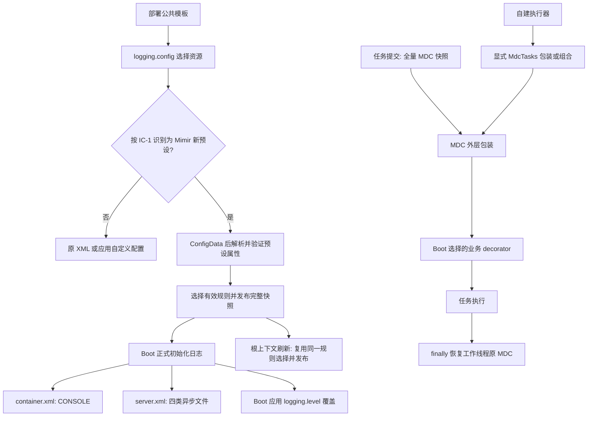

# Log 日志预设与任务上下文设计

## Context

本设计承接 [spec](./spec.md) 的六项行为，基线为 Java 17 / Boot 3.3.13 / Spring 6.1.21 / Logback 1.5.18。具体配置名、默认值和实现选择均为本轮推荐草案，尚未实施，不将其追加为用户确认的版本决定。

当前事实：Starter classpath 根的 `logback-spring.xml` 已自动生效；prod root 为 WARN，访问与 SQL 日志只进文件；滚动和异步参数写死。`LogMaskAutoConfiguration.transferConfig` 在 `ContextRefreshedEvent` 发布规则，转换器用静态快照和首个 Logback Context 引用。`MdcUtil` 仅封装 MDC 操作，没有任务传播实现。

对应版本依赖源码已在本地核对：

- Boot `LoggingApplicationListener.initialize` 先加载 `logging.config`，后设置 `logging.level.*`；默认监听顺序是最高优先级 +20。
- ConfigData 的 EnvironmentPostProcessor 顺序是最高优先级 +10，适合在 ConfigData 后、日志正式初始化前处理新预设默认值。
- `SpringApplication.prepareEnvironment` 在环境准备事件结束后调用 `DefaultPropertiesPropertySource.moveToEnd`。本设计在早期读取预设和脱敏属性前做相同归位，使早期绑定与刷新绑定的默认源优先级一致；保留已有源及全部键值。四组缺省规则在选择有效列表时确定，不写入 Environment。
- `SensitiveDataConverter` 继承 Logback `ClassicConverter`；原 `LogMaskAutoConfiguration` 有 `@ConditionalOnClass` 保护，spring.factories 的 EPP/监听器没有该保护。早期入口必须先完成类存在性及 Boot 后端选择检查，再加载转换器桥接代码。
- `TaskExecutorConfigurations` 的默认平台执行器在无任何 `Executor` Bean 时创建，别名为 `applicationTaskExecutor`、`taskExecutor`；优先使用唯一的 `ThreadPoolTaskExecutorBuilder`，否则使用旧 `TaskExecutorBuilder`。
- 两种 Builder 均支持 `configure(T extends ThreadPoolTaskExecutor)`，先设置 decorator 再执行 customizers；新 Builder 还适配旧 `TaskExecutorCustomizer`。所有路径都经公开 `setTaskDecorator(TaskDecorator)`，无需反射。
- Builder 用 `ObjectProvider<TaskDecorator>.getIfUnique()` 选择业务装饰器。新增普通 Mimir `TaskDecorator` Bean 会污染这一选择。
- Boot `LoggingApplicationListener` 收到 `ApplicationFailedEvent` 会清理日志系统，不以 Mimir 启动令牌判断所有权；Logback 清理移除初始化标记，后续 SpringApplication 可重置共享 LoggerContext。活跃子上下文发布的失败事件还会向父上下文传播，仅移除子应用自己的日志监听器不足以隔离该路径。
- （审查补充）`SpringApplication.handleRunFailure` 先 `listeners.failed` 发布 ApplicationFailedEvent，再在 finally 中 `reportFailure` 输出“Application run failed”及完整堆栈，随后关闭上下文；`ContextClosedEvent` 也早于 Bean 销毁回调发布。`SensitiveDataConverter` 快照为空时经 `readConfiguration` 读取 Context 属性，Context 引用为空则回退系统属性（`SensitiveDataConverter.java:183-192`）。若在这两个事件中清空快照或 Context 引用，失败堆栈与关闭阶段日志会以空规则输出。
- （审查补充）公开的 `addCustomPattern` / `reloadConfig`（`SensitiveDataConverter.java:72-91`）只把快照置空，下一次转换从 LoggerContext 属性重建；该属性当前只在刷新时由 `LogMaskAutoConfiguration` 写入，且 Boot 日志初始化会重置 LoggerContext。Bean 创建期调用这两个入口会丢失 EPP 发布的四组缺省规则。
- （审查补充）快照为空时 `currentConfiguration` 在锁内按 Context 属性/系统属性重建并写回快照（`SensitiveDataConverter.java:113-121`）。若 EPP 在取得令牌后先置空快照、到发布时才写入，其间其他线程的日志会以系统属性构建的空规则写入快照，形成“空快照窗口”。
- （审查补充）spring-cloud-context 4.1.6 的 spring.factories 无条件注册 `LoggingSystemShutdownListener`（`ApplicationEnvironmentPreparedEvent`，最高优先级 +6），对每个 SpringApplication 都执行 `LoggingSystem.cleanUp()` 与 `beforeInitialize()`，与 bootstrap 是否开启无关；`spring-cloud-starter-openfeign` 经 `spring-cloud-starter` 传递引入该模块，Mimir Feign Starter 的消费者因此默认受影响。`BootstrapApplicationListener` 构建 bootstrap Environment 时把主 Environment 当时全部非 Stub 属性源（命令行、系统属性、环境变量及应用默认属性等）追加到 `bootstrap` 源之后，这些源中的 `logging.config` 对 bootstrap 应用可见。Boot `LogbackLoggingSystem.initialize` 仅以初始化标记决定是否跳过加载，`LoggingApplicationListener.initializeFinalLoggingLevels` 不受该标记限制；Logback 配置出现状态错误时 Boot 抛 `IllegalStateException` 终止启动。
- （D-100 依据）spring-cloud-context 4.1.6（Spring Cloud 2023.0.6 BOM 管理版本）在 `spring.cloud.bootstrap.enabled=true`、`spring.config.use-legacy-processing=true` 或存在 `spring-cloud-starter-bootstrap` 标记类时，由 `BootstrapApplicationListener`（`ApplicationEnvironmentPreparedEvent`，最高优先级 +5）同步运行一个 bootstrap SpringApplication：其 Environment 以名为 `bootstrap`（`BOOTSTRAP_PROPERTY_SOURCE_NAME`）的属性源置首，并设置 `spring.config.name` 为 `${spring.cloud.bootstrap.name:bootstrap}`，该源在 `builder.run()` 返回后才移除；此时主应用的 ConfigData（最高优先级 +10）尚未执行，bootstrap 应用看不到 `application.yml` 中的 `logging.config` 与 mask 配置。正常启动时 bootstrap 应用使用 spring.factories 的全部监听器（含 Boot `LoggingApplicationListener`）；仅在环境含 `refreshArgs`（`LegacyContextRefresher` 运行期刷新）时由 `filterListeners` 去掉 `LoggingApplicationListener` 与 `LoggingSystemShutdownListener`。两种路径都会执行 Mimir 的 EPP 与 `LogPresetBootstrapListener`。随后主应用的 `LoggingSystemShutdownListener`（+6）执行 `cleanUp` 移除 Logback 初始化标记并 `beforeInitialize`，主应用 `LoggingApplicationListener`（+20）重新初始化（`stopAndReset` 会清空 LoggerContext 属性）。bootstrap 上下文经 `AncestorInitializer` 成为主上下文的父上下文。

上述是源码静态证据，不等于已跑通应用。模块入口见[讨论中的现状依据](./brainstorm.md#现状与依据)，实现阶段须验证下文条件顺序和早期日志。

## Goal

- 两个明确可选预设，未选择时 0 个新输出默认值；容器每事件标准输出 1 次，服务器按四类文件分流。
- 新预设默认四组脱敏覆盖日志正式初始化后、Bean 创建期与上下文刷新后 3 个阶段。
- 默认业务执行器传播 100% 的 MDC Map 条目，正常、异常、空上下文和嵌套任务退出时均恢复原 Map。

## Non-Goal

- 不引入完整 JSON 编码器、日志采样、逐路径访问阈值、日志采集代理或新 tracing 体系。
- 不自动配置所有用户执行器、虚拟线程执行器、调度器、原生线程和第三方线程池；不接管用户自定义 `logging.config`。
- 不为同一类加载器中的独立子 SpringApplication 协调 Boot 全局日志初始化、失败清理或重试；父子保障限于不另启 Boot 日志生命周期的普通子上下文。不同配置的多 LoggerContext、并行独立应用同样不在范围内。
- 不修改 SQL 日志生产开关与结构，不增加 Log → MyBatis 或 MyBatis → Log 运行时依赖；本轮不执行产品代码修改、部署或发版。

## Architecture



运行时代码全部位于 `mimir-boot-starter-log`。选用独立 XML 而不新增 `mimir...preset` 枚举；部署公共模板直接指定资源，应用的显式 `logging.config` 继续受 Spring Environment 优先级控制。

## Interface Contract

### IC-1 选择日志预设并保持旧接入兼容

新增资源：`classpath:com/yggdrasil/labs/log/logback/container.xml`、`classpath:com/yggdrasil/labs/log/logback/server.xml`，共享格式与转换规则放入同目录 `common.xml`，以 `<included>` 为根。原 `src/main/resources/logback-spring.xml` 保持原输出和参数，不把新默认值抽入旧 XML。

部署示例：`logging.config=classpath:com/yggdrasil/labs/log/logback/container.xml`；服务器模板换为 `.../server.xml`。不设置该值仍走原选择规则。资源不存在沿用 Boot 启动失败，不提供 Mimir 自动回退。

新预设识别仅接受两个 classpath 位置。（审查修订）识别与 Boot 实际加载同一资源的写法对齐，只做最小规范化：以 `environment.getProperty("logging.config")` 读取（与 Boot 一样解析占位符），按 Boot `LoggingApplicationListener` 的做法用 `String.strip()` 去除首尾空白；随后必须以大小写敏感的 `classpath:` 前缀开头，去掉前缀后再去掉紧随其后的一个前导 `/`（与 `ClassPathResource` 的路径处理一致），与 `com/yggdrasil/labs/log/logback/container.xml` / `server.xml` 精确比较。因此 `classpath:/com/...`、`classpath:com/...` 及带首尾空白的写法识别为同一预设（Boot 加载时指向同一资源，若只做原始字符串比较会“资源正常加载但静默缺失缺省规则”）。不带前缀的 `/com/...` 或相对路径 `com/...`、大小写不同的 `CLASSPATH:com/...` 不识别：Spring `DefaultResourceLoader` 仅对大小写敏感的 `classpath:` 走类路径，其余无协议写法经 `ApplicationResourceLoader.getResourceByPath` 解析为文件系统资源，并非这两个预设。同样不接受 `classpath*:`、`file:`、URL 或其他路径变体；复制 XML、自定义 file/URL、其他 classpath XML 均不自动启用四组缺省规则。

（审查推荐）未识别时不静默：`logging.config` 非空、未被识别，但规范化后的位置以 `com/yggdrasil/labs/log/logback/container.xml` 或 `server.xml` 结尾（含上述大小写、缺前缀、`classpath*:`、`file:` 变体）时，EPP 输出一条 INFO，说明该位置未被识别为 Mimir 预设、四组缺省规则与预设参数未启用，并给出两个标准写法；不回显配置值，不改变加载结果。该检查只做一次字符串比较、不访问资源、不依赖 Logback 类，经 Boot 注入 EPP 构造器的 `DeferredLogFactory` 记录，由 Boot 在日志正式初始化后回放；其他任意文件名（如复制后改名的 XML）不提示。（审查修订）输出时机固定：在 IC-4 步骤 1 的 legacy bootstrap 排除与默认源归位、读取 `logging.config` 之后，Logback 类及 Boot 后端检查之前；与实际后端是否为 Logback、本应用能否取得令牌无关。未识别位置不属于新预设，后端检查只会无状态退出，提示不因后端不同而缺失；bootstrap 应用直接返回，不输出该提示，避免重复。自定义 XML 可复用现有转换器和显式 mask 属性，但不能据此承诺本设计的启动期默认规则。

未选择新预设且未使用 Logback 时，早期预设入口直接退出，不影响原后端启动或独立的 MDC 能力。显式选择两个 Logback XML 之一但缺少 Logback、Boot 选择其他后端或禁用日志系统时，EPP 在装载 XML 前明确报错；不隐式切换后端。

### IC-2 路由业务、访问与 SQL 日志

两个新预设的 root 在所有 profile 默认 INFO；仅 `prod | produce | production` 激活 13 个 WARN 前缀：`org.springframework`、`org.apache`、`com.alibaba`、`com.baomidou`、`org.mybatis`、`com.zaxxer`、`com.mysql`、`org.postgresql`、`org.hibernate`、`io.netty`、`io.lettuce`、`redis.clients`、`org.reflections`。不复制旧 XML 的三个 Spring 子 logger INFO 例外，不重复 `io.lettuce.core`。

| Logger / 事件 | 容器预设 | 服务器预设 | 默认级别与继承 |
|---|---|---|---|
| 普通业务，包括 com.yggdrasil.labs | CONSOLE | info.log；ERROR 再归档至 error.log | 继承 root，不另设组织包等级 |
| access.log | CONSOLE | access.log | INFO，additivity=false |
| SQL.JSON | CONSOLE | sql.log | INFO，additivity=false |
| SQL.SLOW | CONSOLE | sql.log | WARN，additivity=false |

容器 XML 完全不声明 RollingFileAppender，也不使用 Boot file appender include；服务器 XML 不声明 ConsoleAppender。info.log 接收经 logger 级别筛选的全部普通业务事件；文件名沿用 info.log，但不再用 INFO appender 过滤器阻止显式 DEBUG 覆盖。error.log 保留 ERROR LevelFilter。专用 access/SQL Logger 不再向 root 累加；其 ERROR 也只进各自专用文件，避免跨分类复制。

格式复用现有 UTF-8 文本、traceId/spanId 与 `%mask` / `%maskThrowable`。`SQL.SLOW` 与 `SQL.JSON` 共用 sql.log，不新建慢 SQL 文件；慢 SQL 的原文保护由 MyBatis 自身完成。仅声明 Logger 不启用 SQL 生产者；后续 MyBatis 实现与本路由约定对齐。

### IC-3 调整滚动、队列与级别

推荐的公共配置契约如下；这些新增项仅对两个新预设生效。属性采用 kebab-case，Spring relaxed binding 保留现有 camelCase mask 写法。

| 属性 | 类型 | 推荐默认值 | 有效范围 / 覆盖 |
|---|---|---|---|
| `logging.config` | String 资源位置 | 不新增默认值 | 两个资源选择预设；其他资源由应用负责 |
| `logging.level.*` | Boot LogLevel | root INFO；专用与第三方见上文 | Boot 在 XML 后覆盖，同名及更具体 Logger 按 Boot/Logback 继承规则生效 |
| `LOG_PATH` | 既有路径变量 | `logs` | 服务器目录仍为 `${LOG_PATH}/${spring.application.name:application}`；不新增同义路径属性 |
| `mimir.boot.log.file.max-size` | DataSize | `100MB` | 服务器四类单文件上限，1MB–1GB，含两端 |
| `mimir.boot.log.file.max-history` | int | `30` | info/access/sql 保留天数，1–3650 |
| `mimir.boot.log.file.total-size-cap` | DataSize | `10GB` | info/access/sql 各自总量，不是三者合计；max-size–10TB |
| `mimir.boot.log.file.error-max-history` | int | `60` | error 保留天数，1–3650 |
| `mimir.boot.log.file.error-total-size-cap` | DataSize | `5GB` | error 总量；max-size–10TB |
| `mimir.boot.log.async.queue-size` | int | `1024` | 服务器四个异步队列各自容量，1–1048576；共四份容量 |
| `mimir.boot.log.async.never-block` | boolean | `false` | 服务器队列满时等待；true 时所有等级均可能丢弃 |
| `mimir.boot.log.async.max-flush-time` | Duration | `1s` | 服务器每个 appender 的停止排空等待，1ms–60s，转换为 Logback 毫秒值 |
| `mimir.boot.log.mask.enabled-patterns` | List<String> | 新预设四组；原配置仍为 `[]` | 缺省取四组；显式列表整体替换，显式空列表关闭预置规则 |
| `mimir.boot.log.mask.custom-patterns` | List<String> | `[]` | 与预置规则相加；使用 Binder 绑定原始列表，不通过逗号重分隔正则 |
| `mimir.boot.log.mask.replacement` | String | `****` | 未设置或空字符串均沿用原转换器的 `****` 回退，不作为启动错误；非空值原样使用 |
| `mimir.boot.log.mdc.enabled` | boolean | `true` | 控制默认平台执行器适配；独立于日志预设选择，false 完全让回 Boot 默认执行器 |

DataSize 接受带单位字节值，使用其字节数进行范围和大小关系校验，再转为 Logback 可接受的数值字节字符串；不把 Boot `MB/GB` 的输入单位原样猜测传给另一解析器。Duration 转为毫秒，拒绝小于 1ms 的有效值。容器对文件/异步参数不绑定、不验证、不创建文件，因此挂载配置中的服务器专用值不会影响容器启动。

推荐保留日志而选择 `discardingThreshold=0`、`neverBlock=false`；该策略没有业务延迟上界，输出端持续阻塞时业务也可能等待。显式 `never-block=true` 是延迟优先选项，连 ERROR 也可能丢失。每个 appender 的停机等待默认 1 秒，不保证 4 个队列在进程强杀或输出阻塞时全部排空。新 XML 不使用 NopStatusListener 隐藏后端故障；依赖 Logback 的状态错误输出，诊断不得回显业务日志或秘密。

### IC-4 从日志正式初始化起执行凭据字段脱敏

新增 `LogPresetEnvironmentPostProcessor implements EnvironmentPostProcessor, Ordered`，公开 SPI 签名为 `void postProcessEnvironment(ConfigurableEnvironment environment, SpringApplication application)`、`int getOrder()`；以 `ConfigDataEnvironmentPostProcessor.ORDER + 1` 注册到 `META-INF/spring.factories` 的 `org.springframework.boot.env.EnvironmentPostProcessor`。它不作为普通 Bean 等待上下文创建。新增内部 `LogPresetBootstrapListener implements ApplicationListener<ApplicationEvent>`，入口 `void onApplicationEvent(ApplicationEvent event)`，通过同一 spring.factories 的 `org.springframework.context.ApplicationListener` 注册。监听 ApplicationContextInitializedEvent 绑定同一 SpringApplication 的根 Context、ApplicationFailedEvent 处理初始化前失败、ContextClosedEvent 释放匹配根所有权（清空整个所有权槽，保留最后规则快照，见下文）；不用普通 Bean listener 处理可能发生于 EPP 的失败。

这两个无条件注册入口及共享所有权记录不得在字段、父类型、方法签名、静态初始化或日志字段中引用 Logback / `SensitiveDataConverter`。新增内部 `LogbackMaskBootstrap` 承载转换器重置、发布、释放；仅通过下述检查后的执行分支触达。监听器无匹配启动令牌时立即返回，不能在失败/关闭事件中首次加载桥接类。所有权记录只使用 JDK、Spring/Boot 类型；普通 MDC 配置、`MdcTasks` 和 `MdcTaskDecorator` 不依赖该桥接类。

顺序明确如下（不承诺其他扩展在本 EPP 之后主动修改 Environment 时仍具有跨阶段一致性）：

1. （D-100）首先识别 Spring Cloud legacy bootstrap 应用：Environment 的属性源中存在名为 `bootstrap` 的源时立即返回，不归位默认源、不输出未识别提示、不做类/后端检查、不取令牌、不重置、不生成内部源、不发布、不写缓存，判定见下文“Spring Cloud legacy bootstrap”。随后 ConfigData 准备完成，先调用 `DefaultPropertiesPropertySource.moveToEnd(environment)` 归位已有 Boot 默认源，再读取 `logging.config`；该操作不创建、替换源或修改其键值，Boot 后续重复归位保持相同优先级。使用当前 SpringApplication 的 ClassLoader，以字符串类名调用 `ClassUtils.isPresent` 检查 `ch.qos.logback.classic.LoggerContext` 与 `ch.qos.logback.classic.pattern.ClassicConverter`；缺类时不调用后端或桥接类。类齐全时调用 Boot `LoggingSystem.get(classLoader)`，只检查返回实例的类型继承链是否包含 `org.springframework.boot.logging.logback.LogbackLoggingSystem`（用类名比较，允许其子类），不调用 initialize/beforeInitialize，也不主动获取 LoggerFactory。该检查沿用 Boot 的 `org.springframework.boot.logging.LoggingSystem` 选择，包括 `none`；不以“Logback jar 存在”代替后端选择。任一条件不满足，未选新预设则返回且不取令牌、不重置、不生成内部源、不发布；选中新预设则抛不含配置值的 `IllegalStateException`，指出 `logging.config` 要求可用的 Logback 后端。Boot 自身更早发现后端冲突时保留其原失败，不承诺覆盖其诊断。
2. 通过检查后取得本次启动代次：无活跃所有者时创建独立令牌并关联当前 SpringApplication 实例及 Environment，再经桥接类重置上一轮 LoggerContext 引用与启动期规则缓存，保留编程式规则列表；（审查修订）此步不置空规则快照，上一轮快照继续服务其他线程的日志，直至步骤 5 直接替换，避免空快照窗口内其他线程以系统属性构建空规则并写回快照；仅当步骤 4 验证失败时，经桥接类在抛出异常前置空快照，不让上一启动的规则冒充本次配置；有活跃所有者时，其他应用/子应用直接退出，不重置、不生成内部源。同一启动重复调用保持幂等；旧配置不增加默认规则。
3. 早期发布和根上下文刷新共用同一内部规则选择逻辑：通过 `Binder.get(environment).bind("mimir.boot.log.mask.enabled-patterns", Bindable.listOf(String.class))` 取得绑定结果；`BindResult.isBound()` 为 true 时直接使用绑定列表，包括显式空列表、空字符串、索引形式与 relaxed 名称对应的结果，不追加缺省项。未绑定且按 IC-1 识别为任一新预设时，使用 `password`、`token`、`secret`、`api_key` 四组；其他情况使用旧配置的空列表默认值。不能以集合非空或 `containsProperty` 判断缺省，也不将所选列表写回 Environment 或修改用户传入的默认属性 Map。新预设的 Binder 绑定错误按非法配置处理，不视作缺省。
4. 使用 `Binder.get(environment)` 绑定 `LogMaskProperties` 和适用的预设属性；发布所用的启用列表必须采用步骤 3 的选择结果。对新预设严格验证未知规则名、非法正则、数值范围。验证失败以不含值的 `IllegalStateException` 阻断启动，包含属性名与列表序号；该阶段不借普通 Logger 输出诊断。旧配置不采用新严格校验，保持原先未知规则忽略和非法正则告警策略。
5. 服务器数值绑定后生成内部 `mimirLogPresetResolved` 属性源，供 XML 的 springProperty 读取规范化结果；内部键分别为 `mimir.boot.log.internal.file.max-size-bytes`、`max-history`、`total-size-cap-bytes`、`error-max-history`、`error-total-size-cap-bytes`（后四项均沿用同一 file 前缀），以及 `mimir.boot.log.internal.async.queue-size`、`never-block`、`max-flush-time-millis`（后两项沿用同一 async 前缀）。这些键不是用户配置入口，由解析后的公开属性唯一生成，禁止模板直接配置；内部源优先于外部同名值，不能改写公开属性。容器不生成文件参数。（审查补充）内部源只负责覆盖，不是 XML 可加载的前提：`container.xml`、`server.xml` 与 `common.xml` 中引用上述 8 个内部键的每个 `<springProperty>` 都必须声明 `defaultValue`，取值等于 IC-3 推荐默认值的规范化结果，即 `max-size-bytes=104857600`、`max-history=30`、`total-size-cap-bytes=10737418240`、`error-max-history=60`、`error-total-size-cap-bytes=5368709120`、`queue-size=1024`、`never-block=false`、`max-flush-time-millis=1000`；缺少内部源时 XML 仍能独立加载，见下文“无内部源加载预设 XML”。其他 `springProperty`（如读取 `spring.application.name` 的应用名，沿用旧 XML 默认值 `application`）同样必须带 `defaultValue`，按各自既有默认值核对。随后经桥接类以一次原子替换发布完整规则快照（不经过置空中间态），语义同既有 `SensitiveDataConverter.publishConfiguration(List<String>, List<String>, String)`，不能从 Logback 逗号字符串重建配置；识别为新预设时在同一临界区写入下文的启动期规则缓存，旧配置只发布快照、不写缓存。避免在此阶段获取或启动 LoggerFactory。Boot 随后加载 XML，其消息和异常转换器自第一次转换起读取该快照。
6. `SensitiveDataConverter.start()` 重新绑定本次真实 Context，替代现有首个 Context 的 `compareAndSet(null, context)` 行为；（审查修订）仅在 `getContext()` 非 null 时重绑，未设置 Context 的转换器启动不清空全局引用；不得清空步骤 5 已发布的快照。根上下文刷新时，`LogMaskAutoConfiguration` 从事件上下文（即所有者根）的 Environment 复用步骤 3 的规则选择，连同其他已绑定的 mask 属性重发布完整快照；原有 LoggerContext 属性同步也使用该有效列表，使既有 `reloadConfig` 继续读取相同规则；（审查修订）所有者根上下文先写入 LoggerContext 属性，再经桥接类在同一 `CONFIGURATION_LOCK` 临界区内发布快照并清除启动期规则缓存，此后的 reload 按原路径读取 LoggerContext/系统属性。新预设缺省仍为四组，显式空列表仍为空，旧配置缺省仍为空。早期入口和刷新入口使用同一选择逻辑，不新增公共 API。原自动配置的类条件和运行期 ILoggerFactory 检查继续保留；早期入口退出不等于移除旧配置的刷新处理。

（审查修订）刷新入口按以下顺序判定，先命中者生效。各分支统一以事件上下文的 Environment 选择规则，且仅当事件上下文就是监听器所在上下文时才处理，避免 bootstrap 父上下文经事件传播收到主根上下文刷新后，以自身配置覆盖主应用规则。

1. 刷新上下文的 Environment 含名为 `bootstrap` 的属性源：立即返回（D-100）。该判断必须最先执行：bootstrap 上下文刷新时主应用 EPP 尚未运行，所有权槽通常为空，若先判断“无活跃所有者”会误入下一条旧路径，以 bootstrap 配置写 LoggerContext 属性并发布空规则。
2. 所有权槽为空（无活跃所有者）：沿用现有 `transferConfig` 旧路径，任何触发刷新的上下文均写 LoggerContext 属性并发布完整快照，不判断父子关系，也不读写启动期规则缓存（无所有者时缓存必然已清除）。启用列表来源：事件上下文 Environment 按 IC-1 识别为新预设时按步骤 3 选择；否则直接使用注入的 `LogMaskProperties`，与当前实现一致。该分支覆盖不经 SpringApplication 创建、因而没有令牌的上下文，如 `ApplicationContextRunner`、手工 `GenericApplicationContext`，以及直接 `new LogMaskAutoConfiguration(properties)` 并调用 `transferConfig` 的 `LogMaskAutoConfigurationTest`；也覆盖所有者关闭之后的刷新。既有测试与“无 SpringApplication 也可发布”的行为保持不变。
3. 有活跃所有者且刷新上下文是令牌绑定的根：按上文所有者路径写属性、发布快照并清除缓存。
4. 有活跃所有者但刷新上下文不是所有者根（普通子上下文、测试缓存中的非所有者根）：返回，不写属性、不发布、不清缓存。

所有者失败或根关闭时（审查修订）释放整个所有权槽：清除令牌及其持有的 SpringApplication、Environment 与根 ApplicationContext 引用，避免测试上下文缓存或 devtools 重启场景通过静态槽继续持有已关闭的上下文及其类加载器；同时清除启动期规则缓存（若快照此时已被 reload 置空，先在同一临界区按缓存重建快照再清除）。保留最后一次发布的不可变规则快照（只含编译后的正则、字段名与替换串）及转换器的 LoggerContext 引用：ApplicationFailedEvent 早于 Boot 的 `reportFailure` 堆栈输出，ContextClosedEvent 早于 Bean 销毁与 Boot 日志 cleanUp，清空快照会使失败堆栈和关闭阶段日志回退到系统属性/空规则而不脱敏。保留的快照只由下一次取得令牌的启动在步骤 5 直接替换（或在其步骤 4 验证失败时置空），因此顺序启动仍不残留上一轮规则；进程内无后续启动时，该快照随 JVM 结束。服务器内部 `mimirLogPresetResolved` 源仅在当前实例仍属本次所有者时移除，保留用户其他属性源及后续替换源。四组缺省规则只存在于所选列表、启动期规则缓存、发布快照及根刷新后写入的 LoggerContext 属性中。复用同一 Environment 的下一次顺序启动重新选择自身规则。

（审查修订）Bean 创建期间公开的 `reloadConfig` / `addCustomPattern` / `clearCustomPatterns` 会置空快照。推荐引入仅在“EPP 发布 → 所有者根上下文刷新”窗口内有效的启动期规则缓存，内容为本次有效输入（步骤 3 选出的启用列表、custom-patterns 与 replacement）：

- 只在识别为新预设时由步骤 5 写入；旧配置即使经过步骤 1–5 也不写缓存，因此旧配置的 `putProperty` / `System.setProperty` 后 `reloadConfig` 仍按 `SensitiveDataConverter.java:72` Javadoc 所述从 LoggerContext/系统属性读取新值，语义不变。
- 缓存存在时，转换器重建快照优先使用缓存并叠加当前编程式规则；窗口内新预设应用通过属性改值再 reload 不生效，README 列出该限制并建议改用 mask 配置或编程式入口。
- 所有者根刷新按步骤 6 先把有效规则写入 LoggerContext 属性，再在同一临界区发布快照并清除缓存；此后 reload 恢复原读取路径，新预设读到的仍是同一有效列表（自定义正则仍受原逗号拼接限制，属既有行为，不在本轮修改）。失败/关闭释放、下一次取得令牌的步骤 2 重置同样清除缓存，不跨启动、不跨关闭残留，因而不会污染同一 Surefire JVM 中后续直接操作 LoggerContext 属性的测试（如 `SensitiveDataConverterTest.java:173-201`）。
- 存放位置统一：缓存字段与快照同处 `SensitiveDataConverter` 的静态状态，所有写入、清除与快照更新都在同一 `CONFIGURATION_LOCK` 临界区内完成，避免读到“新快照 + 旧缓存”或反之；生命周期由桥接类 `LogbackMaskBootstrap` 唯一驱动（发布写入、刷新清除、释放清除、令牌重置、验证失败置空），其他类不直接读写。
- 可见性（审查修订）：桥接类在 `config` 包、转换器在 `converter` 包，Java 包级可见性无法跨包调用，转换器侧入口必须是 public。推荐不在 `SensitiveDataConverter` 上新增 public 方法，而在 `converter` 包新增 `public final class SensitiveDataConverterInternals`（私有构造器），其 public static 方法只委托转换器的包级静态方法，状态与锁仍留在转换器内；类与方法 Javadoc 标注“内部实现，非公共 API，不承诺兼容”，不进入 README 公共 API 与属性表。“仅桥接类调用、其他类不直接读写”是约定，由代码评审及桥接驱动的生命周期测试保证；模块当前无架构测试依赖，本轮不为此引入。
- 测试隔离：转换器提供包级可见的重置钩子（清除缓存与快照，并可恢复全局 Context 引用，不改公共方法），桥接类提供包级可见的同名钩子供 config 包测试使用；生产代码不调用。`SensitiveDataConverterTest` 等用例启动转换器（包括自建 LoggerContext 或不设 Context 的实例）会按步骤 6 重绑全局 Context 引用，须在 `@AfterEach` 经包级钩子把引用恢复为 SLF4J 当前 `LoggerContext` 并清除快照与缓存，避免改变后续用例的属性读取来源。

这样刷新前调用这些入口不会丢失新预设的四组缺省规则，也不改变其公共签名与编程式叠加语义。

新增内部 bootstrap 重置与 Context 绑定属于静态状态修复，不改变现有 `publishConfiguration`、`reloadConfig`、`addCustomPattern`、`clearCustomPatterns` 的公共签名和编程式规则叠加语义。连续启动不同应用时分别验证“新预设→旧配置”“旧配置→新预设”和“新→新不同显式规则”；不能把上一个 Context 的引用、默认规则或替换字符带入下一轮。

共享单一 SLF4J LoggerFactory 时，受支持的父子方式为：父 SpringApplication 管理唯一 Boot 日志生命周期，接入方直接创建普通子 ApplicationContext，在 refresh 前设置 parent，并先关闭子上下文再关闭父应用。子上下文不另行调用 SpringApplication.run，不独立初始化、停止或重配置日志后端；配置和规则由持有令牌的父应用发布。通过启动事件的 SpringApplication 实例身份将根上下文绑定到该令牌，不能仅靠继承的 Environment 属性判断所有权。普通子上下文刷新、刷新失败或关闭均不得覆盖父规则或释放父所有权；下一次独立应用启动须在旧根关闭后取得新代次。

（审查修订）同一 JVM 中同时存活多个独立 SpringApplication 的常见来源是测试框架的上下文缓存（不同配置的 `@SpringBootTest` 各自启动且缓存到 JVM 结束）。第一个上下文持有令牌直至关闭，后续上下文的 EPP 按步骤 2 退出，其根刷新按上述判定第 4 条返回，因此转换器快照始终是首个所有者发布的规则，后续上下文自身不同的 mask 规则不生效。Boot 日志是否重新加载取决于 classpath：

- 不含 spring-cloud-context：Boot 因 LoggerContext 已有初始化标记跳过加载，后续上下文沿用所有者已加载的 XML、appender 与 LoggerContext 属性，其自身不同的 `logging.config` 不生效；但 Boot 仍按后续上下文的 `logging.level.*` 修改共享 LoggerContext 的级别。
- 含 spring-cloud-context（如经 Feign Starter 传递引入）：后续 SpringApplication 的 `LoggingSystemShutdownListener` 移除初始化标记，Boot 按后者自身 `logging.config` 重新初始化，输出出口随之改为后者的 XML，`stopAndReset` 清空所有者写入的 LoggerContext 属性。后者若为新预设，因其 EPP 已退出、Environment 无内部源，XML 参数取默认值；脱敏仍用所有者快照，但此后调用 reload 入口会失去所有者规则，见“无内部源加载预设 XML”。

推荐预期行为限定为“脱敏快照沿用首个所有者、非所有者刷新不覆盖、启动不失败”；输出出口与 XML 参数是否沿用所有者取决于上述 classpath，不作统一承诺。需要不同日志配置或稳定输出断言的测试应使用 `@DirtiesContext` 关闭前序上下文，或使用独立 JVM（独立 Failsafe/Surefire execution）。LoggerContext 与转换器快照是 JVM 级共享对象，本轮不做按上下文的多份所有权，以免引入每事件查找上下文的成本。旧配置原有“最后刷新者重发布”行为若因此改变，须在 README 中列出。

#### Spring Cloud legacy bootstrap（D-100，用户确认）

2026-10-31 用户确认 D-100：开启 Spring Cloud legacy bootstrap（`spring.cloud.bootstrap.enabled=true`、`spring.config.use-legacy-processing=true` 或引入 `spring-cloud-starter-bootstrap`）时，bootstrap SpringApplication 不取得日志所有权，由主应用取得。若不处理，bootstrap 应用的 EPP 先以只含 bootstrap 配置的 Environment 取得令牌并发布空规则，主应用 EPP 因已有活跃所有者退出；主上下文又以 bootstrap 上下文为父，若按“有父即子上下文”处理则也不发布。结果是新预设四组缺省规则不生效，使用 `bootstrap.yml` 的旧接入者在 `application.yml` 的 mask 配置也不再发布，属于兼容性破坏。

- 判定：以字符串比较 Environment 中是否存在名为 `bootstrap` 的属性源，与 spring-cloud-context 的 `BootstrapApplicationListener.BOOTSTRAP_PROPERTY_SOURCE_NAME` 及其自身“不在 bootstrap 上下文中监听”判断一致；该源在整个 bootstrap `run()`（含 EPP、上下文刷新、失败）期间存在，正常启动与 `LegacyContextRefresher` 运行期刷新两条路径均适用。不以 `spring.config.name=bootstrap` 判断（名称可经 `spring.cloud.bootstrap.name` 改写，普通应用也可能设置），不以上下文 id（`run()` 返回后才设为 `bootstrap`）或 Spring Cloud 类存在性判断。实现不引用任何 Spring Cloud 类型，生产代码不新增 spring-cloud 编译依赖。普通应用自行注册同名 `bootstrap` 属性源会被误判为 bootstrap 应用而跳过预设，README 列为已知限制。
- EPP：按步骤 1 立即返回，不取令牌、不重置 Context 引用与缓存、不发布、不生成内部源、不输出提示。`LogPresetBootstrapListener` 在 bootstrap 应用中无匹配令牌，事件立即返回。
- 刷新：bootstrap 上下文通常只导入 `BootstrapConfiguration` 条目，不加载 `LogMaskAutoConfiguration`；若经 `spring.cloud.bootstrap.sources` 等被加载，刷新时同样检查其 Environment 含 `bootstrap` 源即返回，不写 LoggerContext 属性、不发布、不清除启动期规则缓存。此时主应用尚未取得令牌，因此该判断不能依赖“非所有者”分支。（审查补充）同理该判断须先于“无活跃所有者→旧路径发布”，见步骤 6 后的刷新判定顺序。
- 主应用：BootstrapApplicationListener 返回后，主应用 `LoggingSystemShutdownListener` 先清理并抑制日志，主 EPP 取得令牌，以已加载 `application.yml` 的 Environment 选择规则（Spring Cloud 已把 bootstrap 应用的配置源以 `springCloudDefaultProperties` 合并到主 Environment 末尾，bootstrap 配置仍以最低优先级可见）、发布快照（新预设写缓存）；随后主 `LoggingApplicationListener` 因初始化标记已被移除而重新加载 `logging.config`，`stopAndReset` 清空 bootstrap 阶段写入的 LoggerContext 属性，新转换器 `start()` 重绑 Context。主上下文初始化时已由 `AncestorInitializer` 设置 bootstrap 父上下文，所有者根上下文按 SpringApplication 身份绑定（见步骤及父子说明），不以 `getParent() == null` 判断，因此主上下文刷新按所有者根写属性、发布快照并清除缓存。
- 事件传播：主上下文的 ContextClosedEvent 与活跃上下文的 ApplicationFailedEvent 会向 bootstrap 父上下文传播，父上下文中另一份 `LogPresetBootstrapListener` 实例也会收到；释放按事件携带的 SpringApplication / 根 Context 身份与所有权槽匹配，与接收事件的监听器实例无关，重复释放幂等。主应用启动失败时 Spring Cloud 关闭 bootstrap 上下文，其关闭事件不匹配令牌，不产生作用。
- 保护范围：bootstrap 应用自身的输出早于主 EPP，与“本处理器执行前的输出”同属保护起点之外；其间转换器可能按系统属性惰性构建快照，主 EPP 步骤 5 会直接替换。运行期 legacy 刷新创建的嵌套 bootstrap 应用同样按此判定退出，不改变当前规则，也不构成 Nacos 自动更新承诺。
- （审查补充）`logging.config` 来自 bootstrap 可见的源（系统属性、环境变量、命令行或应用默认属性，常见于部署公共模板）时，bootstrap 应用的 Boot `LoggingApplicationListener` 会加载所选预设 XML，而其 Environment 没有 `mimirLogPresetResolved`；处理见下文“无内部源加载预设 XML”。`logging.config` 只写在 `application.yml` 时 bootstrap 应用看不到，按 Boot 默认规则选择配置。

令牌只管理 Mimir 的静态快照、Context 引用及服务器内部规范化源，不是 Boot 日志系统的拦截器。防御性地保留“非所有者 EPP 退出、失败/关闭仅由匹配所有者释放”的逻辑，但不能据此承诺独立子 SpringApplication 的失败与重试安全。Boot 3.3.13 的失败清理可移除共享初始化标记，下一子启动可能重置父 appender、级别和 Context 属性；即使只移除子 LoggingApplicationListener，活跃子上下文的失败事件仍可能传播给父监听器。因此本轮不替换或包装 Boot 监听器，也不提供这种子启动方式的自动保护；需要各自日志生命周期的应用采用独立进程。该限制不影响普通子上下文复用父日志与父关闭后的顺序独立启动。

`ApplicationStartingEvent`、ConfigData 自身加载日志及本处理器执行前的输出不在保护起点内。共享 XML 不能启用 Logback `scan=true`：Spring 扩展和预设绑定不是普通 XML 热扫描协议。动态刷新只保留已有明确调用的 reload/publish 入口，不增加 Nacos 自动更新承诺。对象、数组和原始错误流保护边界见 [README](../../../../mimir-boot-starters/mimir-boot-starter-log/README.md#敏感信息脱敏)。

#### 无内部源加载预设 XML（审查补充）

以下两种情形中，Boot 会在没有 `mimirLogPresetResolved` 的 Environment 里加载新预设 XML。若 `<springProperty>` 没有默认值，未定义的内部键无法转换为 queue-size 等数值，Logback 记录配置错误，Boot 随即终止启动；因此按步骤 5 要求每个 `<springProperty>` 自带与 IC-3 一致的 `defaultValue`。

| 情形 | 触发条件 | XML 参数 | 脱敏规则 |
|---|---|---|---|
| legacy bootstrap 应用 | 开启 legacy bootstrap，且 `logging.config` 来自 bootstrap 可见的源；bootstrap 应用的 EPP 按 D-100 已返回 | 全部取 `defaultValue`，用户的 file/async 覆盖不生效；服务器目录按 bootstrap Environment 可见的 `spring.application.name`，可能为默认 `application` | 沿用转换器当前快照；JVM 内首次启动时快照为空，按 LoggerContext 属性/系统属性惰性构建，通常为空规则。bootstrap 阶段输出不含四组缺省，属保护起点之外；主 EPP 步骤 5 原子替换快照，主 `LoggingApplicationListener` 重新加载 XML 并读取主应用内部源 |
| 测试缓存中的非所有者 | classpath 含 spring-cloud-context，所有者仍存活，后续 SpringApplication 选择新预设；其 EPP 在步骤 2 退出 | 全部取 `defaultValue`，该应用自身的 file/async 覆盖不生效 | 快照仍为所有者规则：非所有者不发布，新转换器 `start()` 只重绑 Context、不清空快照。`stopAndReset` 已清空 LoggerContext 属性且启动期缓存已在所有者刷新时清除，此后调用 `reloadConfig` / `addCustomPattern` / `clearCustomPatterns` 会按空属性/系统属性重建，失去所有者规则 |

- 不为这两种情形新增发布或所有权获取：bootstrap 应用仍不取令牌，非所有者仍不发布；内部源存在时继续优先于 `defaultValue`。
- `defaultValue` 与 IC-3 推荐默认值是两处表达，资源测试须逐项核对二者一致，防止漂移。
- README 列出：legacy bootstrap 下以系统属性/环境变量等指定预设时，bootstrap 阶段输出使用默认文件/队列参数且不受四组缺省保护；测试上下文缓存的行为与隔离方式见上文。

### IC-5 默认业务任务传递完整日志上下文

公开入口位于 `com.yggdrasil.labs.log.task`：

```java
public final class MdcTaskDecorator implements TaskDecorator {
    public Runnable decorate(Runnable runnable);
}
public final class MdcTasks {
    public static Runnable wrap(Runnable task);
    public static <T> Callable<T> wrap(Callable<T> task);
    public static TaskDecorator compose(TaskDecorator businessDecorator);
}
```

`wrap`、`decorate` 输入任务不能为 null，违反时抛 `IllegalArgumentException`；`compose(null)` 返回仅 MDC 的装饰器。Runnable 原异常直接传播，Callable 结果与原 checked exception 保留；不引入错误码。`wrap` 调用 / `decorate` 调用时取 `MDC.getCopyOfContextMap()`，复制为不可变私有快照，不按 traceId 等白名单筛选。统一入口应在每次提交处调用；重用旧包装任务也重用其旧快照，不被宣传为重新捕获。

执行时先保存工作线程全量 Map；快照为空调用 `MDC.clear()`，否则整体 `MDC.setContextMap(snapshot)`；在 `finally` 清理任务修改并整体恢复原 Map，原为空则 clear。不使用 `MdcUtil.putAll`，其空 Map 分支不会清空旧值。拒绝发生在包装后但执行前时没有工作线程修改；caller-runs 和嵌套执行按同一栈式规则恢复。

`compose(business)` 的语义是先得到业务包装结果，再将 MDC 包装放在最外层：`mdc.decorate(business.decorate(task))`。业务 before/after 代码在传播上下文内执行，但业务有意改写 MDC 时按业务逻辑生效；本能力保证最外层最终恢复。对直接重复传入同一 Mimir 组合装饰器应保持单层，避免显式 compose 多次形成重复包装；不递归拆解或反射识别用户自定义链。

### IC-6 与业务执行器扩展协作

通过 Boot Builder 的 customizer 接入，只增强没有其他执行器定制器的默认路径，保留 Boot 原有业务装饰器选择：

- `MdcTaskExecutionAutoConfiguration` 使用 `@AutoConfiguration(before=TaskExecutionAutoConfiguration.class)`。相关任务类存在、`mdc.enabled=true`、平台线程模式且不存在用户声明的 `Executor`、`ThreadPoolTaskExecutorBuilder` 或 `TaskExecutorBuilder` Bean 时，注册一个内部 `MdcTaskExecutorCustomizer`。用户已声明任意 Executor 或上述任一 Builder 时自动退出，由其显式 compose；不按 bean 名猜测用户线程池，并保留原执行器创建流程。
- 适配器只实现 Boot 3.3.13 仍支持的旧 `org.springframework.boot.task.TaskExecutorCustomizer`，签名为 `void customize(ThreadPoolTaskExecutor taskExecutor)`；现代 Builder 已适配旧接口，因此不再注册第二个现代 customizer。无需实现 Ordered 或要求业务调整 order。旧接口仅作内部版本适配，不作为新增公共 API；升级 Boot 时重新核对。
- **先退让，再组合**：在 customize 实际执行时，通过容器的 ObjectProvider 检查是否存在本适配器之外的 `TaskExecutorCustomizer` 或任何 `ThreadPoolTaskExecutorCustomizer`，包括业务及其他自动配置提供的 Bean。排除本适配器自身，发现任一其他定制器即输出下述退让 INFO 后返回，不调用 setTaskDecorator，不改变其顺序或配置。检查发生在 Builder 配置执行器时，不能仅凭较早的自动配置注册顺序判断没有其他定制器。即使其他定制器只调整线程池参数，也保守退出，不分析其实现、不读取执行器私有字段。（审查补充）退让时输出一条 INFO，说明默认执行器未自动接入 MDC 传播、其他定制器的数量与类名（不含配置值），并提示使用 `MdcTasks.compose(existing)` 显式接入；每次 customize 调用最多一条，不升级为 WARN，避免静默失去传播。
- 无其他定制器时，使用与 Boot 相同的 `ObjectProvider<TaskDecorator>.getIfUnique()` 选择业务 decorator，然后调用 `taskExecutor.setTaskDecorator(MdcTasks.compose(selected))`。无候选时仅安装 MDC；唯一候选或多个 Bean 中有唯一 `@Primary` 时只组合被选中的一个；多个 Bean 且无唯一候选时仅安装 MDC，不执行任何业务 decorator。不能使用 orderedStream 自动组装全部业务 Bean，也不改变 Boot 对冲突候选的原有处理。
- Mimir 不注册普通 `TaskDecorator` Bean。被选中 decorator 的 decorate 失败沿原提交路径传播；进入执行后 MDC 外层 finally 恢复。需要多个业务 decorator 联合执行时，由下游提供一个明确的组合 decorator，或在自己的 customizer 中调用 `MdcTasks.compose(existing)`；该 customizer 的存在已使自动路径退让，无需额外关闭开关。
- 用户自建 Executor 或 Builder Bean 使自动配置退出；即使自定义 Builder 最终被 Boot 用来创建默认 Executor，也不承诺它消费本适配器。自定义 Builder 须由接入方显式配置 `MdcTasks.compose(existing)`，不反射或重写 Builder。通过原生构造器创建的执行器不受影响。没有用户 Executor Bean、但运行期主动复用 Boot Builder 创建其他线程池时，该 Builder 的 customizer 也会应用，这是 Builder 扩展本身的范围；接入方应显式构造/选择自有 customizer 链并 compose，不承诺 Builder 产物仅有默认执行器一个。选定 MDC 方式后避免再手动 wrap 同一任务。
- `mdc.enabled=false` 或虚拟线程模式不注册适配器；（审查补充）`mdc.enabled=true` 且因虚拟线程模式未接入时，同样在启动期输出一条 INFO 说明默认执行器未自动传播 MDC，显式关闭时不输出。适配器在该模式下不存在，因此由同一自动配置内一个仅在虚拟线程模式（`@ConditionalOnThreading(Threading.VIRTUAL)`）、`mdc.enabled=true` 且无用户 Executor 时生效的小型内部组件在单例初始化完成后输出这一条 INFO，不创建执行器、不注册 TaskDecorator；用户排除 `TaskExecutionAutoConfiguration` 时本适配器不会自行创建 Builder/Executor，也不会要求不存在的 Builder。统一手动入口始终可用。自定义 `AsyncConfigurer`、具名 `@Async` 只有选中受支持执行器才覆盖；不能宣称所有 `@Async` 均已传播。

默认执行器实例、名称/别名、lazy 和生命周期完全由 Boot 创建管理。验收重点为原候选选择不变、存在其他新/旧 customizer 时不改写装饰器，以及显式 compose 可用。README 明确保守退让范围及退让/虚拟线程未接入时的 INFO 诊断；不增加全量业务链编排或 customizer 排序要求。

## Data Model

不新增持久化模型。新增内部 `LogPresetProperties` 分组承载 file/async 数值；`MdcPropagationProperties` 承载 enabled；不改变现有 mask 字段与绑定前缀。预设类型由已选择的资源位置解析为内部 CONTAINER/SERVER，不作为第二套公共选择属性。

每个待执行任务保留提交 Map 的独立副本和执行期间保存的工作线程 Map；空间复杂度 O(k)，k 是全部 MDC 条目数量。脱敏仍以不可变规则快照一次发布，单次转换只读一个代次；不在每条日志中重新编译正则。普通子上下文事件不作为新的独立配置代次来源。启动所有权槽包含不可变令牌、SpringApplication/Environment身份、绑定根Context；原子获取和身份匹配释放防止非所有者通过 Mimir 路径清空父规则；释放时整槽清空，不保留对已关闭应用的引用，不控制 Boot 或接入方直接操作 LoggerContext 的行为。

## Error Handling

| 失败来源 | 推荐行为 |
|---|---|
| 配置位置不存在、XML 解析错误 | Boot 日志初始化失败，启动终止，不回退另一预设 |
| 新预设属性/规则无效 | EPP 启动失败，仅报告属性名、索引及合法范围，不回显值 |
| 文件目录无权限、磁盘满等后端可检测错误 | 保留 Logback 实际产生的状态错误；无隐式路由回退，不承诺业务异常或可靠送达 |
| stdout 断开或底层写入失败 | ConsoleAppender 经 System.out 的 PrintStream 输出；PrintStream 可能吞掉 IOException，Logback 因而没有错误状态。不增加主动检测或隐式文件回退；无状态错误不能证明写入成功 |
| 输出长期阻塞、队列满 | 默认等待；显式 never-block 时丢弃可能包括 ERROR；停机超时剩余日志可能丢失 |
| 业务 decorator 或任务抛异常 | 保持执行器原异常/拒绝方式，已进入执行阶段时 MDC finally 恢复 |
| 无 Logback 类、其他后端或禁用 Boot 日志系统 | 未选新预设：早期入口无状态退出；显式选中新预设：在 XML 加载前报配置不兼容。缺类时原自动配置也不装配，不承诺告警；类齐全但实际 ILoggerFactory 非 Logback 时保留原一次告警。MDC 能力仍依赖实际 SLF4J MDC 实现 |

无网络外部服务依赖；输出介质是标准输出与本地文件系统。后端错误状态只能证明其检测到了故障；没有状态错误也不能证明写出或采集成功。本轮不增加 PrintStream.checkError 轮询：其错误标志是流级累积状态，无法直接提供逐事件送达结果。采集成功仍需采集端证据。

## Non-Functional Requirements

| 维度 | 推荐目标 / 边界 |
|---|---|
| 性能 | 依 spec：1KiB 四组命中/未命中分别达到关闭规则吞吐的 ≥80%、P99 ≤125%；至少 3 轮预热，固定 JDK/CPU/堆与输入集，报告各轮和离散程度；尚未测量 |
| 长消息与输出链路 | 64KiB、异常栈、真实控制台/文件、队列满分别测吞吐/P95/P99，不用平均增量替代尾延迟，不外推统一百分比门槛 |
| 并发正确性 | 单线程复用至少 1000 个不同 tenantId/自定义键任务，0 次跨任务残留；规则快照不可部分更新 |
| 安全 | 默认 4 组规则在 3 个受保护阶段均生效；非法规则诊断中规则原文和秘密出现次数为 0 |
| 可用性 | 默认无队列主动丢弃，允许阻塞；每 appender 停机等待默认 1s，不保证强杀/介质故障时交付 |
| 可观测性 | 介质正常时同一出口每事件 1 条；保留后端实际检测到的状态故障输出，stdout 静默失败可能不可见；不增加指标系统依赖或宣称具备丢弃计数 |

## Alternatives Considered

| 方案 | 优点 | 代价 / 未推荐原因 |
|---|---|---|
| logging.config 选择独立 XML（推荐） | 复用 Boot 正式早期入口，旧资源不变，部署显式 | 模板须提供完整资源位置；共享片段避免漂移 |
| 新增预设枚举自动改写 logging.config | 短配置方便 | 新增选择协议与应用自定义 XML 的优先级冲突 |
| 单靠 ContextRefreshedEvent 设置四组默认 | 改动少 | Bean 创建和早期应用日志仍未保护 |
| 将四组缺省规则写入属性源 | 统一从 Environment 读取 | 增加优先级、来源跟踪与清理负担；直接选择有效列表已满足缺省、覆盖和关闭要求 |
| 启动令牌自动保护任意子 SpringApplication | 看似无需接入方约束 | 无法拦截 Boot 的全局失败清理；包装 Boot 监听器还需处理事件向父传播、启动顺序和退出。本轮推荐普通子上下文共享父日志，独立生命周期由进程隔离 |
| 默认 never-block=true | 限制满队列等待 | 可能丢 ERROR；本轮推荐保留日志为默认、提供显式取舍 |
| 注册 Mimir TaskDecorator Bean | 实现直观 | 与业务 decorator 竞争，可能使 getIfUnique 失效 |
| 现代 ThreadPoolTaskExecutorCustomizer | 复用 Boot 创建 Bean | 旧 Builder 不消费该接口；推荐使用新/旧 Builder 均消费的单个旧入口 |
| 旧 TaskExecutorCustomizer + 唯一业务候选（推荐） | 新/旧Builder共用入口，不改变 Boot 候选选择；其他 customizer 存在即退让 | 用户定制路径需显式 compose；升级 Boot 须处理废弃接口 |
| 全量业务 decorator 自动组合、依赖最终 setter 覆盖 | 自动接入范围看似更广 | 会执行原未选中 Bean 或覆盖业务装饰器，增加排序规则；不采用 |
| ContextPropagatingTaskDecorator | 对已使用 Micrometer 上下文的应用方便 | captureAll 依赖 accessor 和额外上下文设置，不能独立保证任意 MDC 字段，不扩张默认 Span 生命周期 |

## Testing Strategy

| 契约 | 层级 | 验证方法 | 通过标准 |
|---|---|---|---|
| IC-1 | 资源/独立 SpringApplication 启动集成 | 未配置、两新预设（含 `classpath:/com/...` 与前后空白写法）；`/com/...`、相对路径、`CLASSPATH:com/...`、`classpath*:`、`file:` 及复制 XML 不识别，其中以预设文件名结尾者输出一条未识别 INFO；自定义 XML、不存在资源；prod 与默认 profile；实际排除 Logback 并配置有效替代后端；Logback 在场但 Boot 后端禁用/另选 | 旧行为不变；资源选择正确；坏资源失败；无 Logback 且未选预设可启动、退出时无链接错误，MDC 按替代实现工作；显式新预设失败 |
| IC-2 | 真正 Logback 输出集成 | 输出带唯一事件 ID 的普通 INFO/ERROR、access、SQL.JSON、SQL.SLOW；捕获 stdout 与临时目录文件；分别注入后端可检测 I/O 错误及被 PrintStream 吞掉的 stdout 写入错误 | 正常介质按路由表计数；容器 0 个文件、服务器 0 条 stdout；故障均不回退，仅可检测错误要求状态证据，静默失败不判送达成功 |
| IC-3 | Binder 单元 + appender 集成 | 边界数值、大小关系、Duration、logging.level 精确覆盖；受控暂停消费使队列满 | 无效值启动失败；实际 appender 参数对应；阻塞/非阻塞与排空行为可观察；（审查补充）无内部源加载两个 XML 不失败，每个 `springProperty` 的 `defaultValue` 与 IC-3 默认值一致 |
| IC-4 | Binder + 父应用真实启动 + 普通子上下文 + 顺序独立启动集成 | 早期监听、Bean 构造、刷新后分别输出消息/异常；setDefaultProperties 的缺省/单规则/空列表/空字符串/索引及 relaxed 列表、ConfigData YAML 空列表及更高优先级覆盖；真实经过 Boot moveToEnd；非法规则；普通子 refresh 失败/关闭/重建；父关闭后独立启动并覆盖复用 Environment；（D-100）含 `bootstrap` 属性源的 Environment 单元测试及开启 legacy bootstrap 的真实启动（独立 Failsafe execution）；（审查补充）legacy bootstrap 下 `logging.config` 经系统属性/环境变量提供；有/无 spring-cloud-context 的两个缓存上下文；无令牌上下文（ApplicationContextRunner、直接调用 transferConfig）与 bootstrap 上下文的刷新判定顺序 | 三阶段选择结果一致：新预设缺省四组、显式列表不扩展、空列表关闭、旧配置缺省为空；用户默认属性不变；普通子生命周期不改父日志；失败/根关闭只释放令牌与内部规范化源，启动失败堆栈（reportFailure）及关闭阶段日志仍按本次规则脱敏，下一启动取得令牌时重置、无残留；刷新前调用 reloadConfig/addCustomPattern 不丢失四组缺省；旧配置在刷新前后经属性改值再 reloadConfig 均读到新值，新预设刷新后缓存已清除并恢复同一读取路径；释放后所有权槽不再引用 SpringApplication/Environment/根 Context；两个缓存测试上下文的后者沿用所有者快照、启动不失败，出口是否沿用所有者按有/无 spring-cloud-context 分别断言；无活跃所有者时刷新按旧路径发布，含 `bootstrap` 源的上下文即使无所有者也不发布；legacy bootstrap 以系统属性/环境变量选择预设时 bootstrap 应用以 XML 默认值加载、启动成功，主应用三阶段四组缺省生效；EPP 取令牌后至发布前其他线程输出仍用上一快照，不出现空规则；开启 legacy bootstrap 时主应用持有令牌，新预设四组缺省及 `application.yml` 的旧 mask 配置均生效，bootstrap 应用不取令牌、不写属性。独立子 SpringApplication 不作为受支持方式验收 |
| IC-5 | 单元/线程池集成 | 快照后修改、空上下文、异常、嵌套、caller-runs、拒绝、Callable、1000 次线程复用 | 全键快照，结果/异常保留，退出 Map 与进入前完全相同 |
| IC-6 | ApplicationContextRunner + 真实异步调用 | 0/1/多 decorator、有/无唯一 Primary；新/旧 customizer 的直接 setter 或仅参数定制、不同注册及执行顺序；自定义 Builder/Executor、禁用、MVC/Async | 业务候选与 Boot 一致；无其他 customizer 时 MDC 生效；有其他 customizer 时原装饰器和参数不变，不自动补 MDC 且输出一条退让 INFO；虚拟线程且开关开启时输出未接入 INFO；显式 compose 后传播与恢复成立 |
| 性能门槛 | 手工受控基准，非普通单元计时断言 | 扩展既有 SensitiveDataConverterBenchmark 的输入与结果口径 | 记录对照数据和门槛判断，不以本轮文档检查替代 |

本轮文档检查仅核对本目录 frontmatter、相对链接、行为与契约映射及差异空白。实现后先执行 Log 模块定向 Maven 验证，再按项目规程进行完整质量验收和对应消费者启动；本地结果与 CI、发布后采集验证分别报告。性能门槛未达时继续优化或修订显式选用范围，不能无记录降低指标。
