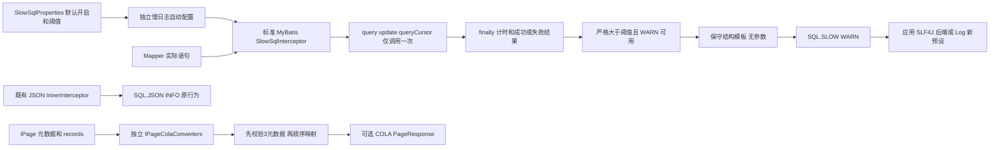

# MyBatis 能力补齐设计

> 推荐方案，未实施。既有 D-55/D-56/D-57/D-59/D-66 至 D-69 继续约束；本文补齐未决技术细节；除 D-99（MyBatis COLA 工具命名，2026-10-31 用户确认）外不追加“用户已确认”的 D 编号。

导航：[版本入口](../brainstorm.md) · [需求大纲](./brainstorm.md) · [规格](./spec.md) · [计划](./plan.md)

## 背景与证据

本轮按 sdd 与 source-driven-development 的规则，基于 [MyBatis POM](../../../../mimir-boot-starters/mimir-boot-starter-mybatis/pom.xml)、[日志装配](../../../../mimir-boot-starters/mimir-boot-starter-mybatis/src/main/java/com/yggdrasil/labs/mybatis/config/MybatisPlusLoggingConfiguration.java)、[JSON 拦截器](../../../../mimir-boot-starters/mimir-boot-starter-mybatis/src/main/java/com/yggdrasil/labs/mybatis/log/JsonSqlLogInnerInterceptor.java)、[旧分页工具](../../../../mimir-boot-starters/mimir-boot-starter-mybatis/src/main/java/com/yggdrasil/labs/mybatis/page/PageConverters.java)核对现状。

当前 JSON 在 beforePrepare 输出 `{sql,params}`，没有执行耗时；现有 maskSql 按敏感字段赋值脱敏，会保留普通字面量及注释，不能直接用于默认开启的新慢日志安全承诺。旧 PageConverters 只有 toMybatisPage/toPageResult，后者保留 null records，无 COLA 类型。

本地 MyBatis 3.5.19 源码确认：StatementHandler 的 query/update/queryCursor 会进入语句执行，query 包含结果映射；batch 调用 addBatch，BatchExecutor.doFlushStatements 内部才执行 JDBC executeBatch。Invocation.proceed 使用反射，Plugin.invoke 按 MyBatis 的 ExceptionUtil 展开异常。MyBatis-Plus 3.5.17 的实际 class 签名确认 PluginUtils.mpStatementHandler 可取得 mappedStatement/boundSql；不靠猜测私有字段名编写新反射路径。

本地 COLA DTO 5.0.0 源码确认 `PageResponse.of(data,totalCount,pageSize,pageIndex)` 设置 success=true，泛型不要求 Serializable，getData 在底层 data=null 时返回空列表。以上均为静态源码/描述符证据，不是实际 Mapper、数据库或隔离消费者验证。

## 目标与非目标

- 覆盖规格 MB-01 至 MB-07；默认慢阈值1000ms，成功及失败调用超过阈值均可观测。
- SQL.SLOW 的新增内容保护独立成立，SQL.JSON 结构、级别、开关及现有行为不改。
- 提供2个独立COLA转换入口，明确null/异常/int边界及无COLA消费者隔离。

不实现批量flush监控、游标全生命周期监控、JDBC代理、无总数分页、拦截器排序、带函数输出PageResult、防全表写或单页限制。不增加MyBatis→Log依赖，不修改其他模块生产代码，不增加tools脚本。本稿不建立“纯数据库耗时”“所有数据库错误监控”或日志可靠送达承诺。

## 架构与路径



普通语句路径独立于 `MybatisPlusInterceptor` 的 InnerInterceptor 列表；不为计时重新排序分页/租户插件。COLA 工具不参与自动装配或组件扫描。生产者安全内容与后端路由各负其责；MDC trace/span 继续由当前线程及日志后端处理，本需求不额外修改 MDC。

## 接口与配置契约

### IC-1：慢 SQL 开关与阈值（MB-01）

新增 `com.yggdrasil.labs.mybatis.config.SlowSqlProperties`，`@ConfigurationProperties(prefix="mimir.boot.mybatis.slow-sql")`，属性签名：

```java
public boolean isEnabled();
public void setEnabled(boolean enabled);
public long getThresholdMs();
public void setThresholdMs(long thresholdMs);
```

| 配置键 | 类型/默认 | 约束 |
|---|---|---|
| `mimir.boot.mybatis.slow-sql.enabled` | boolean / true | 不依赖active profile、JSON开关、Mapper DEBUG或其他“打印SQL”开关 |
| `mimir.boot.mybatis.slow-sql.threshold-ms` | long / 1000 | 闭区间 `[1,9223372036854]` 毫秒，保证乘1000000转换纳秒不溢出 |

不增加Duration别名、print总开关或输出原始参数选项。配置类实现Spring `InitializingBean.afterPropertiesSet()`，在绑定完成后验证，错误为只含键名/合法范围的 IllegalArgumentException；布尔/数值无法绑定走Boot绑定失败。即使enabled=false仍校验阈值，不静默使用默认。新增键为启动时配置快照，不承诺Nacos热刷新。

新增 `MybatisPlusSlowSqlConfiguration`，使用 `@AutoConfiguration`、`@AutoConfigureBefore(name="com.baomidou.mybatisplus.autoconfigure.MybatisPlusAutoConfiguration")`、相关 MyBatis 类存在条件和 `@EnableConfigurationProperties(SlowSqlProperties.class)`。方法签名：

```java
@Bean
public SlowSqlInterceptor slowSqlInterceptor(SlowSqlProperties properties);
```

Bean方法受 enabled=true/matchIfMissing=true 及 `@ConditionalOnMissingBean(SlowSqlInterceptor.class)` 控制，配置类本身不受enabled条件排除，以保持属性验证。消费者提供相同类型Bean时框架退让；消费者自行另行重复注册不属于框架默认单次保证。新增自动配置加入现有 `META-INF/spring/org.springframework.boot.autoconfigure.AutoConfiguration.imports`，由MyBatis-Plus Boot收集标准Interceptor Bean，仅对由MyBatis-Plus Boot自动创建的SqlSessionFactory添加一次；不再次塞进InnerInterceptor列表。

审查补充（推荐）：MyBatis-Plus 3.5.17 的 `MybatisPlusAutoConfiguration` 通过 `ObjectProvider<Interceptor[]>` 收集拦截器，只在其自身创建的 SqlSessionFactory 上应用。审查补充（推荐，2026-10-31 按本地 3.5.17 class 注解核对修正）：其 `sqlSessionFactory(DataSource)` Bean 方法带无参 `@ConditionalOnMissingBean`，按返回类型匹配任意 `SqlSessionFactory`（含产出该类型的 FactoryBean）；消费者只要声明了任一 SqlSessionFactory Bean，MyBatis-Plus 就不再创建自动工厂，不存在“自动工厂与自建工厂并存”的常规形态。因此自建工厂（多数据源、手工 `MybatisSqlSessionFactoryBean` 等）的应用默认慢SQL覆盖为0，除非：

- 自建工厂注入了容器中全部 `Interceptor` Bean（如 `Interceptor[]`、`ObjectProvider<Interceptor[]>` 或 `List<Interceptor>`）并调用 `setPlugins(...)`，此时会自动带上 SlowSqlInterceptor，无需也不应再次添加；
- 或按README手工注册。

典型的 baomidou dynamic-datasource 一般沿用 MyBatis-Plus 自动创建的单个工厂、只把 DataSource 换成路由数据源，因此属于默认覆盖范围；只有自行构建多个工厂的多数据源封装才落入上述“默认0覆盖”情形。框架不遍历/后处理用户工厂补注册，以免与消费者既有插件链重复。

README须给出手工注册方式，并要求先检查自建工厂现有插件链是否已包含 SlowSqlInterceptor（见上一条“注入全部 Interceptor”情形），避免重复：

- `setPlugins(...)` 会整体替换该工厂的插件数组，只传慢SQL拦截器会丢掉 `MybatisPlusInterceptor`（分页、租户等）。须在一次 `setPlugins(...)` 调用中传入完整插件列表（含 MybatisPlusInterceptor 与 SlowSqlInterceptor），或在工厂已构建的 `Configuration` 上用 `addInterceptor(...)` 追加；
- 审查补充（推荐，2026-10-31 按本地 MyBatis 3.5.19 class 核对）：`Configuration.addInterceptor(...)` 直接追加到 `InterceptorChain` 内部的普通 `ArrayList`，无同步保护；由于 `Configuration.newStatementHandler(...)` 每次创建 StatementHandler 都调用 `interceptorChain.pluginAll(...)`，追加后对之后新建的语句处理器生效。但该方式只能在启动阶段、任何 SQL 执行之前完成（如工厂 Bean 定义方法内构建后立即追加），不得在运行期并发执行 SQL 时追加，否则与 `pluginAll` 遍历存在并发修改风险；
- 审查补充（推荐，2026-10-31 按本地 MyBatis-Plus 3.5.17 class 字节码核对）：`com.baomidou.mybatisplus.spring.MybatisSqlSessionFactoryBean#addPlugins(Interceptor...)` 为追加语义——将已有 `plugins` 数组与新参数合并成新数组后再调用 `setPlugins(...)`，原插件（含 MybatisPlusInterceptor）保留。可作为第三种注册方式：在工厂 Bean 构建 `SqlSessionFactory`（`getObject()`/`afterPropertiesSet()`）之前调用 `addPlugins(slowSqlInterceptor)`；之后调用不会影响已构建的工厂。其他 MyBatis-Plus 版本未核对，升级后需复核；
- 同一工厂重复添加会导致同一语句产生多条事件，由消费者自行避免。

默认单次保证仅针对MyBatis-Plus自动创建的工厂。

### IC-2：计时与异常身份（MB-01、MB-03）

新增 `com.yggdrasil.labs.mybatis.log.SlowSqlInterceptor implements org.apache.ibatis.plugin.Interceptor`，核心SPI：

```java
public Object intercept(Invocation invocation) throws Throwable;
public Object plugin(Object target);
```

`@Intercepts` 精确声明 StatementHandler 的3个签名：`query(Statement,ResultHandler)`、`update(Statement)`、`queryCursor(Statement)`；plugin委托Plugin.wrap，不拦截prepare/parameterize/batch，也不叠加Executor层计时。构造接收验证后的阈值毫秒，快照为安全的纳秒值；测试可用包内构造注入LongSupplier单调时钟，生产默认System.nanoTime，不把测试时钟暴露为Spring公共配置。

执行规则：

1. enabled=false时不创建默认Bean；入口WARN不可用时直接调用proceed，不读SQL、参数或计时。WARN状态在入口取快照，结束再次关闭时不生成内容。
2. 入口立即读单调时钟，业务proceed恰好调用一次；捕获仅用于记住是否失败及观察到的Throwable，原样rethrow；finally计算结束值。计时不包含随后日志构建与输出耗时。
3. `elapsedNanos > thresholdMs * 1000000` 才输出；等于阈值不输出，不用向下取整后的毫秒判断。用BigDecimal.valueOf(elapsedNanos,6)输出精确到纳秒的毫秒数，不预先四舍五入。
4. 只在确认需输出后取得语句元数据；优先用 `PluginUtils.mpStatementHandler((StatementHandler)target)` 处理多层代理并获取MappedStatement/BoundSql。只读id与SQL字符串，不取parameterObject、不反射/遍历业务参数。提取失败仍可输出 `<unknown>` ID和省略SQL，不丢耗时/失败状态。
5. SQLException通常被InvocationTargetException包裹；只为提取errorType观察展开原因，不改变重新抛出的对象，不重新构造SQLException或PersistenceException。测试同时覆盖直接插件、MyBatis代理和Mapper层原有包装，底层SQLException必须同实例。

覆盖矩阵：

| 路径 | 记录口径 | 边界 |
|---|---|---|
| query | 实际语句方法，包含结果映射/ResultHandler及其内部嵌套查询时间 | 内层语句可另记；外层时间可能包含内层，不可求和当独占DB时间 |
| update | 执行及该方法内生成键处理 | 不含连接获取、prepare、parameterize；`SelectKeyGenerator.processAfter` 在update内执行另一条selectKey语句，内层查询被同一插件链另记，外层update耗时包含内层，两条事件时间重叠不可求和 |
| queryCursor | 创建Cursor并建立结果集的调用 | 不含后续遍历、完整读取及关闭 |
| 分页count与主查询 | 两次实际调用，各自判断阈值 | 保留各自MappedStatement ID，不伪造合并耗时 |
| 一/二级缓存命中 | 未到StatementHandler时无事件 | 不把缓存耗时当SQL执行 |
| batch/addBatch与内部/外部flush | 首版不覆盖实际批量执行 | 不监控addBatch，不用仅外部flush代理假称覆盖内部flush |
| 连接/prepare阶段失败 | 未进入所拦方法，不计时 | 保持异常，但不承诺被本慢日志捕获 |

### IC-3：SQL.SLOW 内容、值保护与故障隔离（MB-02）

Logger固定 `LoggerFactory.getLogger("SQL.SLOW")`，WARN输出单个JSON对象作为消息，无额外Throwable参数。新增内部不可变payload，不复用SQL.JSON载荷。

| 字段 | 值/含义 |
|---|---|
| `statementId` | 已配置MappedStatement ID；长度上限512字符；含控制字符或超限时固定 `<unknown>`，不截断回显 |
| `operation` | `QUERY`、`UPDATE`、`CURSOR_OPEN` |
| `elapsedMs` | 非负十进制数，单位ms、最多6位小数；不包含本事件输出耗时 |
| `thresholdMs` | 生效阈值整数，默认1000 |
| `timingScope` | `STATEMENT_CALL`，配合operation解释边界 |
| `outcome` | `SUCCESS` 或 `ERROR`；ERROR是字段值，事件级别仍为WARN |
| `errorType` | 成功为null；失败仅展开后异常类名，不输出message/stack/cause文本 |
| `sql` | 保守结构模板或固定 `<omitted>` |
| `sqlStatus` | `SHAPE`、`UNSUPPORTED`、`TOO_LONG`、`UNAVAILABLE` |

示例：`{"statementId":"sample.AccountMapper.select","operation":"QUERY","elapsedMs":1000.000001,"thresholdMs":1000,"timingScope":"STATEMENT_CALL","outcome":"SUCCESS","errorType":null,"sql":"SELECT ? FROM ? WHERE ? = ?","sqlStatus":"SHAPE"}`。

推荐新增包内 `SlowSqlTextSanitizer`，不改现有SqlLogMaskUtils，不默认输出任何参数、原始标识符或字面量。算法是有界的一次扫描结构模板器，不新增SQL解析库，不承诺模板可重新执行：

- 原输入null/空白→UNAVAILABLE；长度先按String.length检查，>65536直接TOO_LONG并省略，不截断后继续解析。
- 只支持首关键字为SELECT/INSERT/UPDATE/DELETE的单条常见DML；去除`--`行注释、非嵌套`/*...*/`块注释。可执行注释`/*!`、`/*M!`及未闭合/嵌套注释→整条省略。
- 单引号字符串接受SQL标准`''`转义，整个替换`?`；含反斜杠、未闭合引号→整条省略。双引号、反引号、方括号、美元引号、JDBC转义块、非ASCII token或存储过程→UNSUPPORTED并省略。不存在“解析失败还保留前半句”的回退。
- 标识符token采用ASCII字母/下划线起始、其后字母数字下划线；只有精确匹配固定关键词白名单才输出大写常量，其他标识符全部替换`?`。白名单固定为 `SELECT INSERT INTO VALUES UPDATE SET DELETE FROM WHERE AND OR NOT IS IN LIKE BETWEEN EXISTS DISTINCT AS JOIN LEFT RIGHT INNER OUTER ON GROUP BY HAVING ORDER ASC DESC LIMIT OFFSET FETCH FIRST NEXT ROWS ONLY UNION ALL CASE WHEN THEN ELSE END`，按ASCII大小写不敏感匹配。`TRUE`、`FALSE`、`NULL` 不属于白名单，和其他非白名单标识符一样，无论出现位置或大小写均整体替换为`?`；因此 `INSERT INTO t(flag) VALUES(TRUE)` 的布尔token被替换，`WHERE x IS NULL` 结构等价于 `WHERE ? IS ?`。数字token整体替换`?`，不把输入切片原样写出。
- 保留运算/分隔符白名单 `? ( ) , . = < > ! + - * / %`，组合运算符仅`<= >= <> !=`；其余符号拒绝。允许末尾1个分号但不输出，任何其他分号拒绝多语句。注释去除后空白归一化，所有输出片段仅来源于固定白名单和`?`，不携带原始值。
- 对安全模板做4096字符上限，超限使用长度包含在上限内的固定后缀（一个空格加 `[truncated]`）；截断发生在替换完成后。最终JSON由序列化器转义，禁止物理换行/控制字符进入消息；原输入从未作为异常诊断字段传给logger。

该方案有意牺牲表/列名、布尔/null实际值与方言细节，只保留有限结构信息，以开发者语句ID配合结构模板定位；业务动态生成的MappedStatement ID也必须避免放入秘密，框架无法判断一个合法类名样式ID是否由秘密拼成。SQL.JSON原有保护边界不因此增强。

审查补充（推荐，保持上述安全设计不变，仅明确取舍）：D-57只要求输出“脱敏SQL”，并未要求保留可读SQL；本模板是该要求的保守实现，代价是常见语法的可读性或可用性明显下降，README须列出：

- 函数名不在白名单，结构保留但名称丢失，如 `COUNT(*)`→`?(*)`、`NOW()`→`?()`；
- 以 `WITH` 开头的CTE首关键字不受支持→`UNSUPPORTED`整条省略；
- PostgreSQL `::` 类型转换、`||` 字符串拼接、JSON运算符（`->`、`->>`、`@>` 等）及其他不在符号白名单内的运算符→整条省略；
- 双引号/反引号/方括号标识符、美元引号、`/*!` 可执行注释、存储过程/多语句→整条省略。

因此慢事件排障主要依赖 `statementId` 定位到Mapper语句，再结合源码或经授权的其他诊断手段；不得为提高可读性在本需求内放宽白名单或增加原文回退。

失败隔离：提取、模板构建、JSON和常规appender异常不得替换返回值/业务异常，也不通过另一个logger打印原文。存在既有业务异常时，以原异常优先，即便日志路径再失败也重抛原对象；无既有业务异常时吞掉可恢复Exception/LinkageError，VirtualMachineError/ThreadDeath等致命错误继续传播，不承诺JVM失效时可用。不新增递归诊断或参数toString；可能丢失慢事件，不能以“未抛错”宣称已送达。

审查补充（推荐）：此处吞掉LinkageError与IC-6禁止捕获LinkageError并不矛盾，二者职责不同。慢日志是业务调用之外的旁路观测，日志后端、JSON序列化或appender插件缺类/版本冲突时，若传播LinkageError会把一次已成功的SQL变成业务失败，违背MB-02“常规日志失败不改变业务结果”；且该错误只影响观测，丢失慢事件即可。COLA适配是消费者显式调用的主路径，返回值本身就是业务结果，缺少DTO属于消费者类路径配置错误，吞掉只能伪造失败/空分页并掩盖问题，因此必须传播。两处均不捕获VirtualMachineError等致命错误。

### IC-4：JSON保留与Log路由（MB-04）

现有 `JsonSqlLogInnerInterceptor`、`MybatisPlusLoggingConfiguration`、`enable-json-sql-log`、`MybatisProperties.enableJsonSqlLog` 的执行语义均保持。不开启JSON不会阻止SlowSqlInterceptor注册或执行；SQL.SLOW关闭也不触碰JSON。普通Mapper DEBUG和SlowSql logger WARN分别判断，不创造总print开关。

与[Log设计](../log-runtime/design.md)采用同一协议：新容器预设 SQL.SLOW→CONSOLE，新服务器预设 SQL.SLOW→sql.log，级别WARN、additivity=false；SQL.JSON仍为INFO并按Log约定路由。路由文件属于Log需求，本计划不改；联调用实际出口计数而非只检查logger名称。未选择新预设或使用自定义XML时由应用后端决定，不自动注入新配置，不强制引入Log Starter。

同步后端、异步满队列及IO失败由实际日志配置决定；Log新预设默认保留日志可能阻塞，never-block模式可能丢弃。不得承诺业务延迟上界、日志持久化或采集端送达。

### IC-5：IPage→COLA接口（MB-05）

新增独立类，旧PageConverters保持原公共签名/语义，包括其null records处理：

```java
package com.yggdrasil.labs.mybatis.page;

public final class IPageColaConverters {
    private IPageColaConverters();
    public static <T> com.alibaba.cola.dto.PageResponse<T> toCola(
            com.baomidou.mybatisplus.core.metadata.IPage<T> source);
    public static <S, T> com.alibaba.cola.dto.PageResponse<T> toCola(
            com.baomidou.mybatisplus.core.metadata.IPage<S> source,
            java.util.function.Function<? super S, ? extends T> mapper);
}
```

命名（D-99，2026-10-31 用户确认）：MyBatis新工具最终名为 `com.yggdrasil.labs.mybatis.page.IPageColaConverters`，不使用 `ColaPageConverters`。MyBatis Starter依赖Common，Common的 `com.yggdrasil.labs.common.page.ColaPageConverters` 总在同一类路径，短类名相同会造成导入冲突与误用；类名前缀表明源类型为 `IPage`。

泛型差异是有意的：Common版输入为 `PageResult<T extends Serializable>`，上界继承自PageResult本身；MyBatis版直接读取 `IPage<T>`，`IPage` 无此上界，故两重载输入及输出均无Serializable上界。两者输出 `PageResponse` 均不增加上界，不为对齐而给MyBatis版补上界。

输入及输出均无Serializable上界，不经PageResult中转以免引入其上界。规则与[Common独立工具](../common-contracts/design.md)对齐，Common的原生PageResult.map允许data=null原样保留；COLA输出则规范为getData非null空列表，不把两者混为一条协议。

1. source非null，带函数重载再校验mapper非null，错误为IllegalArgumentException，包括空页。
2. 读取total/current/size各一次作为long快照，依次检查total≥0、current≥1、size≥1，以及三个值都≤Integer.MAX_VALUE。失败先于读取records及调用mapper，异常消息指出`total/current/size`与约束；不先强转再校验。
3. 读取records一次。null records按COLA5行为传null或空集合，公开getData为空且不保证该空列表可变性。非null列表建立新ArrayList，按原顺序每个非null元素调用mapper一次；null元素不调用mapper并原位保留；mapper返回null同样保留。
4. mapper异常原实例传播，不包装不吞掉不返回部分页，不回滚用户函数已经发生的副作用。框架不修改输入页、列表或元素，不深复制元素；不承诺并发修改安全。
5. 调用 `PageResponse.of(mappedData,(int)total,(int)size,(int)current)`；success=true、errCode/errMessage=null，参数顺序注意size在current之前。总页数由COLA派生，不复制IPage额外属性，不检查records.size与total/size一致性，不拒绝“页码超过最后一页”。

身份重载采用相同校验与新列表语义，元素身份保留。合法边界total=0、current/size=1及三个int最大值均可转换；任一int最大值+1拒绝，无数据库调用和总数推断。

### IC-6：可选依赖及无COLA隔离（MB-06）

MyBatis POM新增 `com.alibaba.cola:cola-component-dto`，`optional=true`，不写版本，使用[BOM需求](../bom-dependencies/design.md)管理的5.0.0。Common的optional不会传递，MyBatis须自己声明编译依赖；不引入cola-components-bom。

COLA类型只出现在独立工具里；不在旧PageConverters、MybatisProperties、自动配置方法/字段、普通模型getter或静态初始化中引用/扫描该工具，不注册成Bean。显式调用者自行声明DTO；缺少DTO而调用工具属于编译/链接错误，不捕获LinkageError转换成业务失败。

验收不能只用模块测试classpath（含optional编译依赖）：必须创建真正剔除 `com.alibaba.cola` 的隔离ClassLoader或独立消费者，确认依赖树、反射普通工具/模型、Jackson序列化、启动自动配置、H2 Mapper与旧PageConverters均成功；再加入DTO验证新接口。另验证“编译有DTO运行删除DTO”的适配调用失败，范围只限显式适配路径。

### IC-7：searchCount说明（MB-07）

仅修改MyBatis README增加两个场景：业务单独 `count` 后用 `new Page<>(current,size,false)` 查记录，显式 `page.setTotal(realTotal)` 再转换；只取前N条时关闭COUNT，仅返回业务需要的记录，不把未查询total=0描述为真实总数。不修改模板项目、不新增无总数分页模型/多查一条工具、不恢复M-01排序说明。

查询实际COUNT次数通过H2数据源/JDBC计数或MyBatis执行事件验证，不能用慢日志计数替代（快COUNT不会产生慢事件）。COLA转换只验证数值范围，不能证明total是否真实。

## 数据模型与非功能约束

无持久化表、HTTP API或公共响应结构变更。新增SlowSqlProperties和仅用于日志的不可变payload；计时状态为每次调用局部变量，不使用共享可变计时器/SQL缓存或ThreadLocal栈。COLA输出为独立新对象、新非null记录容器，不复用源分页实例。

| 维度 | 可验证约束 |
|---|---|
| 日志值保护 | SQL.SLOW参数遍历/反射次数0；测试秘密在SQL、消息、诊断中出现0次；SQL模板≤4096字符 |
| 有界工作 | 原SQL>65536字符直接省略；支持输入一次扫描O(min(n,65536))；普通关闭路径0次模板处理 |
| 时钟与业务 | 单调计时，proceed每次1次；比较精度1ns；常规日志失败不改变业务返回/异常 |
| 分页 | O(n)时间/新列表空间，非null元素mapper各1次；三个long值校验后转int，不额外COUNT |
| 依赖隔离 | MyBatis→Log依赖新增0个；DTO optional；无DTO普通消费者链接错误0次 |
| 可观测性 | 每个默认注册的受支持调用最多1条SQL.SLOW事件；payload单行；实际送达与性能尚未验证 |

性能不编造固定百分比收益。实施后对关闭、WARN关闭、未超阈值、超阈值+模板4条路径做固定JDK/输入/后端的对比，报告吞吐与P95/P99；本轮没有量测。输出阻塞属于后端行为，不用模板器耗时冒充端到端日志耗时。

## 失败处理

| 来源 | 处理 |
|---|---|
| 非法阈值或绑定失败 | 阻断启动，属性名/合法范围诊断，不回显秘密 |
| 实际SQL返回/SQLException | 原样返回/按原MyBatis包装传播，失败超阈值仍尝试慢事件 |
| 语句元数据提取失败 | 使用unknown/omitted安全占位，保留耗时与结果状态 |
| 模板不支持/过长 | 固定omitted和状态，无原文回退 |
| 模板构建、序列化、常规appender失败 | 隔离日志失败，不覆盖业务；无递归日志/原异常文本 |
| DTO缺失或不兼容 | 仅显式适配路径保持链接错误；普通路径应有隔离验收 |
| source/mapper/元数据非法 | IllegalArgumentException，元数据先于用户映射检查 |
| mapper或IPage getter自身抛错 | 原异常传播，不包装不自动重试 |

## 替代方案

| 方案 | 优点 | 代价/未推荐原因 |
|---|---|---|
| Executor计时 | 语句ID易取，覆盖逻辑调用 | 混入缓存、连接及映射，重载/内部flush去重困难；首版选择实际语句口径 |
| JDBC代理观测execute/executeBatch | 更接近执行并可覆盖batch | 新增连接/资源包装与更广兼容责任，超出本轮范围 |
| StatementHandler.batch计时 | 实现短 | 只是addBatch，无法代表真正批次执行，不采用 |
| Duration阈值 | 可读单位 | 新属性无兼容负担，推荐显式毫秒long减少绑定歧义并验证溢出 |
| 只复用maskSql或参数黑名单 | 排障细节多 | 普通字面量/动态SQL/注释/未登记字段会泄漏，默认开启不适合 |
| 结构模板全部标识符替换（推荐） | 不依赖Log/外部解析器，输出来源有界 | 丢失表/列名和方言细节，以语句ID补定位；不支持直接省略 |
| 全程只输出SQL省略标记 | 安全简单 | 对普通可支持DML也无结构信息；保留为处理失败的回退 |
| COLA方法放旧PageConverters或经PageResult中转 | 少一个类/复用已有模型 | 可选类型加载或Serializable上界耦合，选择独立工具直接转换 |

## 验证策略

| 契约 | 层级 | 用例与通过标准 |
|---|---|---|
| IC-1 | Binder/自动配置上下文 | 默认/false、合法边界、0/负/乘法溢出、非法布尔；禁用仍校验；自定义同类型Bean退让；仅自动工厂时恰好1个拦截器；声明任一用户SqlSessionFactory后MyBatis-Plus不创建自动工厂，未注入全部Interceptor的自建工厂默认0个，注入全部Interceptor并setPlugins的自建工厂恰好1个，按README手工注册后恰好1个且MybatisPlusInterceptor仍在插件链中 |
| IC-2 | 可控时钟单元+真实MyBatis/H2集成 | 阈值前/等/后1ns、成功/失败、单次proceed、代理链、count/主查询/缓存/嵌套/selectKey AFTER生成键/cursor/batch；范围与矩阵一致 |
| IC-2异常 | 真实Plugin代理+Mapper集成 | JDBC桩抛固定SQLException实例；成功及失败时分别注入模板/序列化/appender错误；原异常链底层assertSame |
| IC-3 | 模板器单元+实际日志事件 | 明文秘密在字符串/数字/标识符/注释/拼接/未知方言/过长输入/未闭合文本中均不出现；完整payload和输出检查，不能只断言字段名 |
| IC-3关闭/并发 | 单元与多线程MyBatis调用 | WARN关闭0次取SQL/模板调用；大量并发及嵌套不串语句/耗时；参数对象带抛错getter也不读取 |
| IC-4 | 既有JSON回归+日志后端集成 | JSON四环境与prod、显式true/false不变；JSON/slow四组合；结构保持sql/params、INFO，logger独立 |
| IC-4路由 | 与Log需求联调 | 新容器stdout、新服务器sql.log事件各1次；无LogStarter/自定义XML可运行；记录阻塞/丢弃边界 |
| IC-5 | 单元+JavaCompiler泛型编译 | 两重载、非SerializableDTO、null位置/mapper返回null/原异常、int最大/+1、非法元数据先于mapper、空列表/复制/顺序 |
| IC-6 | 隔离classloader及消费者 | 有DTO转换成功；无DTO普通启动/反射/Jackson/Mapper成功；发布POMoptional；删除DTO后显式路径失败 |
| IC-7 | H2集成+README代码片段核对 | 单独COUNT+searchCount=false只有1次COUNT；前N条示例0次COUNT，不声称total真实 |

实现阶段先运行 `./mvnw -pl mimir-boot-starters/mimir-boot-starter-mybatis -am test`，真实数据库/配置IT使用对应verify入口，再执行项目完整质量验收。日志安全需检查最终事件和实际出口，模块单测通过不等于Log预设或真实数据库方言通过。数据库方言未实测时，明确哪些语句被安全省略，不以H2通过外推MySQL/PostgreSQL全覆盖。

本轮仅检查四份文档的frontmatter、相对链接、规格映射、决策覆盖和空白，不执行功能测试或全库文档门禁。后续任务与ownership见[计划](./plan.md)，性能/CI/发布消费者/采集端状态分别报告。
