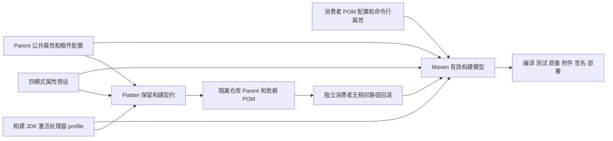

# Parent 构建契约设计

> 推荐方案，未实施。D-82 至 D-89 等既有决定为约束；本稿新增的 profile ID、插件组织及 Flatten 策略是推荐，未登记为用户确认的 D 编号。所有运行结果均须后续验证。

导航：[版本入口](../brainstorm.md) · [需求大纲](./brainstorm.md) · [规格](./spec.md) · [实施计划](./plan.md)

## 背景与事实边界

本设计面向 Maven Parent 的公共构建契约，不改变运行时模块依赖方向，无需新增模块或架构边界。事实入口是 [Parent POM](../../../../mimir-boot-parent/pom.xml)、[根 POM](../../../../pom.xml)、[Processor POM](../../../../mimir-boot-starters/mimir-boot-starter-mybatis-processor/pom.xml)、[发布指南](../../../engineering/release.md)和 [release workflow](../../../../.github/workflows/release.yml)。本轮只静态核对并读取本机 Compiler 3.16.0、Failsafe 3.6.0 的插件描述符，没有执行 Maven、GPG 或远程部署。

当前 Compiler 用 `source/target=${java.version}`，Surefire 写死 `skipTests=false`，JaCoCo 在 `dev/prod` 写死跳过，Spotless 在通用管理及 `ci` 各有一个 `validate` execution。Flatten 当前保留属性与 build，却解析 profiles。根 POM 已有公共 GPG `sign-artifacts@verify`，`maven-central` profile 设置 `gpg.skip=false`；Central workflow 还显式传 `-Dgpg.skip=false`。Parent 本身没有公共 GPG 默认属性，`ci` 内重复声明签名配置。

本地描述符证据：Compiler 的 `compile/testCompile` 均接受 `maven.compiler.proc`；Failsafe 的 `integration-test/verify` 接受 `skipITs`、`maven.test.skip`；3.6.0 描述符虽有已废弃的 `skipTests` 参数，但未绑定 `-DskipTests` 用户属性，故 `-DskipTests` 不跳过 IT 的结论不变。这只证明参数入口，不证明有效模型、执行覆盖和 Flatten 保留已通过。

## 目标与非目标

- 满足规格 PB-01 至 PB-08，覆盖 P-01 至 P-05、PC-01 至 PC-03。
- JDK 17、21、25 共 3 组默认目标均为 17；4 个构建模式独立成立且 JDK 适配不改变质量默认值。
- 通过发布前隔离制品消费者验证每个可覆盖入口，格式检查默认每模块 1 次。

不升级 Java/Boot/Maven 基线、不更换插件版本、不建立处理器 allowlist、不引入新的 Mimir 开关或 profile 强制互斥。不新增工程脚本，不调整 CI/发布流程（既有构建模型检查按 D-97 调整除外，见 PB-05），不执行真实私服或 Central 发布。公开仓库消费者验证属于将来实际发布阶段。

## 架构与配置流



推荐把“能力是否进入生命周期”和“默认是否跳过”分开：JaCoCo、GPG 的可继承 execution 放在公共路径；四个模式主要选择默认属性，`ci` 继续增添 Enforcer。所有 skip 通过原生属性控制，无写死的 `true/false` 阻挡消费者。JDK profile 只设置处理器属性。

## 配置契约

### PB-01：选择编译目标

修改 `mimir-boot-parent/pom.xml` 的 Compiler 管理配置：`<source>${java.version}</source>` 和 `<target>${java.version}</target>` → `<release>${java.version}</release>`；删除 Parent 的 `<maven.compiler.source>17</maven.compiler.source>`、`<maven.compiler.target>17</maven.compiler.target>` 和只包含 `-parameters` 的 `compilerArgs`，保留 `<parameters>true</parameters>`、UTF-8 编码。

`java.version` 是非空、构建 JDK 支持的 Java release 数值字符串，默认 `17`；推荐消费者属性或 `-Djava.version=21` 覆盖。默认 `17` 对应 class major 61，目标 `21` 对应 65。非法/不支持值及目标外 API 交给编译器报错，不降级。Compiler 配置直接引用 `java.version`，不新增 `maven.compiler.release` 中间属性。

根 POM 尚有 `maven.compiler.source/target` 属性，BOM 也有同名属性；本需求不扩大到 BOM 属性清理。Parent 不再把这些属性作为目标配置。实施时检查有效 Compiler 配置和实际 javac 参数，确保根属性未造成 source/target 与 release 冲突。旧消费者若自行配置 Compiler 的 `source/target/release`，应迁移为 `java.version` 或自行管理完整 Compiler 配置；不承诺 Parent 属性能强行覆盖消费者字面量配置。

### PB-02：按构建 JDK 发现注解处理器

推荐在 Parent 最后新增 `jdk-annotation-processing` profile：`activation/jdk=[21,)`，唯一业务属性为 `maven.compiler.proc=full`。公共属性不设置 `maven.compiler.proc`，Compiler 配置不增加默认 `<proc>`，由插件原生参数消费属性，使 JDK 17 至 20 不接收 Parent 默认 `full`。

覆盖入口为 `-Dmaven.compiler.proc=none`、消费者同名属性或消费者 Compiler `<proc>none</proc>`。Processor 模块既有 `<proc>none</proc>` 不改。profile 依据运行 Maven 的 JVM（其 `java.version` 系统属性），不依据 toolchain/fork 实际调用的 javac；默认不承诺 fork/toolchain 所选 javac 与 Maven JDK 不一致时的自动适配，消费者需自行显式配置并验证。

不声明 `annotationProcessorPaths` 或固定 `annotationProcessors`，继续 classpath discovery。Lombok、MapStruct、binding 的版本由 [BOM 需求](../bom-dependencies/design.md)负责，MyBatis 生成行为由 [Processor 需求](../mybatis-processor/design.md)负责。依赖缺失或消费者关闭必需处理器后的缺类错误正常失败。

### PB-03/PB-04：公共默认、模式和原生开关

Parent 公共 `properties` 推荐显式声明下表默认值。所有布尔值推荐使用 `true/false`；不新增 Parent 校验器，对非法输入按具体插件报错或解析行为报告，不承诺统一错误文案。

| 属性 | 公共默认 | 作用及边界 |
|---|---|---|
| `java.version` | `17` | 编译目标，不选择构建 JDK |
| `skipTests` | `false` | 仅 Surefire 测试执行；无 `skipITs` 联动 |
| `skipITs` | `false` | Failsafe 执行与结果验证；无单测联动 |
| `maven.test.skip` | `false` | 编译插件跳过测试编译，两类测试跳过执行 |
| `jacoco.skip` | `true` | `prepare-agent/report/check`；不随测试开关变化 |
| `spotless.check.skip` | `true` | Spotless 默认 `check`；不跳过手动 `apply` |
| `gpg.skip` | `true` | 默认不签名，各构建模式不覆盖为 false |
| `maven.deploy.skip` | `true` | 标准 Deploy 默认跳过；不代表其他发布扩展的统一开关 |

`maven.source.skip`、`maven.javadoc.skip` 继续使用插件原生默认“不跳过”，不新增包装属性。

以下矩阵均指 `clean verify` 可达的执行、无消费者覆盖且数据/源码存在，所有行的签名与标准部署默认均跳过。T/F 分别为 true/false；`skipTests/skipITs` 在各行均为 F。

| 模式 | `maven.test.skip` | `jacoco.skip` | `spotless.check.skip` | 单测/集测 | Enforcer |
|---|---|---|---|---|---|
| 未指定模式 | F | T | T | 执行/执行 | 无额外激活 |
| `dev` | F | T | T | 执行/执行 | 无额外激活 |
| `precheck` | F | F | F | 执行/执行 | 无额外激活 |
| `ci` | F | F | F | 执行/执行 | 执行既有规则 |
| `prod` | T | T | F | 跳过编译及执行 | 无额外激活 |
| 仅 JDK profile 自动激活 | F | T | T | 执行/执行 | 无额外激活 |

保留 `dev` 的 `activeByDefault` 以减少 profile 标识变化，但任何其他 profile 使其失活时，公共属性仍提供等价开发默认值。四模式各显式声明自身 `maven.test.skip/jacoco.skip/spotless.check.skip`；补齐 `precheck/prod` 的 `spotless.check.skip=false`，避免继承公共开发跳过值。`prod` 的格式检查是现状实际行为，不新增“prod 自动部署/自动签名”的承诺。

Surefire 管理配置中的 `<skipTests>false</skipTests>` 删除，使用原生 `skipTests`；Failsafe 继续使用 `skipITs`，不写 `<skipTests>`，保留原有 includes/excludes 与执行阶段。两类测试都跳过需同时传 `skipTests=true` 和 `skipITs=true`；只在希望跳过测试编译时使用 `maven.test.skip=true`。覆盖率开关不跟随测试开关。

审查补充：`-DskipTests` 不跳过 IT 依赖当前管理的 Failsafe 3.6.0 未把废弃 `skipTests` 参数绑定到该用户属性；消费者降级或改写 `maven.failsafe.plugin.version` 时该边界可能变化，README 须说明，PB-04 验收仅对默认 3.6.0 成立。

JaCoCo 推荐：公共 `build/plugins` 声明一次激活；在管理配置使用 `<skip>${jacoco.skip}</skip>`，移除 `dev/prod` 的字面量 skip 配置及四模式重复的激活声明。原有 `prepare-agent`、`report@verify`、`check@verify`、`jacoco.exec` 追加规则与排除范围均保留，阈值仍为指令 0.60、分支 0.50。这样 JDK profile 单独激活时，消费者仍可仅用 `jacoco.skip=false` 开启能力。

覆盖率采集依赖测试进程的实际 agent 参数；消费者自行覆盖 Surefire/Failsafe `argLine` 时需保留 JaCoCo 注入，Parent 不修改消费者 JVM 参数。不执行测试、无被测类或无数据时，区分插件跳过/无数据与阈值通过，不新增自动判失败策略。

### PB-03：属性优先级与组合边界

推荐按 Maven 原生模型解释：同一属性的命令行用户属性优先于项目属性；消费者 POM 可覆盖继承属性；同一 Parent 内多个活动 profile 的冲突属性按声明顺序后者覆盖前者。消费者自己写入的插件字面量、execution 配置、`combine.*` 合并规则不属于“任意 `-D` 都能覆盖”的保证。

保留模式声明顺序 `dev → precheck → ci → prod`，JDK profile 放最后且不写质量属性。下表是推荐配置按该规则得到的预期，必须以有效 POM和运行日志验证；不得把交换 `-P` 书写顺序当作切换优先级的方法。

| 常用组合 | 预期测试/覆盖率/格式 | 附加行为 |
|---|---|---|
| `dev,precheck` | 执行 / 开启 / 开启 | 无 Enforcer |
| `dev,ci` 或 `precheck,ci` | 执行 / 开启 / 开启 | 保留 ci Enforcer |
| `dev,prod` 或 `precheck,prod` | 跳过编译及执行 / 跳过 / 开启 | 不自动部署 |
| `ci,prod` | 跳过编译及执行 / 跳过 / 开启 | ci Enforcer 仍执行 |
| 任一单模式或组合 + JDK profile | 不改变上述质量值 | JDK≥21 默认处理器 full |

允许消费者显式覆盖各属性组合，例如 `-Pprod -Dmaven.test.skip=false -Djacoco.skip=false` 重新开启测试和覆盖率。`-Pprod -DskipTests=false` 本身不能抵消 `maven.test.skip=true`。不引入 profile 互斥、冲突报错或根据测试开关自动改写质量属性。

### PB-05：可选 GPG 与框架自身发布

推荐将 Parent `ci` 中的 `maven-gpg-plugin` 声明和 `sign-artifacts@verify` 移到公共 `build/plugins`，保留 execution ID，与根已有 ID 合并；plugin 和 execution 的 `<skip>` 都使用 `${gpg.skip}`。Parent 自己显式声明公共 `gpg.skip=true`，避免依赖根发布 POM 保留属性。公共绑定默认跳过；显式 `-Dgpg.skip=false` 后普通 `verify` 或四模式均可进入签名，不要求先选择 `ci`。

Parent 的公共 GPG 声明同时保留根现有的 `gpgArguments`（`--batch`、`--pinentry-mode`、`loopback`），使发布 Parent 即使不再继承根的原始 build，也具备相同非交互参数。只搬移执行块而丢失有效模型中的非交互配置，不算完成；口令仍从受控环境输入，不能固化到属性或示例。

根 POM 的 `maven-central` profile 和 workflow 的 `-Dgpg.skip=false` 保持。Parent 子层新增默认值可能影响祖先 profile 属性的合并，因此本仓库正式签名命令必须保留显式用户属性；不以仅 `-Pmaven-central` 代替现有完整发布命令。验证根、Parent 及一个实际 JAR 的签名，确保同 ID 合并后每构件只签一次。

已确认（D-97）：Parent 自身属性优先于祖先 profile 注入的属性，改动后 Parent、common 及全部 Starter 在仅 `-Pmaven-central` 时有效 `gpg.skip` 为 true。现有[构建模型检查](../../../../tools/engineering/src/quality/verify-build-model.mjs)对每个 Reactor POM 断言 `[default]=true`、`[maven-central]=false`，属于完整门禁，不调整必然失败。推荐把其中的发布场景改为与 [release workflow](../../../../.github/workflows/release.yml) 一致的 `-Pmaven-central -Dgpg.skip=false`：

- 默认场景保持原断言：`properties/gpg.skip` 唯一且为 true，GPG 插件及每个 execution 的 skip 为 true。
- 发布场景只断言插件及每个 execution 的有效 skip 为 false，并要求存在 `sign-artifacts` execution；跳过 `properties/gpg.skip` 断言。已核实（Maven 3.10.0，`help:effective-pom -Dgpg.skip=false`）：插件与 execution 的 `<skip>${gpg.skip}</skip>` 插值为 false，但有效 POM `<properties><gpg.skip>` 仍为模型值 true，用户属性不回写 `<properties>`。现有 `requireGpgConfiguration`（`verify-build-model.mjs:43-46`）先断言属性，发布场景若沿用必然失败，故属性断言只在默认场景保留。
- 不新增"仅 `-Pmaven-central` 必须为 true"的断言，避免把实现细节固化为契约；显式传 `-Dgpg.skip=false` 的依据是 [release workflow](../../../../.github/workflows/release.yml) 第 282 行，[发布规程](../../../engineering/release.md)当前未写明该参数，由 T4 补一句说明。
- 根 [POM](../../../../pom.xml) 第 54 行注释"maven-central profile 显式覆盖为 false"只对根与 BOM 成立，同步改为说明发布命令须显式传 `-Dgpg.skip=false`；第 250-251 行 profile 注释"需显式 -P maven-central"同样不再充分，且引用的 Parent README「发布到 Maven Central」章节不存在，一并改为指向[发布规程](../../../engineering/release.md)。`maven-central` profile 本身不改。

审查补充：发布场景断言弱于原断言。用户属性 `-Dgpg.skip=false` 使所有 `${gpg.skip}` 引用均插值为 false，该场景实际只能发现硬编码的 skip 字面量和缺失的 `sign-artifacts` execution；根 `maven-central` profile 中 `gpg.skip=false` 的声明不再被任何检查覆盖。该 profile 属性本就不影响 Parent 子树（D-97），只对根与 BOM 有效，此缺口接受，不另增断言。

`tools/` 准入说明：该脚本已是 `bash scripts/engineering.sh build-model` 与完整验收 FULL_PLAN 的正式入口，长期职责是校验全部 Reactor POM 的默认与发布签名模型；本次只修改其期望以匹配新的跨版本发布契约，不新增文件、不加入 v2.4.0 专项版本或一次性验证逻辑。按[工具准入约束](../../../../tools/engineering/README.md#保留范围)第 16 行的同步清理要求，同时更新 [tools/engineering/README.md](../../../../tools/engineering/README.md) 第 73 行 `build-model` 用途（“default/maven-central 签名开关”）及脚本第 124 行汇总输出文案，使其表述为默认场景与 `-Pmaven-central -Dgpg.skip=false` 发布场景。

本地验证使用隔离临时 GPG home 与一次性测试密钥，不用真实发布密钥。默认无私钥场景不传 `-Dgpg.skip=true`，否则无法证明默认契约。显式开启失败时阻断 verify/deploy，不静默回退；签名成功不等于部署成功。

### PB-06：合并默认 Spotless execution

保留 `pluginManagement` 的 `spotless-check@validate` 和公共插件激活，移除 `ci` 里的整个重复 `check@validate` execution；若 `ci` 的 Spotless 声明已无其他内容，一并移除空声明。既有格式配置、Google AOSP 规则、扫描/排除范围、`spotless.check.skip` 引用不变。

以每个模块的 `spotless-maven-plugin:check (spotless-check)` 生命周期调度计数，一次正常 verify 只能有 1 次 Parent 默认调度。跳过时允许插件显示跳过日志；不要求完全没有 mojo 日志。显式直接调用 check、消费者额外 executions、多模块各执行一次均不属于重复。

迁移建议：消费者原先覆写 `check` 时，改为覆写 `spotless-check`；若保留旧 `check`，Maven 可能把它视为自定义新 execution，保留其配置并在 README 解释额外检查来源。不能为保持旧 ID 又保留第二个自动调度。

### PB-07：接通已有版本属性

在 Parent `build/pluginManagement/plugins` 新增以下三条管理声明，不增加公共激活或 execution：

| 插件坐标（groupId 均为 `org.apache.maven.plugins`） | version 引用 | 当前默认 |
|---|---|---|
| `maven-clean-plugin` | `${maven.clean.plugin.version}` | 3.4.0 |
| `maven-resources-plugin` | `${maven.resources.plugin.version}` | 3.3.1 |
| `maven-install-plugin` | `${maven.install.plugin.version}` | 3.1.1 |

下游同名属性可覆盖，或自行配置插件版本。默认生命周期绑定由 Maven/packaging 保持，不因版本接通增添执行次数。版本不存在或与环境不兼容直接按插件解析/执行失败处理；这项变更会替换部分消费者的 Maven 自带版本，应明确为可观察默认值变化。

### PB-08：Flatten 发布继承契约

推荐仅在 Parent 的 Flatten `pomElements` 将 `<profiles>resolve</profiles>` → `<profiles>keep</profiles>`；继续保留 `properties/pluginManagement/build=keep`，`parent/dependencies/dependencyManagement=resolve`、`flattenMode=oss`、`updatePomFile=true` 和执行阶段均不变。JDK 激活条件和原生 skip 属性引用由消费者构建时解析，不能在生产者发布 JDK/profile 上固化。

发布 Parent 必须包含自己的公共默认值、四模式与 JDK profile，保留 `${java.version}`、`${jacoco.skip}`、`${spotless.check.skip}`、`${gpg.skip}`、三个插件版本属性的可覆盖引用；不把生产者 `-Dgpg.skip=false` 写成消费者 `skip=false`，也不把生产者测试跳过参数写成消费者默认值。Parent/导入 BOM 的坐标必须为实际版本，不残留不可解析的 `${revision}`；允许保留有对应属性定义、消费者需要覆盖的表达式。

这是跨全部 profiles 的选择，实施前须对比未开启发布参数、显式 `-Dgpg.skip=false`、`-Pci`、JDK 17 与 JDK 25 等生产者模型。若 `keep` 实际保留祖先发布 profile、丢失必要继承插件配置或默认属性仍被固化，则该方案不通过；不得用给消费者临时补 skip 参数绕过，应回到本设计修正 Flatten/配置落点并重验全部模式。根和普通 JAR 模块的 Flatten 默认策略不在本需求中统一改成 `keep`。

### PB-08：附件、仓库说明与边界

Parent README 需给出 `maven.source.skip` 和 `maven.javadoc.skip` 独立命令；默认依旧在 package 生成附件。校准覆盖率说明为 verify 阶段汇总实际测试数据，不再称“test 生成且不含集成测试”。

默认 `maven.deploy.skip=true`，保留现有 `distributionManagement` 地址，不新增仓库属性。下游可覆写自身 `distributionManagement`，或使用 `altReleaseDeploymentRepository`、`altSnapshotDeploymentRepository`；仓库 ID 对应 settings 的 server，凭据留在 settings/CI。示例使用受控 `file://` 仓库并显式开启部署，不对真实仓库写入。

正式默认 URL 是 Central Portal Publisher API。推荐 README 明确：标准 Deploy 插件的 Maven 仓库协议与 Portal 上传通道不同；本仓库 Central 发布由现有扩展接管，不能把一个私服 `deploy` 示例视为 Central 通用命令。当前仅据配置判断通道差异，未对线上接口试写；私服验证以隔离文件仓库为本地证据。

## 配置数据模型与兼容性

无数据库、HTTP API、运行时模型或序列化变更。公开数据为 POM 属性、profile ID、execution ID、插件坐标和附属制品；有效模型为解析结果，不是持久化新数据结构。profile 名称不变；新增 JDK profile 仅作内部适配标识。`spotless-check` 和 `sign-artifacts` 为推荐稳定执行入口。

已知迁移点：旧 source/target 定制、旧 Spotless `check` ID、默认插件版本接通、非默认 JDK/toolchain、消费者自行覆盖 argLine/skip 字面量。它们须在 README 给出明确边界与验证办法，不声称所有自定义项目无需迁移。

## 失败处理

| 依赖或失败 | 处理与观察 |
|---|---|
| 不支持的 JDK/release、非法目标 API、处理器依赖缺失 | 编译失败，保留 javac 诊断；不改目标或自动开关 |
| 远程依赖/插件解析失败、离线缓存不足 | 报告坐标及失败阶段；与产品行为失败分开，不换版本绕过 |
| UT/IT 失败、格式错误、覆盖率不足、Enforcer 拒绝 | 保留各门禁非零退出码；Failsafe 结果在 verify 判断 |
| 覆盖率无数据或 agent 未接入 | 记录未检查与实际原因，不伪称覆盖率通过 |
| GPG 不可用或显式签名失败 | 默认 skip 无需调用 GPG；显式开启则失败阻断，不自动改 skip |
| 仓库认证/协议错误、只读目录、磁盘空间不足 | 不声称部署或安装成功；保留错误，使用隔离可写目录重验相应场景 |
| Flatten 丢失引用/激活条件或制品坐标错误 | 发布前消费者验收失败，阻止交付；不以源码 reactor 成功替代 |

## 非功能约束

| 维度 | 量化约束及依据 |
|---|---|
| 兼容性 | 默认 Java 17，构建 JDK 验证 17/21/25；4 模式名称保留，新增隐式开关联动 0 个 |
| 质量 | JaCoCo 指令阈值 0.60、分支阈值 0.50 保持；Parent 默认 Spotless 调度每模块 1 次 |
| 安全 | 仓库内新增凭据/私钥 0 个；默认构建不要求私钥；签名测试只用隔离测试密钥 |
| 发布隔离 | 本地验收真实远程写入 0 次；消费者相对源码回退 0 次，Mimir 制品均来自本次隔离仓库 |
| 可观测性 | 每组场景保留 JDK/Maven 版本、有效模型、执行日志、报告及退出码；无数据场景与阈值通过分开 |

## 比较过的替代方案

| 方案 | 取舍与不选原因 |
|---|---|
| 目标使用 `maven.compiler.release` 双入口 | 更贴近插件属性，但增加优先级；D-83 已选择唯一 `java.version` |
| 在 JDK profile 复制开发默认值 | 文件变动较少，但 JDK 与质量耦合且重复维护；D-82 已选择公共默认 |
| 设置固定 `annotationProcessorPaths` | 发现范围更显式，但破坏现有 classpath 发现；与 D-41 不符 |
| 保留 `profiles=resolve`，把所有可覆盖配置移出 profiles | 可减少保留 raw profile 的影响，但 JDK 激活与模式属性仍需正确下传；更复杂且不能只修 GPG 就推定其余安全，故推荐 keep 并全矩阵验证 |
| 删除 GPG 配置或给消费者强制传 skip | 可以避开本机缺钥，但失去可选签名能力或默认契约；与 D-87 不符 |
| 保留 ci 的 `check`，移除通用 `spotless-check` | 可能保留少量旧 ci 定制，却改变通用/precheck/prod 的既有 ID；推荐保留更广泛使用的通用 ID 并说明旧 ID 迁移 |
| 增加 Mimir 测试总开关或关闭测试时自动停覆盖率 | 常用命令短一些，但引入联动；与 D-84/D-85 的独立控制不符 |

## 验证策略

以下均为后续实施验收，不是本轮执行结果。验收工作根使用仓库外的唯一临时目录（例如 `mktemp -d /tmp/parent-build-acceptance.XXXXXX`），不得放入仓库根或任何参与 `-am clean` 的项目构建目录。消费者源码/POM、生产者本地仓库、文件发布仓库、消费者本地仓库及需保留的证据分开存放在该工作根下；生产者构建输出仍由 Maven 写入各项目自己的 `target`。消费者自身的 `clean` 只清理消费者项目构建目录，不得清理其源码/POM或持久证据。不得在验收期间删除该工作根；结束后由实施者按本地临时目录管理方式处理。此处为后续验收设计，不表示已创建目录或执行验证。调用现有工程入口只作为回归，新增场景用受控临时消费者和手工命令，不把专项逻辑嵌入通用工具。

已知缺口（审查补充）：CI 固定 `JAVA_VERSION: '17'`（[ci.yml](../../../../.github/workflows/ci.yml)），[构建模型检查](../../../../tools/engineering/src/quality/verify-build-model.mjs)也要求 Java 17，因此 JDK≥21 的 `proc=full` 与 JDK profile 行为只由 T3 一次性矩阵覆盖，没有持续回归。已登记为 [TD-048](../../tech-debt-tracker.md#td-048-jdk-高版本构建回归)，后续再评估 CI 多 JDK 方案；本需求不调整 CI。

| 对应契约 | 层级 | 方法 | 通过标准 |
|---|---|---|---|
| PB-01 | 编译集成 | JDK 17/21/25 默认与 java.version=21；`javap -verbose`；Java 21 API 负向输入 | 默认 major=61，支持的目标 21 为65；负向均非零；反射可读参数名 |
| PB-02 | 处理器集成 | 三 JDK 编译 Lombok、MapStruct/binding、Boot 元数据、MyBatis 样例，独立关闭 proc；检查生成文件和编译产物 | 预期生成结果存在，none 不生成；Processor 自身仍 none；17 至20 无默认 full |
| PB-03 | 有效模型+生命周期 | `help:active-profiles`、`help:effective-pom`，每 JDK 的默认/四单模式和上述组合；交换 -P 顺序 | 公共默认、模式及组合矩阵成立，JDK 激活不改质量默认 |
| PB-04 | 测试/质量集成 | 含一个 UT、一个 IT 和有分支被测类；独立/同时 skip、test.skip、dev/prod 重新开启；从 clean 开始 | XML 报告与执行标记匹配；skip 彼此不改；覆盖率实际数据与报告对应 |
| PB-05 | 签名集成 | 空 GPG home 不传 skip 的默认和ci；测试密钥开启/关闭；故意失败签名；框架自身原签名路径回归 | 默认无 GPG 调用/附件，开启签名可验，失败阻断；发布显式开启仍生效 |
| PB-06 | 生命周期+迁移 | 按模块及 ID 统计 check；false/true 切换；旧check、新spotless-check及自定义extra分别样例 | Parent默认1次；跳过可观察，消费者自定义保留，迁移说明与实际合并一致 |
| PB-07 | 插件集成 | clean/process-resources/install 日志、有效模型；三属性分别覆盖可用版本；一个不存在版本 | 默认/覆盖版本均实际执行；资源与本地制品存在；错误版本失败 |
| PB-08 | 发布前隔离消费者 | 按下述步骤生成 Flatten POM、部署文件仓库、无 relativePath 的独立消费者重复矩阵 | 可覆盖引用、JDK条件与默认值保留，未泄漏生产者发布开关；来源可核验 |
| 本仓库 reactor | 构建回归 | JDK 21/25 下 `clean verify` 本仓库全部模块（继承 Parent，受 JaCoCo/GPG 公共路径、skip 默认值与 JDK profile 影响） | 与 JDK 17 结果一致；签名、覆盖率、格式默认值不变 |
| PB-08 附件/仓库 | 产物集成 | jar消费者 package 默认和两个 skip 分开；正式/快照向两个不同file仓库deploy | 附件各自独立；默认部署无写入，开启后各去正确目录；无远程写入 |

### 发布前隔离消费者验证步骤

1. 首先在仓库外创建唯一验收工作根，并记录绝对路径、待验源码、固定验证坐标、Maven 与 JDK 版本；创建消费者源码/POM、生产者本地库、文件发布库、消费者本地库和证据目录，确认它们均不在任何参与构建项目的 `target` 下。普通验证沿用仓库 Wrapper；Central 生产者兼容回归还覆盖发布规程要求的 Maven 3.9.16，不能据此宣称跨 Maven 可复现构建。第三方缓存可预热，排除旧 Mimir 坐标回退。
2. 源码基线与修改后对比：Parent/根有效模型、profiles、插件 executions、Flatten 生成文件。每种生产者参数使用独立输出目录/坐标，避免前次生成文件掩盖结果。
3. 先以不签名生产者生成并向文件仓库部署本次 Parent、根和所需 BOM/模块 POM；默认无签名消费者测试不得传任何 gpg.skip。再用测试密钥和显式 `gpg.skip=false` 完成另一组生产者签名；该产物的消费者仍须默认不签名。只激活 `maven-central` 观察模型或执行至 verify，不运行其远程 deploy 扩展。
4. 检查实际上传的 Parent POM 内容与哈希，不能只看源码或 workspace `.flattened-pom.xml`；验证四模式、JDK激活和表达式，根/BOM 坐标可解析。
5. 独立消费者 `<parent><relativePath/></parent>`，固定本次版本；在独立目录、独立本地库运行，不加入 reactor、不使用源码 parent。读取 Maven解析日志/缓存 POM，核对与文件仓库相同哈希，再重复矩阵、原生属性覆盖、各失败用例。
6. 每个场景 `clean`，无历史 Surefire/Failsafe XML、生成代码、jacoco.exec、附件或.asc；消费者源码/POM和需保留的日志、报告、产物证据均在项目构建目录之外，确保生产者 reactor 的 `-am clean` 和消费者自己的 `clean` 都不会删除验收输入或持久证据。有效 POM证明配置，执行日志/报告/产物证明行为，两类证据缺一不能称消费者通过。无数据覆盖率只记录未检查。
7. 独立验收 P-03/P-05；正式和快照采用不同文件目录，显式 Deploy 的目标、仓库 ID 与路径可核验。线上 Central 通道和真实凭据未测试，发布后的公开消费者由正式发布流程另取证。

实施期命令骨架如下，目录均应为本次隔离输出，消费者 POM 须已配置文件仓库且 `relativePath` 为空。代码块只定义将来验收入口，本轮不执行：

```bash
parent_acceptance_root="$(mktemp -d /tmp/parent-build-acceptance.XXXXXX)"
mkdir -p "$parent_acceptance_root/consumer" \
  "$parent_acceptance_root/producer-m2" \
  "$parent_acceptance_root/repository" \
  "$parent_acceptance_root/consumer-m2" \
  "$parent_acceptance_root/evidence"
# 在运行任何 clean/deploy 前写入 consumer/pom.xml 和消费者源码。
./mvnw -B -pl mimir-boot-parent,mimir-boot-bom -am clean deploy \
  -Drevision=2.4.0-parent-check-SNAPSHOT \
  -Dmaven.repo.local="$parent_acceptance_root/producer-m2" \
  -Dmaven.test.skip=true -Dgpg.skip=true -Dmaven.deploy.skip=false \
  "-DaltDeploymentRepository=parent-fixture::file://$parent_acceptance_root/repository"
./mvnw -B -f "$parent_acceptance_root/consumer/pom.xml" \
  -Dmaven.repo.local="$parent_acceptance_root/consumer-m2" help:effective-pom \
  -Doutput="$parent_acceptance_root/evidence/consumer-effective.xml"
./mvnw -B -f "$parent_acceptance_root/consumer/pom.xml" \
  -Dmaven.repo.local="$parent_acceptance_root/consumer-m2" clean verify
./mvnw -B -f "$parent_acceptance_root/consumer/pom.xml" \
  -Dmaven.repo.local="$parent_acceptance_root/consumer-m2" -Pci clean verify
```

这里的 `clean` 只清理 reactor 各项目及消费者自己的构建输出；所有输入和持久证据均留在仓库外临时工作根。消费者 POM 与输入必须在第一条 Maven 命令之前准备完成，不能等生产者 `clean deploy` 之后才创建。消费者默认签名测试使用空的隔离 GPG home，后两条命令不补 `gpg.skip=true`。命令骨架用已管理 Deploy 3.2.0 的 `id::url` 形式；正式与快照路由用例分别设置 `altReleaseDeploymentRepository`、`altSnapshotDeploymentRepository` 并检查实际目标。测试签名生产者改用另一验证坐标、输出目录与测试密钥，不覆盖上一组证据。处理器/四模式及失败输入按矩阵扩展，并保留每组完整命令于 evidence 目录。

### 本轮文档验收

限定四个 SDD 文件检查 frontmatter、相互链接、PB-01 至 PB-08 映射和 D-82 至 D-89、D-97 覆盖；`git diff --check -- docs/active/v2.4.0/parent-build/` 检查已跟踪差异，未跟踪新文件另检查尾空白及本地链接。多人并行时不运行全库文档门禁。

## 阶段衔接

配置契约修改 → 源码模型/生命周期验证 → Flatten及隔离消费者 → README 同步与统一质量回归。任务文件归属和具体通过条件见[实施计划](./plan.md)。任何契约变化先回写本规格与设计；本稿不构成实施、Git 写入或发布授权。
