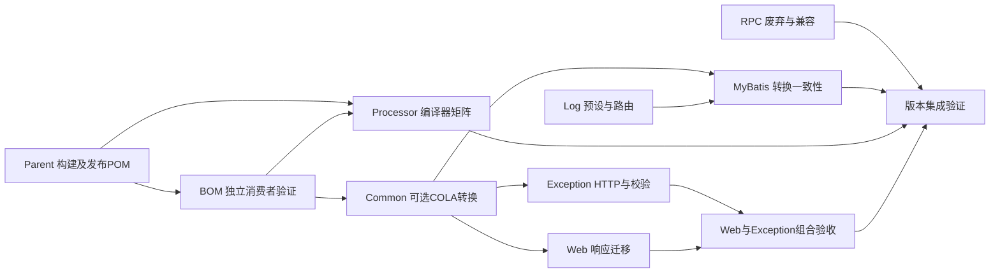

# v2.4.0 版本记录

## 版本目标与当前阶段

围绕现有模块提供可由下游自由组合的基础能力，不新增模块，优先稳定性与兼容性。规划版本为 v2.4.0，当前开发制品版本仍以[根 POM](../../../pom.xml)的 revision 为准。

2026-10-29 用户要求停止逐项提问，先提供推荐方案并补齐每项需求的 SDD。本轮在既有 9 个需求目录补齐规格、设计、静态实施计划。此前逐项确认的 D-01～D-96 以及 2026-10-31 审查后确认的 D-97～D-100 保存在[版本级 brainstorm](./brainstorm.md)；未逐项确认的其余签名细节、默认值和边界由本轮推荐明确，文档标记 draft，不追记为用户已确认决策。原问题“默认消息与覆盖消息均为null”采用允许null的推荐，不视为用户曾回答A。

本页是文档入口。下表按现有模块组织，每个已纳入的需求编号均在相应规格与计划内覆盖；Processor和RPC使用精简设计。未纳入方向不因补齐SDD自动变为本轮需求。

## 推荐方案与需求文档

| 模块 | 覆盖需求 | 推荐方案 | SDD |
|---|---|---|---|
| [Parent讨论](./parent-build/brainstorm.md) | P-01～P-05、PC-01～PC-03 | 公共默认值与JDK适配分离；原生开关独立；GPG可选；发布POM保留覆盖能力 | [规格](./parent-build/spec.md) · [设计](./parent-build/design.md) · [计划](./parent-build/plan.md) |
| [BOM讨论](./bom-dependencies/brainstorm.md) | B-01～B-03 | 只托管binding、OOXML、COLA DTO；消费者按需声明；验证继承与import两条路径 | [规格](./bom-dependencies/spec.md) · [设计](./bom-dependencies/design.md) · [计划](./bom-dependencies/plan.md) |
| [Common讨论](./common-contracts/brainstorm.md) | C-01、C-02、C-04、C-07 | 兼容命名工厂；消息允许为空；复制分页元数据；不可变完整批量结果；COLA独立可选 | [规格](./common-contracts/spec.md) · [设计](./common-contracts/design.md) · [计划](./common-contracts/plan.md) |
| [Log讨论](./log-runtime/brainstorm.md) | L-01、L-02 | 容器/服务器显式预设；少量可覆盖属性；MDC提交快照与执行后恢复 | [规格](./log-runtime/spec.md) · [设计](./log-runtime/design.md) · [计划](./log-runtime/plan.md) |
| [Exception讨论](./exception-contracts/brainstorm.md) | E-01、E-02 | 标准HTTP状态与协议头；结构化校验明细显式启用，保留默认响应形态 | [规格](./exception-contracts/spec.md) · [设计](./exception-contracts/design.md) · [计划](./exception-contracts/plan.md) |
| [Web讨论](./web-binding/brainstorm.md) | W-01、W-02、C-07接入 | Java Time缺省格式器；大整数按阈值可选字符串化；Web承担R MixIn与兼容开关 | [规格](./web-binding/spec.md) · [设计](./web-binding/design.md) · [计划](./web-binding/plan.md) |
| [MyBatis讨论](./mybatis-capabilities/brainstorm.md) | M-04、D-59说明、D-69转换 | 独立慢SQL WARN与阈值；IPage到COLA；仅补searchCount=false说明 | [规格](./mybatis-capabilities/spec.md) · [设计](./mybatis-capabilities/design.md) · [计划](./mybatis-capabilities/plan.md) |
| [Processor讨论](./mybatis-processor/brainstorm.md) | D-71 | 支持源版本跟随编译器；准确解释生成全限定名冲突 | [规格](./mybatis-processor/spec.md) · [设计](./mybatis-processor/design.md) · [计划](./mybatis-processor/plan.md) |
| [RPC Core讨论](./rpc-deprecation/brainstorm.md) | D-75 | 仅增强旧入口删除预告，保留原始since、兼容适配与运行行为 | [规格](./rpc-deprecation/spec.md) · [设计](./rpc-deprecation/design.md) · [计划](./rpc-deprecation/plan.md) |

## 组合与实施顺序

箭头表示集成前置，不要求所有文档或实现串行。建议先落实Parent/BOM并验证发布形态；Common与各Starter可在固定契约后并行；最后集中验证共享ObjectMapper、响应工厂、日志路由及实际消费者。改动同一POM或自动配置类的任务由对应模块单一负责人整合，避免并行覆盖。

跨模块约定：Common只定义响应与转换语义，Web拥有C-07的Jackson实现；BOM只托管COLA版本，Common/MyBatis各自维护optional与无COLA类路径；MyBatis产生SQL.SLOW事件，Log负责新预设路由；HTTP状态由异常处理模块决定，Common新工厂不决定HTTP。

Exception 的统一 ResponseEntity 封装与 Web 的既有 traceId 增强兼容需共同交付：适配归属 Web W-TC，联合 MVC 验收归属 Web W-T4，Exception T4 复核其结果；不新增 Exception→Web 依赖，也不扩展 W-03。仅 Exception 模块通过不足以完成 E6/W4 验收。Log 的预设默认规则须保留用户启动默认属性中的显式列表及空列表；无可用 Logback 且未选新预设时，早期入口退出，独立 MDC 能力保持可组合。

2026-10-31 设计审查补充的跨模块约定（除注明的 D-97～D-100 外为推荐，非逐项确认）：

- C-07 及 Web W1～W4 的生效前提是 Servlet 应用且 `mimir.boot.web.enabled=true`；非 Servlet 或关闭 Web 总开关时，共享 ObjectMapper 不安装 Mimir MixIn，Common 的统一表述须带此前提。
- Web W-T4 联合验收另覆盖三项：Exception 现有 8 个已返回 ResponseEntity 分支缺失 traceId 的存量缺陷；默认消息为 null 时 `NON_NULL` 丢弃 `message` 键的输出形态；下游自定义 `ResponseBodyAdvice` 在运行期 ResponseEntity 下的行为。
- 只导入 BOM、不继承 Parent 的消费者在 JDK 23 及以上需自行开启 `proc=full`，Processor 与 BOM 的接入说明及验收矩阵均需覆盖"仅导入 BOM + JDK 25"。
- 能力因用户配置而静默退让时（MDC 传播、R MixIn、自建 SqlSessionFactory 不注册慢 SQL 拦截器、日志预设路径未识别）须输出 INFO 诊断或在 README 写明，不静默失效。
- 签名开关按 D-97 调整构建模型检查；空集合与纯 Bean 约束异常按 D-98 由 400 改为 500。
- 按 D-100，开启 Spring Cloud legacy bootstrap 时由主应用而非 bootstrap 应用取得日志所有权；Nacos 等使用 `bootstrap.yml` 的消费者仍获得预设缺省规则与原 mask 配置。
- 按 D-99，Common 提供 `com.yggdrasil.labs.common.page.ColaPageConverters`（PageResult→COLA），MyBatis 提供 `com.yggdrasil.labs.mybatis.page.IPageColaConverters`（IPage→COLA），短类名不重复。

## 范围边界

Nacos、Feign、Dubbo、Test Starter保持现状。无总数分页、多字段排序、拦截器排序、完整JSON日志、W-03请求标识回传等不纳入；完整依据见[范围排除记录](./brainstorm.md#暂缓撤销与未采纳)。框架基线升级、安全补丁专项覆盖、对接HTTP Service Client和真实Dubbo Consumer E2E均未扩入。Parent 实施按 D-97 调整既有构建模型检查 `tools/engineering/src/quality/verify-build-model.mjs` 及 `tools/engineering/README.md` 用途说明、根 POM 注释与发布规程说明，准入理由见 [Parent 设计](./parent-build/design.md#pb-05可选-gpg-与框架自身发布)；不新增工具脚本。

TD-013/TD-023只明确删除周期，TD-047继续待规划；JDK 21 及以上缺少持续构建回归已登记为 TD-048，本轮不改 CI。技术债状态不因设计文档齐备自动关闭，详见[台账](../tech-debt-tracker.md)。

## 交付与验证边界

规划阶段交付为9组SDD文档及导航，不是功能交付。当时未修改Java、POM、工作流、模块README或工具，没有功能测试、构建矩阵、发布后消费者或生产验收结果。文档中测试命令与场景是实施期验收要求；后续实施与验证情况见下文。

文档检查与独立审查结果在本轮会话汇报；静态plan保持为实施输入，不写执行期账本。进入编码后按实际证据登记功能交付和最终验证摘要。

### Parent 实施（2026-11-01，分支 `feat/v2.4.0-parent-build`）

- **范围**：按 [Parent 计划](./parent-build/plan.md) 完成 T1～T4 的实施工作，部分验收尚未覆盖；修改 Parent POM、构建模型检查及其工具 README 用途、根 POM 注释、Parent README 与发布规程签名参数说明；未改 BOM、Processor、workflow，根 `revision` 不变。
- **源码与有效模型**：JDK 17/21 下默认、四模式及组合的有效 POM 符合设计矩阵；`build-model` 旧断言在 Parent 发布场景按 D-97 预期失败，新断言 15 个 Reactor POM 全部通过。
- **发布前隔离消费者**：仓库外临时工作根内，以文件仓库部署的 Flatten Parent 驱动独立消费者（`relativePath` 为空，解析 POM 哈希与发布件一致），在 JDK 17/21 覆盖 PB-01～PB-08 正常、组合与负向场景；生产者签名/不签名、`-Pci`、JDK 21 及 Maven 3.9.16 生成的 Parent 内容一致。测试密钥签名下每构件一个签名。
- **回归**：JDK 17 下 `quality --mode full --source worktree` 全部通过。
- **未覆盖**：本机无 JDK 25；JDK 21 下本仓库四个 Starter 测试的既有附加失败已补记 [TD-048](../tech-debt-tracker.md#td-048-jdk-高版本构建回归)；真实私服、Central 通道与公开仓库消费者未验证，未发布。

### BOM、Processor、Common 实施（2026-11-01，分支 `feat/v2.4.0-parent-build`）

- **范围**：按 [BOM 计划](./bom-dependencies/plan.md)、[Processor 计划](./mybatis-processor/plan.md)、[Common 计划](./common-contracts/plan.md) 实施。BOM 新增 `lombok-mapstruct-binding` 0.2.0、`poi-ooxml`（复用 `poi.version`）、`cola-component-dto` 5.0.0 三个受管坐标并补接入说明；处理器改为 `SourceVersion.latestSupported()`，README 修正冲突说明并补 JDK≥23 非 Parent 消费者开启处理的说明；Common 新增 `ErrorDefinition` 与 `R.failCode`/两类 `fromError`、`PageResult.map`、optional COLA 的 `ColaPageConverters`、不可变 `batch` 模型及 v2.3.0 API 兼容测试。未改 Web、Exception、MyBatis，C-07 的 Jackson 接入与 HTTP/联合验收仍归对应需求。
- **许可证核对**：binding 为 MIT（缓存 POM），`cola-component-dto` 5.0.0 为 LGPL-2.1（缓存 POM），只以 optional 进入 Common，不向下游传递。
- **模块测试**：JDK 17 下 Common 与处理器模块测试通过；处理器新增用例在 JDK 21 上于旧实现失败（支持源版本告警）、新实现通过。批量模型的 Jackson 不变量用例含前置自检，确认测试 mapper 确实经私有构造创建条目。
- **发布前隔离消费者**：仓库外工作根内，以生产者独立本地库将整个 reactor 部署到文件仓库，消费者使用独立本地库并经该文件仓库解析（BOM 发布 POM 哈希与文件仓库一致）。JDK 17/21 下：仅导入 BOM 的消费者依赖树不含三坐标、运行期无 COLA；继承 Parent 与仅导入 BOM 两类消费者完成 xlsx 文本/数值读写、Lombok+MapStruct 映射与 COLA 转换运行；消费者 `dependencyManagement` 覆盖 binding 为 0.1.0 生效；缺失版本构建失败并给出缺失坐标。OOXML 传递有效版本：log4j-api 2.23.1（由 Boot 自 2.24.3 管理）、commons-io 2.21.0、commons-compress 1.28.0、xmlbeans 5.3.0。处理器消费者（Parent/仅 BOM）默认生成三类产物；JDK 21 以 release 21 编译无支持版本告警；`proc=none` 时无生成文件，引用生成类型则编译失败。
- **二进制兼容**：以 Central 上 v2.3.0 Common 正式制品（sha1 校验一致）编译的旧消费者，换用本次 Common 运行，R 两种 fail、success 与两类异常各四种构造输出与基线一致，无链接错误。
- **未覆盖**：本机无 JDK 25，“仅导入 BOM + JDK 25”未开启处理的负向、按 README profile 开启 `proc=full` 的正向以及 JDK 25 处理器矩阵均未验证；仅导入 BOM 的处理器消费者未测 release 21 目标。C-07 受管 JSON、Exception HTTP 200/500 与 null 消息 JSON 形态待 Web/Exception 联合验收；MyBatis `IPageColaConverters` 待实施。未发布。

### RPC Core 与 Log 实施（2026-11-01～02，分支 `feat/v2.4.0-parent-build`）

- **RPC 范围**：按 [RPC 计划](./rpc-deprecation/plan.md)将 `RpcTracerBridge.extract`、内置两个 Bridge 覆盖方法及 `RpcHookChain` 四个旧入口改为 `@Deprecated(since = "2.2.1", forRemoval = true)`，`LegacyMdcTraceScope` 抑制自身告警；签名与方法体不变，README 增加 2.4.0 升级段，TD-013/TD-023 登记进展、不关闭。
- **RPC 验证**：rpc-core 测试通过，主代码编译无 removal 告警，测试代码告警来源与计划清单一致；新增用例验证默认编译 5 条 removal 告警可完成、`-Werror` 失败，外部 Bridge 覆盖须加 `@SuppressWarnings("removal")` 才通过严格模式，README 同步/异步迁移示例以 `-Werror` 编译并实际运行清理顺序。以 Central 上 v2.3.0 rpc-core 正式制品（sha1 校验一致）编译的旧消费者换用本次制品运行，输出与基线一致。
- **Log 范围**：按 [Log 计划](./log-runtime/plan.md)新增容器/服务器两个 Logback 预设（共享 `common.xml`）、早期 EnvironmentPostProcessor 与所有权监听器、启动期规则缓存与原子发布、`MdcTasks`/`MdcTaskDecorator` 及 Boot 默认执行器适配；旧 `logback-spring.xml` 未改。
- **Log 验证**：`./mvnw -pl mimir-boot-starters/mimir-boot-starter-log -am clean verify` 通过，单元测试与集成测试均为 0 失败（集成测试结构调整见下）。真实 `SpringApplication` 启动覆盖三阶段四组缺省、默认属性单规则/空列表、参数覆盖、新→旧→新顺序启动、启动失败堆栈与销毁日志脱敏、普通子上下文、缓存双应用、默认 `@Async` MDC；服务器预设按唯一事件 ID 逐出口计数、容器零文件、prod 降噪可被覆盖、默认队列满阻塞与 never-block 不阻塞、stdout 写入失败不回退文件；legacy bootstrap 下主应用持有所有权（含系统属性/环境变量指定预设）；去掉 Logback 改用 Log4j2 时未选预设可启动/失败清理无链接错误、显式预设被拒绝、`MdcTasks` 正常。MDC 适配在 JDK 21 下虚拟线程用例通过。
- **Log 性能（实施期优化后达标）**：首轮测得四组规则 1KiB 纯转换约 22µs/次，完整同步文件链路吞吐仅为关闭规则的约 11%。按用户决定本轮优化 `SensitiveDataConverter` 字段扫描：只在 `=`/`:` 分隔符前的最长字段名窗口内逐位置匹配，并按首字符建立字段名索引；新增等价性测试以优化前算法为参考实现，对 8 万条随机消息与边界用例逐字对照一致。优化后（Temurin 17.0.19，Ryzen 9 8945HX，各 5 轮）完整链路 1KiB 吞吐比中位数命中 0.890、不命中 0.901，P99 比中位数 0.709、1.068，满足 ≥0.80 / ≤1.25；命中组单轮波动较大，5 轮中 2 轮吞吐比低于 0.80（文件 I/O 抖动，对照组同样出现 P99 尖刺）。纯转换口径：1KiB 命中约 0.6µs、不命中约 0.3µs，64KiB 约 12µs，8KiB 异常栈约 16µs。门槛对照口径已在 [Log 设计](./log-runtime/design.md)NFR 中补充为完整链路并按中位数判定（关闭规则时纯转换为直接返回，不具可比性）。
- **集成测试结构调整**：仓库质量门禁只允许单个 Failsafe execution、不允许自定义报告目录与 execution 级排除，与计划的三个独立 execution 冲突。经用户决定，legacy bootstrap 与替代后端两组场景改由 `LogIsolatedJvmIntegrationTest` 按场景组装类路径拉起子 JVM 执行（各 5 个场景），专用依赖不进入测试类路径，由 `maven-dependency-plugin:copy` 构建时复制到 `target/` 供子 JVM 使用；未修改 `tools/`。
- **未覆盖**：JDK 25 未验证；MVC 默认执行器选择未单独验证；“取得令牌至发布前并发输出”只以单线程语义用例验证，未做多线程竞争测试。未发布。
- **整体审查修复（2026-11-02）**：MDC 适配改为只作用于 `applicationTaskExecutor` 的 BeanPostProcessor，复用 Boot Builder 自建并显式设置装饰器的线程池不再被覆盖；未选预设的旧配置不取得所有权，恢复“最后刷新者发布”语义；转换器仅在全局引用为空或上下文为 SLF4J 当前 LoggerContext 时重绑；`server.xml` 的 ERROR 过滤移到异步 appender 入队前；EPP 改为在全部 EnvironmentPostProcessor 之后执行；无 SpringApplication 时所有权按 Environment 绑定与释放；早期监听器只订阅三类事件；资源测试改用临时日志目录。审查建议将 `RpcTracerBridge.extract` 改为默认方法，因 RPC 计划决策边界禁止取消旧抽象约束，未采纳。
- **第二轮审查修复（2026-11-02）**：运行期配置刷新以原 SpringApplication 再次调用 EPP 时跳过（已从 spring-cloud-context 4.1.6 字节码确认该调用路径），避免刷新配置异常时置空脱敏快照；新预设归档目录日期改为 `%d{yyyy-MM,aux}`，按天滚动、保留天数生效（旧 `logback-spring.xml` 同类问题登记 [TD-049](../tech-debt-tracker.md#td-049-旧日志配置按月滚动)，本轮不改旧行为）；取得所有权不再清空转换器 Context 引用；公开 `publishConfiguration` 清除启动期缓存；非 ASCII 首字符查表改为排序数组二分查找；删除仅测试使用的所有权释放入口；EPP 排序说明改为不保证与同为最低优先级处理器的先后。审查再次建议 `RpcTracerBridge.extract` 改默认方法，按 RPC 计划决策边界未采纳。
- **第三轮审查修复（2026-11-02）**：未选预设且 Environment 中无任何 `mimir.boot.log.mask.*` 属性时 EPP 不再发布空快照，恢复从 LoggerContext（logback.xml `<property>`）/系统属性懒加载规则；`mimir.boot.log.mdc.enabled` 改为默认 `false`，默认执行器 MDC 适配须显式开启；经用户决定调整 RPC 计划决策边界，`RpcTracerBridge.extract` 改为空默认方法（源码与二进制兼容），仅实现 `extractScope` 的 Bridge 可在 `-Werror` 下编译，README 同步。
- **Log 模块整体审查修复（2026-11-02）**：LoggerContext 中 mask 列表属性改为可无损往返的编码（顶层逗号转义为 `\,`，拆分跳过 `()`/`{}`/`[]` 内及转义逗号），修复刷新后 `reloadConfig`/`addCustomPattern` 把 `\d{15,18}` 等自定义正则拆坏导致规则失效（2.3.0 起既有，预设使该路径常规化）；新预设校验全部先于发布，失败时不再置空全局快照（删除 invalidate 链），同 JVM 其他应用规则不受影响；运行登记按上下文集合维护，同一 SpringApplication 多个存活上下文时关闭其一不再误判后续刷新为新启动；MDC 适配不再直接引用 Boot 3.4 移除的 `TaskExecutorBuilder`/`TaskExecutorCustomizer`（按类名判断）；访问日志 Filter 顺序改为 `HIGHEST_PRECEDENCE + 2`，位于 Boot 观测 Filter 之内以保留 traceId/spanId。低优先级项登记 [TD-050](../tech-debt-tracker.md#td-050-log-模块低优先级清理)。
- **D-101 预设启动机制简化（2026-11-03）**：按 [Log 计划 D-101 修订](./log-runtime/plan.md#d-101-修订预设启动机制简化)删除 `LogPresetOwnership`、`LogPresetBootstrapListener`、`LogbackMaskBootstrap` 与转换器启动期规则缓存。EPP 只做校验、规则选择并写内部属性源（预设选中时必定存在，mask 键仅在用户已配置时写入），`common.xml` 以三条 `springProperty` 写入 LoggerContext，转换器在 Context 带 mask 属性时于 `start()` 切换规则代次（F2，用户选择），刷新恢复“最后刷新者发布”并以“父 Environment 含内部源”守卫预设应用的子上下文；列表编码迁至不依赖 Logback 的 `MaskListCodec`；预设新增拒绝无法解析的 `${` 占位符。经四轮独立文档审查后用户接受剩余风险实施。
- **D-101 验证**：`./mvnw -pl mimir-boot-starters/mimir-boot-starter-log -am clean verify` 通过（单元 268、集成 22，含子 JVM 中 Spring Cloud 场景 6 个、替代后端场景 5 个）。新增覆盖：索引列表三阶段、预设应用启动期并发输出不含明文、旧 XML reset 后重载保留已发布规则、无/含 spring-cloud-context 的双存活应用、真实 `ConfigDataContextRefresher` 推送非法规则时刷新失败且规则不变、bootstrap 残留内部源移除、`${` 校验。随后 `bash scripts/engineering.sh quality --mode full --source worktree` 通过（docs-full、build-model、release 合约/消费者/签名、Java 质量/测试/覆盖率均 passed，Sonar 未启用）。未覆盖：真实业务消费者应用启动未在本修订后验证；性能基准未重测（转换热路径未改）。

### Web 局部实施（2026-11-05，联合验收待完成）

- **范围**：按 [Web 计划](./web-binding/plan.md) 实施日期绑定、可选安全整数输出、`R.fail` 迁移及异常响应增强候选；业务格式、序列化器和 MixIn 的覆盖边界见 Web README。Exception 统一封装尚未实施，W4/E6 联合验收未完成，不登记为完整交付。
- **验证**：Web 及依赖模块本地 `verify` 通过；完整 `quality --mode full --source worktree` 在补充既有异常分支测试及最终文档说明前通过，之后新增的 8 个异常分支测试单独通过，含真实 Tomcat 上传超限；补充文档的格式和链接检查另行执行。Java 质量门禁中 JaCoCo 对第三方 JSqlParser 的过大方法插桩失败，但门禁整体通过。
- **独立消费者**：使用本地打包 JAR 的独立进程验证 Common 单独使用与 Web 受管 Jackson；Servlet 应用以真实 Tomcat 和 HTTP 请求覆盖默认、旧字段兼容、大整数和总开关关闭，非 Servlet 对照保留原 JSON 行为。此验证未重新解析发布后消费者依赖，也不是 CI 或线上验证。
- **待验收**：Exception T1 至 T3 完成后，以真实统一封装补齐 W4/E6 的异常状态、协议头、工厂回退及追踪组合。未发布。

### Exception 与 Web 联合实施（2026-11-05）

- **范围**：按 [Exception 计划](./exception-contracts/plan.md) 实施 HTTP 状态及协议头、工厂回退和可选结构化校验明细；联合 Web 的异常响应追踪增强。保留旧处理器方法描述符、单参构造和默认 data 格式，返回值及未知来源约束按约定返回 500。无法安全确认声明字段时，结构化 FIELD 路径降为 `$`，详见 Exception 设计和 README。
- **模块验证**：JDK 17 下 `./mvnw -o -pl mimir-boot-starters/mimir-boot-starter-web -am verify` 通过；Exception 单元 94、集成 50，Web 单元 123、集成 73，失败、错误和跳过均为 0。含真实 MVC 及校验器的输入、返回值、跨参数、混合来源、动态键，Web 联合响应 25 项及既有八个异常分支（含真实 Tomcat 上传超限）。
- **边界**：以上为本地工作区验证；不代表远端 CI、生产或发布后消费者通过。完整仓库质量门禁以最终执行结果为准，未发布。
