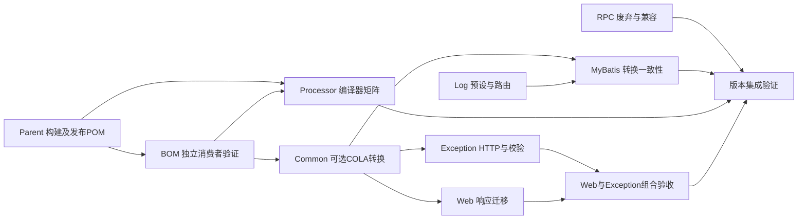

# v2.4.0 版本记录

## 版本目标与当前阶段

围绕现有模块提供可由下游自由组合的基础能力，不新增模块，优先稳定性与兼容性。规划版本为 v2.4.0，当前开发制品版本仍以[根 POM](../../../pom.xml)的 revision 为准。

2026-10-29 用户要求停止逐项提问，先提供推荐方案并补齐每项需求的 SDD。本轮在既有 9 个需求目录补齐规格、设计、静态实施计划。此前逐项确认的 D-01～D-96 以及 2026-10-31 审查后确认的 D-97～D-100 保存在[版本级 brainstorm](./brainstorm.md)；未逐项确认的其余签名细节、默认值和边界由本轮推荐明确，文档标记 draft，不追记为用户已确认决策。原问题“默认消息与覆盖消息均为null”采用允许null的推荐，不视为用户曾回答A。

本页是文档入口。下表按现有模块组织，每个已纳入的需求编号均在相应规格与计划内覆盖；Processor和RPC使用精简设计。未纳入方向不因补齐SDD自动变为本轮需求。

## 推荐方案与需求文档

| 模块 | 覆盖需求 | 推荐方案 | SDD |
|---|---|---|---|
| [Parent讨论](./parent-build/brainstorm.md) | P-01～P-05、PC-01～PC-03 | 公共默认值与JDK适配分离；原生开关独立；GPG可选；发布POM保留覆盖能力 | [规格](./parent-build/spec.md) · [设计](./parent-build/design.md) · [计划](./parent-build/plan.md) |
| [BOM讨论](./bom-dependencies/brainstorm.md) | B-01～B-03 | 只托管binding、OOXML、COLA DTO；消费者按需声明；验证继承与import两条路径 | [规格](./bom-dependencies/spec.md) · [设计](./bom-dependencies/design.md) · [计划](./bom-dependencies/plan.md) |
| [Common讨论](./common-contracts/brainstorm.md) | C-01、C-02、C-04、C-07 | 兼容命名工厂；消息允许为空；复制分页元数据；不可变完整批量结果；COLA独立可选 | [规格](./common-contracts/spec.md) · [设计](./common-contracts/design.md) · [计划](./common-contracts/plan.md) |
| [Log讨论](./log-runtime/brainstorm.md) | L-01、L-02 | 容器/服务器显式预设；少量可覆盖属性；MDC提交快照与执行后恢复 | [规格](./log-runtime/spec.md) · [设计](./log-runtime/design.md) · [计划](./log-runtime/plan.md) |
| [Exception讨论](./exception-contracts/brainstorm.md) | E-01、E-02 | 标准HTTP状态与协议头；结构化校验明细显式启用，保留默认响应形态 | [规格](./exception-contracts/spec.md) · [设计](./exception-contracts/design.md) · [计划](./exception-contracts/plan.md) |
| [Web讨论](./web-binding/brainstorm.md) | W-01、W-02、C-07接入 | Java Time缺省格式器；大整数按阈值可选字符串化；Web承担R MixIn与兼容开关 | [规格](./web-binding/spec.md) · [设计](./web-binding/design.md) · [计划](./web-binding/plan.md) |
| [MyBatis讨论](./mybatis-capabilities/brainstorm.md) | M-04、D-59说明、D-69转换 | 独立慢SQL WARN与阈值；IPage到COLA；仅补searchCount=false说明 | [规格](./mybatis-capabilities/spec.md) · [设计](./mybatis-capabilities/design.md) · [计划](./mybatis-capabilities/plan.md) |
| [Processor讨论](./mybatis-processor/brainstorm.md) | D-71 | 支持源版本跟随编译器；准确解释生成全限定名冲突 | [规格](./mybatis-processor/spec.md) · [设计](./mybatis-processor/design.md) · [计划](./mybatis-processor/plan.md) |
| [RPC Core讨论](./rpc-deprecation/brainstorm.md) | D-75 | 仅增强旧入口删除预告，保留原始since、兼容适配与运行行为 | [规格](./rpc-deprecation/spec.md) · [设计](./rpc-deprecation/design.md) · [计划](./rpc-deprecation/plan.md) |

## 组合与实施顺序

箭头表示集成前置，不要求所有文档或实现串行。建议先落实Parent/BOM并验证发布形态；Common与各Starter可在固定契约后并行；最后集中验证共享ObjectMapper、响应工厂、日志路由及实际消费者。改动同一POM或自动配置类的任务由对应模块单一负责人整合，避免并行覆盖。

跨模块约定：Common只定义响应与转换语义，Web拥有C-07的Jackson实现；BOM只托管COLA版本，Common/MyBatis各自维护optional与无COLA类路径；MyBatis产生SQL.SLOW事件，Log负责新预设路由；HTTP状态由异常处理模块决定，Common新工厂不决定HTTP。

Exception 的统一 ResponseEntity 封装与 Web 的既有 traceId 增强兼容需共同交付：适配归属 Web W-TC，联合 MVC 验收归属 Web W-T4，Exception T4 复核其结果；不新增 Exception→Web 依赖，也不扩展 W-03。仅 Exception 模块通过不足以完成 E6/W4 验收。Log 的预设默认规则须保留用户启动默认属性中的显式列表及空列表；无可用 Logback 且未选新预设时，早期入口退出，独立 MDC 能力保持可组合。

2026-10-31 设计审查补充的跨模块约定（除注明的 D-97～D-100 外为推荐，非逐项确认）：

- C-07 及 Web W1～W4 的生效前提是 Servlet 应用且 `mimir.boot.web.enabled=true`；非 Servlet 或关闭 Web 总开关时，共享 ObjectMapper 不安装 Mimir MixIn，Common 的统一表述须带此前提。
- Web W-T4 联合验收另覆盖三项：Exception 现有 8 个已返回 ResponseEntity 分支缺失 traceId 的存量缺陷；默认消息为 null 时 `NON_NULL` 丢弃 `message` 键的输出形态；下游自定义 `ResponseBodyAdvice` 在运行期 ResponseEntity 下的行为。
- 只导入 BOM、不继承 Parent 的消费者在 JDK 23 及以上需自行开启 `proc=full`，Processor 与 BOM 的接入说明及验收矩阵均需覆盖"仅导入 BOM + JDK 25"。
- 能力因用户配置而静默退让时（MDC 传播、R MixIn、自建 SqlSessionFactory 不注册慢 SQL 拦截器、日志预设路径未识别）须输出 INFO 诊断或在 README 写明，不静默失效。
- 签名开关按 D-97 调整构建模型检查；空集合与纯 Bean 约束异常按 D-98 由 400 改为 500。
- 按 D-100，开启 Spring Cloud legacy bootstrap 时由主应用而非 bootstrap 应用取得日志所有权；Nacos 等使用 `bootstrap.yml` 的消费者仍获得预设缺省规则与原 mask 配置。
- 按 D-99，Common 提供 `com.yggdrasil.labs.common.page.ColaPageConverters`（PageResult→COLA），MyBatis 提供 `com.yggdrasil.labs.mybatis.page.IPageColaConverters`（IPage→COLA），短类名不重复。

## 范围边界

Nacos、Feign、Dubbo、Test Starter保持现状。无总数分页、多字段排序、拦截器排序、完整JSON日志、W-03请求标识回传等不纳入；完整依据见[范围排除记录](./brainstorm.md#暂缓撤销与未采纳)。框架基线升级、安全补丁专项覆盖、对接HTTP Service Client和真实Dubbo Consumer E2E均未扩入。Parent 实施按 D-97 调整既有构建模型检查 `tools/engineering/src/quality/verify-build-model.mjs` 及 `tools/engineering/README.md` 用途说明、根 POM 注释与发布规程说明，准入理由见 [Parent 设计](./parent-build/design.md#pb-05可选-gpg-与框架自身发布)；不新增工具脚本。

TD-013/TD-023只明确删除周期，TD-047继续待规划；JDK 21 及以上缺少持续构建回归已登记为 TD-048，本轮不改 CI。技术债状态不因设计文档齐备自动关闭，详见[台账](../tech-debt-tracker.md)。

## 交付与验证边界

规划阶段交付为9组SDD文档及导航，不是功能交付。当时未修改Java、POM、工作流、模块README或工具，没有功能测试、构建矩阵、发布后消费者或生产验收结果。文档中测试命令与场景是实施期验收要求；后续实施与验证情况见下文。

文档检查与独立审查结果在本轮会话汇报；静态plan保持为实施输入，不写执行期账本。进入编码后按实际证据登记功能交付和最终验证摘要。

### Parent 实施（2026-11-01，分支 `feat/v2.4.0-parent-build`）

- **范围**：按 [Parent 计划](./parent-build/plan.md) 完成 T1～T4 的实施工作，部分验收尚未覆盖；修改 Parent POM、构建模型检查及其工具 README 用途、根 POM 注释、Parent README 与发布规程签名参数说明；未改 BOM、Processor、workflow，根 `revision` 不变。
- **源码与有效模型**：JDK 17/21 下默认、四模式及组合的有效 POM 符合设计矩阵；`build-model` 旧断言在 Parent 发布场景按 D-97 预期失败，新断言 15 个 Reactor POM 全部通过。
- **发布前隔离消费者**：仓库外临时工作根内，以文件仓库部署的 Flatten Parent 驱动独立消费者（`relativePath` 为空，解析 POM 哈希与发布件一致），在 JDK 17/21 覆盖 PB-01～PB-08 正常、组合与负向场景；生产者签名/不签名、`-Pci`、JDK 21 及 Maven 3.9.16 生成的 Parent 内容一致。测试密钥签名下每构件一个签名。
- **回归**：JDK 17 下 `quality --mode full --source worktree` 全部通过。
- **未覆盖**：本机无 JDK 25；JDK 21 下本仓库四个 Starter 测试的既有附加失败已补记 [TD-048](../tech-debt-tracker.md#td-048-jdk-高版本构建回归)；真实私服、Central 通道与公开仓库消费者未验证，未发布。
