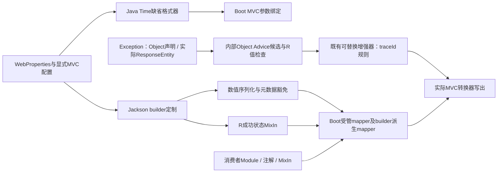

# Web 日期绑定与 JSON 输出设计

推荐方案，未实施。[规格](./spec.md) · [计划](./plan.md) · [Common协作](../common-contracts/design.md) · [Exception协作](../exception-contracts/design.md)

## 背景、目标与非目标

源码中JacksonConfig已有日期序列化customizer，WebMvcConfig目前只装配拦截器。目标是W1/W2/W3可独立工作，并由W4保持Exception统一封装后的既有响应增强；业务有清晰覆盖路径。不全局注入spring.mvc属性，不影响传统Date默认值，不自动适配OpenAPI，不扩展请求标识生成、回传或传播策略。

## 架构与依据

本轮静态核对项目JacksonConfig、WebAutoConfiguration、WebMvcConfig，以及本地Boot3.3.13的WebMvcAutoConfiguration/WebConversionService、Spring6.1.21的DateTimeFormatterRegistrar源码。Boot在创建WebConversionService后再执行configurer；其adapter顺序为0并注册用户转换器Bean。以下设计仍需实际上下文与MockMvc验证，不能把静态可行性当作已完成验证。

**生效前提（审查补充）**：[WebAutoConfiguration](../../../../mimir-boot-starters/mimir-boot-starter-web/src/main/java/com/yggdrasil/labs/web/config/WebAutoConfiguration.java) 以 `@ConditionalOnWebApplication(type = SERVLET)` 及 `mimir.boot.web.enabled=true`（matchIfMissing）为条件，并通过 `@Import` 引入JacksonConfig与WebMvcConfig。W2/W3随JacksonConfig、W4随该自动配置装配；W1虽按下文改为独立自动配置，也须带同样两项条件。因此非Servlet应用（WebFlux、无Web的消息/任务服务）或 `mimir.boot.web.enabled=false` 时，W1至W4全部不生效，Boot共享mapper仍输出 `fail`。[Common B6](../common-contracts/spec.md#behavior-b6受管-json-只输出-success-并提供过渡策略) 所说“共享mapper的消息、缓存和HTTP客户端用途也遵循该输出”仅在此前提成立时适用；README与升级说明须写明，不能把C-07描述为所有使用Boot共享mapper的应用均生效。

W4另核对 [ResponseBodyEnhancer](../../../../mimir-boot-starters/mimir-boot-starter-web/src/main/java/com/yggdrasil/labs/web/advice/ResponseBodyEnhancer.java)、[Advice工厂](../../../../mimir-boot-starters/mimir-boot-starter-web/src/main/java/com/yggdrasil/labs/web/config/ResponseBodyEnhancerAdviceFactory.java)、WebAutoConfiguration及既有响应增强MVC测试。增强器HttpEntity分支依赖声明泛型；本地Spring6.1.21类型探针确认Object声明、实际ResponseEntity的参数类为ResponseEntity但泛型仍为Object，当前supports=false，直接R对照=true。工厂中的Object Advice已具备非R保护，Web POM已有Web→Exception依赖，因此实现与联合测试均放Web，不加反向依赖。该探针只证明现状缺口，不代表推荐方案已实现或MVC已通过。

## 配置和接口契约

| 配置 | 类型/推荐默认 | 行为 |
|---|---|---|
| mimir.boot.web.enabled（既有）及Servlet应用类型 | boolean / true | 上层总前提；不满足时W1至W4均不装配，下方三个开关无效 |
| mimir.boot.web.mvc.date-format-enabled | boolean / true | W1独立开关；关闭不影响既有JSON日期 |
| mimir.boot.web.serialization.write-large-integers-as-string | boolean / false | W2，仅控制数值输出 |
| mimir.boot.web.json.include-legacy-fail | boolean / false | W3，true不安装忽略fail的框架MixIn |
| spring.mvc.format.date/time/date-time | 业务已有格式入口 | 对应类型有显式有效配置时不注册Mimir默认 |
| mimir.boot.web.serialization.date-format/time-format/date-time-format | 沿用已有默认 | yyyy-MM-dd、HH:mm:ss、yyyy-MM-dd HH:mm:ss，作为MVC缺省来源 |

### W1：只增加Java Time缺省格式器

新增独立 `MimirDateTimeWebMvcConfigurer`，实现 `void addFormatters(FormatterRegistry registry)`。只有Boot的 `WebMvcAutoConfiguration.EnableWebMvcConfiguration` 存在且开关开启时装配。业务@EnableWebMvc接管时退出；不修改已有拦截器类的构造器。

**装配顺序（审查补充，推荐）**：现有WebAutoConfiguration未声明 `after`，其内部类经 `@Import` 引入，无法保证Boot MVC自动配置已先注册Bean定义，此时对 `EnableWebMvcConfiguration` 的Bean条件判断不可靠。推荐W1使用独立的 `@AutoConfiguration(after = WebMvcAutoConfiguration.class)` 类（如 `config/MimirDateTimeWebMvcAutoConfiguration`），带SERVLET、`mimir.boot.web.enabled`（matchIfMissing=true）、`mimir.boot.web.mvc.date-format-enabled`（matchIfMissing=true）及对 `EnableWebMvcConfiguration` 的Bean条件，并在 `META-INF/spring/org.springframework.boot.autoconfigure.AutoConfiguration.imports` 中登记；不通过WebAutoConfiguration的 `@Import` 引入。该类同样启用WebProperties绑定，不改变WebAutoConfiguration已有条件。

Configurer顺序推荐-1：位于Boot默认服务初始化之后、adapter(0)注册消费者转换器Bean之前；未指定顺序的用户Configurer随后执行，允许覆盖。

**格式器不得暴露为Bean（审查补充，推荐）**：W1的Printer/Parser及其包装的Formatter只在 `addFormatters` 内部创建并直接注册，不得声明为 `Formatter`、`Printer`、`Parser`、`Converter`、`GenericConverter` 等类型的Spring Bean。否则Boot `WebMvcAutoConfiguration`（3.3.13约318-319行）在adapter(0)中经 `ApplicationConversionService.addBeans` 会把这些Bean再注册一次，等同排在0，绕过-1顺序，使其在未指定顺序的用户Configurer之后仍可能覆盖业务格式。Configurer本身可以是Bean，但其字段及方法返回值不以上述类型对外暴露。显式有序的业务Configurer若需要覆盖，应排在-1之后，或关闭该开关；不承诺覆盖任意顺序的业务自定义。

逐类型检查对应spring.mvc.format配置，存在有效配置则完全保留Boot处理。缺省时仅注册LocalDate、LocalTime、LocalDateTime的Printer/Parser，不调用会连带注册Zoned/Offset等类型的全量registrar。使用Spring的TemporalAccessorPrinter/Parser以保留ISO回退；重注册Jsr310DateTimeFormatAnnotationFormatterFactory，使字段注解仍优先于普通类型默认。空输入沿转换服务现有空值语义处理，必填约束交给绑定/校验层；非法文本产生原MVC绑定错误。非法pattern在初始化时失败并指明配置，不降级到另一格式。

默认切换会使仅接受locale SHORT的旧输入不再成为承诺路径；升级说明提供关闭开关、显式spring.mvc.format或字段注解三种迁移方式。传统java.util.Date/Calendar不由新增格式器修改，业务显式spring.mvc.format.date对Date的已有影响仍保留。

### W2：可选数值模块与元数据

新建内部Jackson Module（typeId唯一，不与其他Module按typeId合并），先于消费者Module注册Long/long、BigInteger的兜底serializer及long[]专用serializer。保留现有JavaTimeModule行为，避免本轮顺带改写日期JSON优先级。基于BigInteger比较上下界，禁止Math.abs(Long.MIN_VALUE)或double比较。

核心方法遵守Jackson签名 `void serialize(Long value, JsonGenerator gen, SerializerProvider provider) throws IOException`，BigInteger和long[]同形签名；基本数组逐项输出，不能依赖仅注册Long serializer就覆盖long[]。ContextualSerializer处理显式JsonFormat的NUMBER/STRING；显式JsonSerialize(using/contentUsing)及消费者替换数组serializer按Jackson原生适用范围优先。null交给现有null serializer；反序列化不变。

元数据白名单按声明类型与属性共同匹配，不能按字段名全局豁免：R.timestamp；PageResult.totalCount/pageIndex/pageSize/totalPages；PageRequest.pageIndex/pageSize/offset。

**子类匹配（审查补充，推荐）**：“声明类型”指被序列化Bean类型是白名单类型本身或其子类（`R.class.isAssignableFrom(beanClass)` 等），且属性逻辑名在该类型的白名单中。子类继承这些属性时仍保持number；子类覆盖对应getter但未加显式serializer/format时同样视为同一元数据属性。子类新增的其他Long属性、无继承关系但同名的业务字段均不豁免。不按 `getDeclaringClass()==R.class` 精确匹配，避免子类覆盖getter后静默失去豁免。COLA分页字段本来是int，无需新增COLA运行依赖。白名单使用BeanSerializerModifier为无显式属性serializer/format的属性设置number输出；字段注解、消费者MixIn上的显式serializer/shape优先。业务全局Long Module可覆盖普通业务数值，但白名单保持number；若要改变白名单格式，使用属性级MixIn或自定义整个模型serializer。

普通业务数值优先级为字段显式处理 > 消费者Module类型处理 > Mimir兜底。框架元数据优先级为字段显式处理 > 白名单number > 全局类型处理。新增builder customizer低于消费者显式定制优先级，不取代消费者ObjectMapper Bean。

**模块实际安装顺序（审查修正）**：JacksonConfig传给 `modulesToInstall` 的列表为“Mimir数值模块、消费者有序Modules、Mimir JavaTimeModule”，但这不是最终注册顺序。本地Spring6.1.21 `Jackson2ObjectMapperBuilder.configure` 先登记well-known模块（Jdk8Module、ParameterNamesModule、JavaTimeModule等），再按 `LinkedMultiValueMap.set(typeId)` 登记列表中的模块：已有typeId保持首次插入位置，只替换值。因此Mimir JavaTimeModule占据well-known JavaTimeModule的位置，实际排在消费者Module之前，而不是最后；消费者若提供自身JavaTimeModule Bean，因typeId相同会被列表中靠后的Mimir实例替换（既有行为）。本地Jackson2.17.3 `SerializerFactoryConfig.withAdditionalSerializers` 把后注册的Serializers插到列表头部，后注册者优先。据此：Mimir数值模块在消费者Module之前注册，typeId不同时“消费者Module > Mimir兜底”的结论成立；日期类型同理，typeId不同的消费者Module可覆盖Mimir JavaTimeModule的同类型serializer。本轮保持该既有日期优先级不变，并以“消费者Module覆盖Long/LocalDateTime”集成用例固化，不以列表书写顺序推断。

OpenAPI/客户端示例应说明业务大整数可能是integer或string，给出oneOf示例；不自动改springdoc模型，不新增springdoc强制依赖。元数据坚持number的兼容取舍意味着极大分页数仍需消费者处理精度，不宣称全部数字均安全。

### W3：R MixIn迁移

内部MixIn仅对 `boolean isFail()` 添加忽略标记。使用builder后处理，在默认include-legacy-fail=false且 `mapper.findMixInClassFor(R.class)==null` 时安装。已有业务R MixIn整体优先，不覆盖或假定可安全合并；业务之后的显式配置仍可覆盖。true只是不安装框架忽略，不能撤销业务自己的忽略规则。

**检测位置（审查补充，推荐）**：检测与安装必须放在customizer内调用的 `Jackson2ObjectMapperBuilder.postConfigurer(Consumer<ObjectMapper>)` 中，对已构建的ObjectMapper执行；不能在customizer主体中直接判断，因为builder没有读取已登记mixIns的getter，customizer执行时业务mixIn也可能尚未登记。本地Spring6.1.21 `Jackson2ObjectMapperBuilder.configure` 中，`objectMapper.registerModules`（约732行，含Module内 `setMixInAnnotations`）与 `this.mixIns.forEach(objectMapper::addMixIn)`（约767行）均先于postConfigurer链（约789-790行）执行，因此此时 `findMixInClassFor(R.class)` 能看到经builder `mixIn(...)`、Module登记及排在框架之前的postConfigurer所加的业务MixIn。多个postConfigurer按登记顺序 `andThen` 串联，即按customizer执行顺序。

**检测盲区（审查补充）**：业务在框架之后执行的postConfigurer（customizer排序更晚）中为R加MixIn，或在mapper构建后自行调用 `mapper.addMixIn(R.class, ...)`，均发生在框架检测之后：Jackson以后者替换R的MixIn，业务规则生效、框架MixIn被覆盖，但框架不会记录INFO日志，默认值下 `fail` 是否输出取决于业务MixIn。README须写明该盲区，并建议业务通过builder `mixIn(...)`、Module或排序早于框架的customizer登记R MixIn，以便被检测并获得提示。

**customizer实现形态（审查补充）**：现有 [JacksonConfig](../../../../mimir-boot-starters/mimir-boot-starter-web/src/main/java/com/yggdrasil/labs/web/config/JacksonConfig.java) 的 `jackson2ObjectMapperBuilderCustomizer()`（约61-112行）返回无状态lambda，无法承载下述去重状态。W3须改为有状态实现：独立的内部customizer类（推荐），或在@Bean方法内创建一次去重集合并由返回的lambda/postConfigurer闭包捕获；不得在每次customize调用内新建集合，否则去重失效。由于builder为原型作用域，多个mapper可能在不同线程并发构建，去重集合须并发安全（如 `ConcurrentHashMap.newKeySet()`，以 `add` 返回值决定是否记录）。

**跳过可观测性（审查补充）**：业务只要为R注册任意MixIn（哪怕只为改其他字段），框架就跳过自身MixIn，默认值下 `fail` 会静默回到JSON。推荐跳过时记录一条INFO日志，含业务MixIn类名、跳过原因及“如需移除fail请在业务MixIn中忽略isFail”的提示，不含业务数据。日志时机为首次构建受管ObjectMapper时，不承诺在启动阶段：Boot的 `Jackson2ObjectMapperBuilder` 为原型作用域，mapper可能延迟构建。去重以customizer实例为范围（实例字段或@Bean方法内一次创建的闭包变量记录已提示的MixIn类，并发安全，见上方实现形态），同一上下文内同一MixIn类只记录一次，避免多次builder构建刷屏；不使用静态Set，否则同一JVM中多个ApplicationContextRunner上下文会互相抑制日志，测试结果依赖执行顺序（审查补充）。README同步说明该行为。检测只调用 `findMixInClassFor(R.class)`，即仅针对R类本身：为R子类或其他父类型注册的MixIn不会被识别为“业务R MixIn”，框架仍安装自身MixIn，二者按Jackson类层级合并注解生效；README须说明此限制。

受管builder派生mapper也会生效，涵盖可能的消息/缓存/客户端。手工new ObjectMapper、fastjson2与完全自建mapper不自动适配；README逐条列出。开关在2.x保留，不承诺删字段已覆盖全消费者。Common负责行为规格，Web拥有唯一实现和配置。

### W4：异常封装与响应增强兼容

承接 [Exception I3b/E6](../exception-contracts/design.md#i3bweb-追踪增强兼容协作e6)。保持公开 `ResponseBodyEnhancer(WebProperties)`、`supports(MethodParameter, Class<? extends HttpMessageConverter<?>>)`、`R<?> beforeBodyWrite(R<?>, MethodParameter, MediaType, Class<? extends HttpMessageConverter<?>>, ServerHttpRequest, ServerHttpResponse)` 及 `ResponseBodyAdvice<R<?>>` 泛型接口。新增逻辑只修复统一封装引出的候选遗漏，不新增SPI或属性。

1. **候选判定在默认增强器**：保留 enabled 检查、原 R/ResponseEntity<R> 与 Object Advice 分支、RestController/RestControllerAdvice 注解作用域。在 HttpEntity 泛型不能解析到R时，仅补充 `returnType.getGenericParameterType() == Object.class`、运行期 `ResponseEntity.class.isAssignableFrom(returnType.getParameterType())` 且 containing class 有合并 RestControllerAdvice 注解的情形。不能把任意原始、通配或未知 HttpEntity 一律当作R；显式非R泛型继续按原规则退出。
2. **运行值保护在既有内部包装器**：WebAutoConfiguration仍只通过 `ResponseBodyEnhancerAdviceFactory.MvcResponseBodyEnhancer implements ResponseBodyAdvice<Object>` 接入MVC，其 supports 原样调用当前delegate的supports；false时不得用兼容分支再次放行。beforeBodyWrite先检查实际解包body是否为 `R<?>`，非R（包括字符串、任意工厂对象）和null原样返回，只有R才调用泛型delegate一次。不能把R泛型delegate另行注册为MVC Advice，或绕过保护调用其Object桥接方法，否则非R会触发ClassCastException。
3. **元信息分工**：声明/运行期外层类型只用于候选判定，实际body用于R检查；所有调用保留原MethodParameter、containing class及converter参数，不伪造嵌套R泛型。默认增强不为null构造body，不改写原生MVC协商、Resource、条件/Range请求的处理结果。
4. **保持原填充规则**：默认增强器不覆盖body中非空traceId；空值时取MDC的traceId，再取requestId，均无时不生成。复用 `mimir.boot.web.enabled`、`mimir.boot.web.response.enabled`、`mimir.boot.web.response.auto-fill-trace-id`，不与W1/W2/W3联动。关闭入口使默认增强不填充；消费者替换Bean及其supports/beforeBodyWrite继续按原扩展契约接管，不用新路径补做被拒绝的增强。

Web任务拥有默认增强器兼容实现及Object包装器保护回归；Exception负责保留原Object公开描述符、构建ResponseEntity并直接交给原生MVC。联合MVC必须使用真实Exception实现，覆盖正常可写的Biz200、System500、普通500、工厂失败回退；不能仅用手写Advice或裸MethodParameter单测代替。不可表示格式等原生处理不纳入固定状态或空体保证。

## 数据模型、错误与非功能约束

只新增WebProperties三个配置组字段及内部序列化/格式器类型，不改响应Java模型。三组字段（`mvc.date-format-enabled`、`serialization.write-large-integers-as-string`、`json.include-legacy-fail`）推荐由计划W-T1一次性加入，W-T2/W-T3只读取，不再修改WebProperties。非法配置启动失败；非法输入绑定失败；serializer异常原样交给Jackson/MVC处理，不用字符串占位伪装成功。关闭数值策略时不注册其模块；关闭W1不注册格式器。

| 维度 | 约束 |
|---|---|
| 计算 | 单个整数O(1)，n个元素O(n)；不遍历整个响应复制对象图 |
| 类型兼容 | Common新增Jackson运行依赖为0，反序列化行为修改为0；既有增强器公开构造、方法及泛型接口修改为0；不新增Exception→Web依赖 |
| 并发 | serializer/formatter不存请求可变状态，线程可共享 |
| 覆盖 | 三个开关独立，在总前提成立（Servlet且 `mimir.boot.web.enabled=true`）时形成8组基础组合，无隐式联动；总前提不满足时三者均不生效，另作对照 |

## 替代方案

注入spring.mvc.format默认属性可复用Boot，但影响java.util.Date，选择类型级缺省格式器。全部Long字符串化更简单但违背安全范围策略；仅字段注解不能满足统一可选入口。Common直接加Jackson注解会改变运行依赖边界，选择Web MixIn。

## 验证策略

| 契约 | 层级 | 通过条件 |
|---|---|---|
| W1默认/ISO/非法 | MockMvc真实参数绑定 | 三种类型正常，ISO回退，非法400；空值与必填各自可判定 |
| W1覆盖/退出 | Boot上下文+MockMvc | 显式格式/注解/Converter Bean/默认顺序Configurer覆盖；关闭与@EnableWebMvc退出；传统Date结果与基线相同；上下文中不存在由W1提供的Formatter/Converter类Bean |
| W1装配顺序 | ApplicationContextRunner按真实AutoConfigurations顺序 | 独立自动配置在WebMvcAutoConfiguration之后评估，Bean条件命中；imports文件登记生效 |
| W2边界/容器 | ObjectMapper单测 | ±9007199254740991及两侧、Long极值、BigInteger、long[]等按规则输出 |
| W2定制/元数据 | 受管builder集成 | 白名单number、同名业务字段正常转换、注解与消费者Module按既定优先级；R/PageResult子类继承及覆盖getter的元数据仍为number |
| W3迁移 | 有/无Web及受管/自建mapper对照 | 默认只success、兼容模式双字段、业务MixIn优先、Java方法仍可用；业务R MixIn跳过时每个上下文在首次构建受管mapper时有一条INFO日志，多个ApplicationContextRunner上下文各自独立记录；并发构建多个受管mapper时日志仍恰好一条；R子类MixIn不阻止框架MixIn；经builder `mixIn`、Module及早于框架的postConfigurer登记的R MixIn均被检测；晚于框架的postConfigurer或构建后 `addMixIn` 覆盖框架MixIn且无INFO（盲区固化） |
| 总前提 | ApplicationContextRunner：非Servlet（Reactive/非Web）与 `mimir.boot.web.enabled=false` | 格式器、数值模块、R MixIn均未装配；共享mapper输出success与fail |
| W4候选与类型安全 | 使用Spring运行期返回元信息的单测+内部Object包装器测试 | Object声明实际ResponseEntity候选放行；显式非R及不在Advice作用域的未知泛型不扩大；非R/null不调用R桥接方法；用户supports=false不被fallback覆盖；传入元信息保持原值 |
| W4异常联合 | Web真实应用上下文+MockMvc，依赖Exception统一封装 | Biz200/System500/普通500/工厂失败后的可写R都增强，工厂≤1次；已有traceId不覆盖、MDC双值优先与requestId回退、双空不生成；三个既有关闭入口与自定义增强器允许/拒绝均验证 |
| W4既有分支与输出形态 | 同一真实MVC链 | 升级前已返回ResponseEntity的8个分支（HandlerMethodValidationException、ConstraintViolationException、缺少请求头、缺少路径变量、406、415、413、NoResourceFound）可写R均补上traceId（既有缺陷回归）；message为null时默认JSON无 `message` 键；下游自定义ResponseBodyAdvice在运行期ResponseEntity下的supports/body记录在案 |
| W4边界与正常响应 | 同一真实MVC链 | 可写的工厂字符串/其他对象保持原值，null不被构造为新响应；正常R/ResponseEntity<R>仍增强、非R不变；保留原MethodParameter及containing class，不改变原生内容协商及请求处理 |
| 组合 | 总前提成立下8组开关矩阵，另加总开关关闭及非Servlet各一组对照 | 日期/数值/fail互不联动，既有响应增强测试通过；对照组三项均不生效 |
