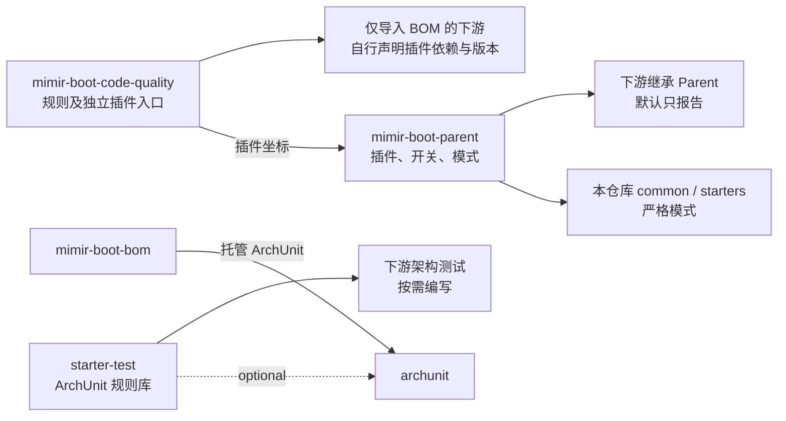

# 代码质量工具链与定位

## 背景与目标

现有构建只覆盖格式（Spotless）、覆盖率（JaCoCo）、环境与禁用库（Enforcer），Sonar 仅在受控 CI 中可选运行。注释、命名、坏味道、重复代码和依赖方向在本地开发阶段没有检查入口；下游业务服务继承 Parent 后也拿不到这些能力。

本 RFC 引入 PMD、CPD、ArchUnit，并为全部质量工具建立一张“每个维度只有一个负责工具”的定位表，避免规则重叠和同一问题多处报告。目标：

- 本仓库严格执行，违规阻断构建。
- 下游通过继承 Parent 获得同一套规则；每个工具独立开关，默认只报告、不阻断。
- Spotless、JaCoCo 保持既有配置位置、开关与失败语义，纳入统一治理但不合并实现。

不在范围内：Checkstyle、SpotBugs、Error Prone、`dependency:analyze`、Enforcer 模块方向规则、Javadoc doclint、Sonar 导入外部报告、Git hook 变更。

## 架构方案

| 组件 | 职责 | 不承担 |
|---|---|---|
| `mimir-boot-code-quality` | PMD 规则集、从固定官方插件生成的派生描述符与来源元信息；作为独立插件入口 | Java 类、Spotless/JaCoCo 配置、运行时依赖 |
| `mimir-boot-parent` | 以规则制品坐标运行检查并声明配对官方实现依赖；管理执行绑定、原生开关默认值和四模式 | 规则正文 |
| `mimir-boot-bom` | 托管 ArchUnit 版本 | 构建逻辑；插件依赖不受 `dependencyManagement` 管理，规则 jar 不进 BOM |
| `mimir-boot-starter-test` | 以 optional ArchUnit 提供可参数化的依赖方向规则与 COLA 预设 | 自动执行；下游不写测试则不生效 |

规则 jar 以根 POM `mimir-boot` 为父，不继承 Parent，避免 Parent 的插件配置反向依赖自身。依赖方向仍满足 [ARCHITECTURE.md](../../ARCHITECTURE.md)：Parent 只管构建，BOM 只管版本，Common 不依赖任何 Starter。

## 关键流程与边界

### 定位矩阵

| 维度 | 唯一负责工具 | 其他工具的约束 |
|---|---|---|
| 格式：缩进、换行、空白、import 顺序与未使用 import | Spotless | PMD 不启用 `UnnecessaryImport`、`CommentSize` 等格式相关规则，codestyle 类目只启用命名规则 |
| 注释：公开 API 的 Javadoc 存在性、Javadoc 位置 | PMD（`CommentRequired`、`DanglingJavadoc`） | 不开启 doclint；标签与签名一致性不检查（D-109） |
| 命名 | PMD（codestyle 命名规则） | codestyle 类目中命名以外的规则不启用 |
| 坏味道与潜在错误 | PMD（bestpractices、errorprone、design、multithreading 精选） | — |
| 重复代码 | CPD | Sonar 重复率只作远端参考 |
| 依赖方向：包/分层方向、包循环、模块间禁止引用 | ArchUnit | Enforcer 不扩展模块方向规则；Maven reactor 负责模块循环 |
| 环境与禁用库 | Enforcer（现状） | ArchUnit 不检查第三方坐标 |
| 测试覆盖率 | JaCoCo（现状） | — |
| 远端 New Code 门禁与安全热点 | Sonar（现状，可选） | 不导入 PMD/CPD 报告，避免重复问题；本地工具是各自维度的判定依据 |

新增规则时先按本表确认归属；若某维度需要第二个工具，须先修订本 RFC。

### 严格与报告

Parent 发布的公共默认是“执行时只报告”：`pmd.failOnViolation`、`cpd.failOnViolation` 均为 `false`，`dev`、`prod` 跳过，`precheck`、`ci` 执行。本仓库在直接继承 Parent 的 Common 与 10 个 Starter 的 POM 中各自把两个属性设为 `true`（`mimir-boot-starters` 只是聚合器，属性不会被继承），完整验收会拒绝漏设或放宽。下游从报告切换为阻断是显式选择；若将来要改变下游默认值，按破坏性变更走版本说明。

Parent 分别由 `pmd`、`test-pmd` execution 读取 Maven 实际主、测试源码根，共用 PMD 原生开关；主源码使用 41 条生产规则，测试使用 8 条测试规则，CPD 同样分别比较主、测试源码，阈值均为 100 tokens，规则清单见[规则模块](../../mimir-boot-code-quality/README.md#规则边界与替换)。

按 D-110，Mimir 的检查使用独立插件坐标，避免官方插件分叉目标的配置与下游合并；XML、HTML、缓存、规则临时文件和性能记录均使用 `target/mimir-quality/`。开关采用插件原生属性（D-108），因此下游已自行配置 PMD 时仍会读到 Parent 的开关默认值。下游自有的 Checkstyle 配置不受影响。原生开关共享及新增插件解析要求是显式兼容例外，影响与恢复方式见[需求规格 CQ-10](../active/v2.4.0/code-quality-toolchain/spec.md#行为-cq-10已自行配置同名插件的下游升级)。

Spotless 与 JaCoCo 在下游已是“执行即阻断”。把它们改成只报告会放宽已发布的门禁，因此保持不变。PMD、CPD 与它们共用四模式表，但不新增聚合开关（D-85 独立开关原则）。

### 发布形态

Parent 的 `pluginManagement` 在 Flatten 时原样保留属性引用，插件依赖若写 `${project.version}`，在下游会解析为下游自身版本。设计采用 Parent 专用版本属性，并以 Flatten `extended_interpolate` 让发布 Parent 中的该属性成为字面版本；下游还须能从插件仓库解析规则 jar。具体方案和替代方案比较见[需求设计](../active/v2.4.0/code-quality-toolchain/design.md#发布-parent-的规则-jar-版本)。

### 运行时基线

所有工具必须能在 JDK 17 上运行。`maven-pmd-plugin` 3.28.0 内置 PMD 7.17.0，满足这一要求。ArchUnit 规则库只依赖 ArchUnit 核心，不引入 `archunit-junit5`，避免与 Spring Boot 3.3 管理的 JUnit Platform 版本冲突。

## 方案取舍

| 方案 | 结论 | 理由 |
|---|---|---|
| 规则文件放入独立 jar（采用） | 采用 | 继承 Parent 与仅导入 BOM 两条路径都能按 classpath 引用；IDE 插件可复用同一文件 |
| 规则文件放入 Common | 不采用 | 污染运行时制品，违反 Common 只承载稳定模型的边界 |
| 规则通过 URL 引用 | 不采用 | 依赖网络，规则与发布版本无法绑定 |
| Spotless/JaCoCo 并入规则 jar 并统一为只报告 | 不采用 | 无外部文件需求，且会放宽已发布门禁 |
| 聚合开关 `mimir.quality.skip` | 不采用 | 与 D-85 独立开关冲突；模式已提供组合预设 |
| 阿里 P3C-PMD | 不采用 | 绑定 PMD 6，已停止维护 |
| Error Prone | 暂缓 | 新版要求 JDK 21 运行，与 CI JDK 17 冲突 |
| SpotBugs | 暂缓 | 与 PMD 部分重叠，本轮先稳定现有工具 |
| Checkstyle 负责注释与命名 | 不采用（D-109） | PMD 选定规则可覆盖 Javadoc 存在性与命名；少一个工具与引擎，避免 Checkstyle 13 起需 JDK 21 运行的版本约束，也不影响下游已有 Checkstyle 配置。代价是不检查 Javadoc 标签与签名一致性 |

## 演进与决策依据

用户于 2026-11-02 确认工具选型、严格/报告分层、Spotless/JaCoCo 统一治理不合并实现，以及新增规则 jar 模块并入 v2.4.0；决策编号见[版本级 brainstorm](../active/v2.4.0/brainstorm.md#决策日志) D-102～D-108；同日以 D-109 撤销 Checkstyle，由 PMD 接管注释与命名。静态实施要求见[需求计划](../active/v2.4.0/code-quality-toolchain/plan.md)。本地完整门禁与发布前隔离验收已通过，结果与未覆盖边界见[版本记录](../active/v2.4.0/release.md#代码质量工具链实施2026-11-06)；`verified` 不表示正式发布或生产验收。

2026-11-06 用户在接入方案与审查后确认实施独立插件入口（D-110），调整报告路径、规则覆盖入口和版本配对约束；详见[接入设计](../active/v2.4.0/code-quality-toolchain/design.md#分叉配置问题与接入方案)。最小原型验证不替代正式交付。

## 相关文档

- [ARCHITECTURE.md](../../ARCHITECTURE.md)
- [模块划分与依赖设计](./arch-module-dependencies.md)
- [测试与质量](../engineering/testing.md)
- [需求规格](../active/v2.4.0/code-quality-toolchain/spec.md) · [需求设计](../active/v2.4.0/code-quality-toolchain/design.md)
